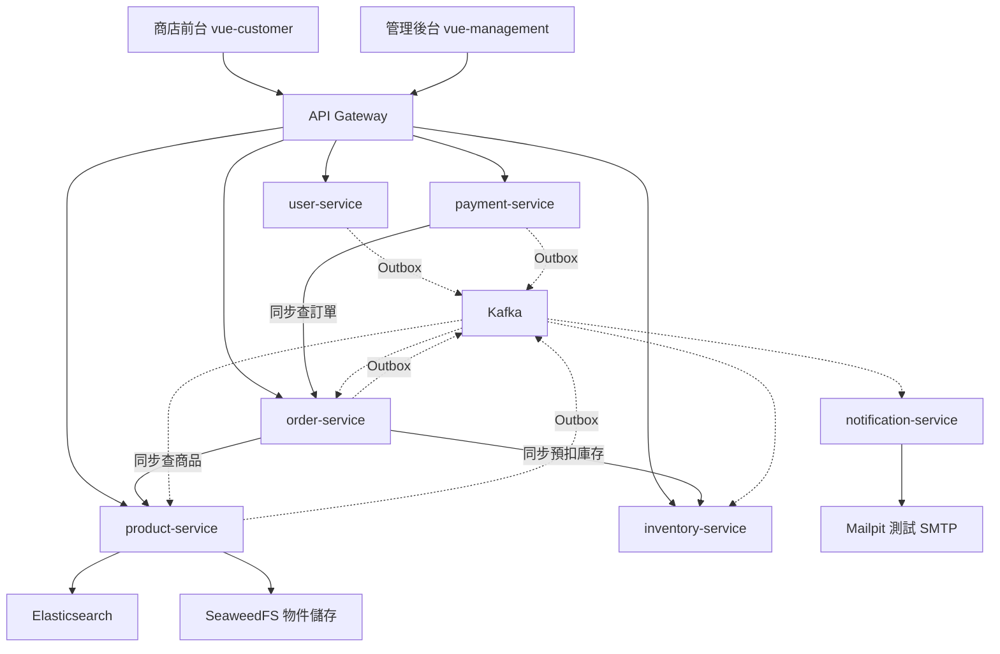

# my-microservice

以 Spring Boot 與 Vue 3 打造的電商微服務雛型。顧客可以瀏覽與搜尋商品、加入購物車、下單並模擬付款；管理員可以維護商品、分類、圖片、庫存，並處理訂單出貨。系統另外提供中文搜尋、通知信，以及跨服務的指標、日誌與追蹤。

專案的重點是：功能拆到不同服務之後，仍能正確處理權限、併發、重送與部分服務故障。付款使用模擬流程，**不是可直接對外營運的商城**；上線前的風險見[安全清單](docs/security/known-issues.md)。

> 第一次接觸專案，建議先讀[系統導讀：從一筆訂單理解整個專案](docs/architecture/system-guide.md)。

## 架構



實線是 HTTP 同步呼叫，虛線是 Kafka 非同步事件。圖中省略各服務自己的 PostgreSQL、Redis 與監控連線。

| 元件 | 負責什麼 | 本機 port |
|---|---|---|
| api-gateway | 路由、驗證 JWT、傳遞身分 header、限流、熔斷；封鎖 `/internal/**` | 8080 |
| product-service | 分類、商品、圖片關聯、中文搜尋（ES，失敗退回 SQL） | 8081 |
| order-service | 建單、訂單快照、狀態轉換、付款逾時 | 8082 |
| inventory-service | SKU 庫存、預扣、確認、釋放、預扣逾時 | 8083 |
| user-service | 註冊、登入、RS256 JWT、refresh token 輪替、登入限流 | 8084 |
| payment-service | 付款紀錄、模擬金流回呼 | 8085 |
| notification-service | 消費事件、建立寄信工作、SMTP 派送（無對外業務 API） | 8086 |
| [vue-customer](frontend/vue-customer/README.md) | 商店前台：瀏覽、購物車、結帳、模擬付款、我的訂單 | 5174 |
| [vue-management](frontend/vue-management/README.md) | 管理後台：商品、圖片、庫存、訂單、使用者 | 5173 |

## 主要設計

- **每個服務一個資料庫**：服務間只透過 API 或事件交換資料，不跨資料庫 join、不共用 Entity。
- **Transactional Outbox**：業務變更與事件在同一個本地交易提交，背景 relay 再送到 Kafka；提供 at-least-once，業務消費者以 `eventId` 去重，搜尋索引以商品版本處理重送與亂序。
- **跨服務以補償取代全域交易**：建單時同步預扣庫存，失敗時釋放；付款成功、取消、逾時透過事件確認或歸還庫存。
- **冪等**：建單支援 `Idempotency-Key`，庫存預扣以 `orderId` 識別，搜尋索引用商品版本拒絕過時快照。
- **身分由 Gateway 統一驗證**：下游讀取 Gateway 建立的 `X-User-Id`、`X-User-Roles`，K8s 以 NetworkPolicy 限制直連。
- **故障可降級**：ES 停機時搜尋退回 SQL；SMTP 停機不影響下單，寄信工作退避重試；無法處理的事件進入 DLT。
- **可觀測性**：OpenTelemetry → Grafana LGTM（Prometheus 指標、Tempo 追蹤、Loki 日誌），含儀表板與告警。

細節見[架構參考](docs/architecture/microservice-architecture.md)與[事件契約](docs/architecture/event-contracts.md)。

## 技術棧

| 層 | 使用 |
|---|---|
| 後端 | Java 21、Spring Boot 4、Spring Cloud Gateway（WebFlux）、Spring Data JPA／JDBC、Flyway、Resilience4j、ShedLock |
| 資料與中介軟體 | PostgreSQL、Redis、Kafka、Elasticsearch（SmartCN 中文分詞）、SeaweedFS（相容 S3）、Mailpit |
| 前端 | Vue 3、TypeScript、Vite、Pinia、Vue Router、Element Plus（後台） |
| 測試 | JUnit、Testcontainers、Vitest、MSW、Playwright |
| 部署與監控 | Docker Compose、Kubernetes（kind + Calico）、OpenTelemetry、Grafana LGTM |

## 專案結構

```text
backend/
  pom.xml                 Maven 聚合建置入口
  common/                 錯誤格式、身分、稽核、事件、韌性與排程共用元件
  observability/          指標、追蹤、日誌的共用設定
  spring-api-gateway/     API Gateway
  spring-*-service/       六個業務服務（含 notification）
frontend/
  vue-customer/           商店前台
  vue-management/         管理後台
infra/
  docker-compose.yml      本機資料庫與中介軟體
  k8s/                    kind 部署、Secret、NetworkPolicy 與操作腳本
  observability/          Grafana 儀表板與告警
  scripts/                本機啟動後端的腳本
docs/                     系統／程式導讀、架構、實作計畫與紀錄、設計評估、安全事項
```

## 本機執行

需要 Java 21、Docker、Node.js（`^22.18.0` 或 `>=24.12.0`）。後端使用 Maven Wrapper，不需另外安裝 Maven。

**1. 啟動基礎設施**

```bash
docker compose -f infra/docker-compose.yml up -d
```

**2. 準備 user-service 的開發用密鑰**（`secrets/` 不進版控）

```bash
mkdir -p backend/spring-user-service/secrets && cd backend/spring-user-service/secrets
openssl genpkey -algorithm RSA -pkeyopt rsa_keygen_bits:2048 -out jwt-private.pem
openssl pkey -in jwt-private.pem -pubout -out jwt-public.pem
# dev.env 放 dev profile 自動建立的第一個管理員帳號
printf 'BOOTSTRAP_ADMIN_EMAIL=admin@example.com\nBOOTSTRAP_ADMIN_PASSWORD=<自訂密碼>\n' > dev.env
```

**3. 建置並啟動後端**

```bash
cd backend && ./mvnw -DskipTests package && cd ..
infra/scripts/local-backend.sh start     # OBSERVE=1 可同時送出監控資料到 Grafana :3000
```

約 1 分鐘後 `http://localhost:8080/actuator/health` 會變成 `UP`。此腳本不會啟動 notification-service；要觀察寄信流程需另外啟動它，並在 Mailpit（`http://localhost:8025`）查看信件。

**4. 啟動前端**（開發伺服器把 `/api` 轉給 Gateway）

```bash
cd frontend/vue-customer && npm ci && npm run dev      # http://localhost:5174
cd frontend/vue-management && npm ci && npm run dev    # http://localhost:5173
```

完整步驟與 E2E 測試見[商店前台紀錄](docs/implementation-plans/vue-customer/README.md#step-12)與[管理後台紀錄](docs/implementation-plans/vue-management/README.md#step-12)。

### 部署到 Kubernetes（kind）

從 [infra/k8s/README.md](infra/k8s/README.md) 開始；部署設計與驗證結果見[後端部署計畫](docs/implementation-plans/backend-deployment-implementation-plan.md)。

## 測試

```bash
cd backend
./mvnw -pl spring-order-service -am test   # 單一服務（-am 一起建置共用模組）
./mvnw clean test                          # 全部；整合測試使用 Testcontainers，需要 Docker

cd frontend/vue-customer
npm run test:unit    # Vitest
npm run test:e2e     # Playwright，需要先啟動後端
```

## 文件

| 想知道什麼 | 閱讀入口 |
|---|---|
| 整個系統怎麼運作 | [系統導讀](docs/architecture/system-guide.md) |
| 服務、API、port 與路由 | [架構參考](docs/architecture/microservice-architecture.md) |
| 後端類別、依賴與交易分工 | [後端類別關係與職責](docs/class-relationships/README.md) |
| 前端路由、元件、狀態與操作流程 | [前端元件關係與職責](docs/component-relationships/README.md) |
| 事件格式、版本與消費行為 | [事件契約](docs/architecture/event-contracts.md) |
| Kafka、搜尋、通知等中介軟體的階段與決策 | [中介軟體路線圖](docs/implementation-plans/middleware/middleware-roadmap.md) |
| 告警響起時如何診斷與處理 | [告警手冊](docs/operations/alert-runbook.md) |
| 還有哪些暫緩項目 | [暫緩清單](docs/implementation-plans/deferred-items.md) |
| 最佳化與文件缺口修正結果 | [最佳化審查](docs/implementation-plans/codebase-optimization-review.md)、[驗證證據](docs/implementation-plans/evidence/codebase-optimization-validation.md)、[文件缺口審查](docs/implementation-plans/documentation-gaps-review.md) |
| 已知安全問題與上線前檢查 | [安全清單](docs/security/known-issues.md) |
| 所有文件 | [文件索引](docs/README.md) |
