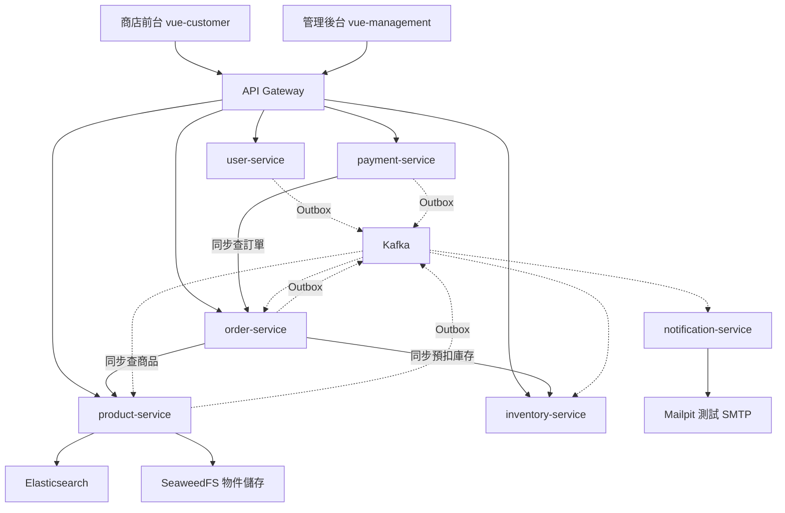
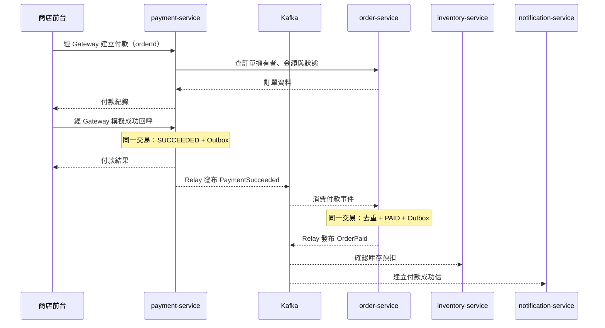

# 系統導讀：從一筆訂單理解整個專案

> 對象：具備程式開發經驗，但還不熟悉本專案的開發者。
> 核對日期：2026-11-12；依目前程式、設定與既有驗收紀錄整理。本文不代表重新執行過部署或測試。

這是一個電商微服務雛型。顧客可以瀏覽商品、加入購物車、下單與模擬付款；管理員可以維護商品、圖片、庫存，並處理訂單出貨。系統另外提供中文搜尋、通知信，以及跨服務的指標、日誌與追蹤。

專案的重點是把這些功能放在不同服務後，仍能處理權限、併發、重送與部分服務故障。付款使用模擬流程，尚不是可直接對外營運的完整商城。

本文先建立全貌，再用一筆訂單說明各元件如何合作，最後提供程式閱讀與驗證入口。若只想先掌握核心，讀第 1–5 節；要開始修改程式，再讀第 6–11 節。

## 閱讀路線

- [1. 系統有哪些部分](#1-系統有哪些部分)
- [2. 資料由誰負責](#2-資料由誰負責)
- [3. 一個請求如何進入系統](#3-一個請求如何進入系統)
- [4. 跟著一筆訂單走](#4-跟著一筆訂單走)
- [5. 為什麼事件不容易遺失，卻仍可能重複](#5-為什麼事件不容易遺失卻仍可能重複)
- [6. 搜尋與圖片如何運作](#6-搜尋與圖片如何運作)
- [7. 通知信為什麼有自己的服務](#7-通知信為什麼有自己的服務)
- [8. 故障時會發生什麼](#8-故障時會發生什麼)
- [9. 程式與基礎設施怎麼對應](#9-程式與基礎設施怎麼對應)
- [10. 如何閱讀、執行與驗證](#10-如何閱讀執行與驗證)
- [11. 修改系統時要守住的原則](#11-修改系統時要守住的原則)

## 1. 系統有哪些部分

系統有兩個 Vue 前端、七個可執行的後端服務，以及資料庫、訊息、搜尋、物件儲存等基礎設施。後端主要使用 Java 21、Spring Boot、JPA／JDBC；Gateway 使用 Spring Cloud Gateway 的 WebFlux 版本。



實線代表 HTTP 或其他直接呼叫；虛線代表非同步事件。圖中省略各服務自己的資料庫、Redis 與監控連線，避免遮住主要流程。圖片上傳還有瀏覽器直連物件儲存的路徑，見第 6 節。

| 元件 | 負責什麼 | 不由它決定的事情 |
|---|---|---|
| 商店前台 | 瀏覽、購物車、登入、結帳、查看訂單 | 商品成交價、付款金額與是否有庫存由後端決定 |
| 管理後台 | 商品、分類、圖片、庫存、訂單、使用者管理 | 後台畫面隱藏按鈕不能取代後端授權 |
| Gateway | 路由、驗證 JWT、清理與傳遞身分 header、限流、路由熔斷 | 不承擔訂單或庫存業務交易 |
| user-service | 帳號、角色、登入、簽發 token、refresh token 輪替 | 不擁有訂單與購物車 |
| product-service | 分類、商品、圖片關聯、商品搜尋 | 不維護實際庫存與預扣 |
| inventory-service | 以 SKU 管理可用量、預扣量及預扣狀態 | 不根據前端畫面自行判定付款成功 |
| order-service | 訂單、成交時商品快照、訂單狀態轉換 | 不直接保存其他服務的資料表 |
| payment-service | 付款紀錄與模擬付款結果 | 不相信前端提供的金額，也不直接改訂單資料庫 |
| notification-service | 消費事件、建立寄信工作、SMTP 派送 | 不參與建單成敗，也沒有對外業務 HTTP API |

目前沒有獨立的購物車服務或搜尋服務。購物車放在瀏覽器，搜尋先整合在 product-service；不要因為看到 Elasticsearch 就預期有另一個 Java 搜尋服務。

## 2. 資料由誰負責

每個有業務資料的服務使用自己的 PostgreSQL 資料庫。Gateway 不需要業務資料庫。服務間透過 API 或事件交換資料，不跨資料庫直接 join，也不共用 Entity。

| 資料 | 權威來源 | 其他地方保存的副本或用途 |
|---|---|---|
| 帳號、角色 | user-service | JWT 帶身分資訊；notification 保存寄信所需的收件人資料 |
| 商品、價格、上架狀態 | product-service | Redis 加速部分讀取；ES 建搜尋索引；訂單保存成交快照 |
| 可用庫存、預扣 | inventory-service | 前端顯示查詢結果，但結帳時仍須真正預扣 |
| 訂單金額與狀態 | order-service | payment 查詢金額；notification 保存訂單與使用者的關聯 |
| 付款狀態 | payment-service | order 消費付款事件後更新自己的訂單狀態 |
| 圖片檔案 | SeaweedFS | product 保存 object key 與圖片關聯，不把檔案塞進訂單 |
| 寄信進度 | notification-service | Mailpit 可用來觀察 SMTP 實際收到的內容 |

這裡有兩種容易混淆的複製。**訂單快照**刻意保存下單當時的商品名稱、SKU、單價與數量，之後商品改名或漲價，舊訂單不應跟著改。**搜尋索引與收件人資料**則是為了查詢、寄信建立的衍生資料，更新可能稍晚於來源交易。

因此「資料庫已提交」不代表整個系統在同一瞬間都已更新。本專案在各服務內使用本地交易，跨服務採事件與補償，沒有一個涵蓋所有服務的全域交易。

## 3. 一個請求如何進入系統

例如顧客送出 `POST /api/v1/orders`：

1. 前端透過 `/api` 呼叫 Gateway。開發時由 Vite proxy 轉送，部署時由前端 nginx 轉送，瀏覽器使用同源 API 路徑。
2. Gateway 驗證 access token 的 RS256 簽章、有效時間與 issuer 等條件；公鑰從 user-service 的 JWKS（公鑰集合）取得，不需要拿到簽章私鑰。
3. Gateway 移除客戶端自行帶入的身分 header，再以 JWT 內容建立 `X-User-Id`、`X-User-Roles`。
4. 下游從這些 header 取得使用者，並執行角色與資源擁有者檢查。例如一般顧客只能讀自己的訂單，管理操作由後端檢查 `ADMIN`。
5. 服務執行業務並回應；錯誤採 ProblemDetail，加上可供前端判斷的 `code`。

`/api/v1/...` 是對外 API；`/internal/v1/...` 是服務間 API，Gateway 不對外轉發內部路徑。不過「由服務呼叫」不等於 URL 一定含 `/internal`：目前 order 查商品用的是 product 的 `/api/v1/products/batch`，直接呼叫商品服務。

下游信任 Gateway 傳入的身分，沒有每個服務都再驗一次 JWT。因此這個設計依賴網路邊界：K8s 的 NetworkPolicy 限制誰能直連服務。本機直接啟動的服務不具備相同隔離，不能把其監聽埠直接當成安全的對外入口。

### 登入狀態與重新整理頁面

目前 access token 放在前端記憶體，預設有效期為 5 分鐘；refresh token 由後端放入 HttpOnly cookie，JavaScript 不直接讀取。localStorage 只保存登入提示與購物車等資料，不保存 refresh token。

重新整理頁面後，前端利用 cookie 換取新的 access token。多個請求同時需要 refresh 時會共用同一次刷新，避免輪替中的 token 被並行使用。登出會撤銷 refresh token，但已簽發的無狀態 access token 仍可能有效至到期，縮短期限只是限制這個時間窗。

## 4. 跟著一筆訂單走

假設顧客購買同一個 SKU 的兩件商品，庫存原本是 `available=10`、`reserved=0`。

### 4.1 購物車不是庫存預扣

商店的購物車在 localStorage 保存 `productId` 與數量。顯示購物車時重新查商品，價格與狀態可能已改變；把商品加入購物車不會占住庫存。真正的購買資格檢查在建單時再做一次。

### 4.2 建單需要同步取得答案

order-service 收到建單請求後，先合併重複品項，再處理以下步驟。這裡的「冪等」指相同操作重送時，不會多建立一張訂單或多扣一次庫存：

1. **檢查冪等鍵**：相同使用者、相同 `Idempotency-Key` 與相同品項數量，已建過就回傳既有訂單；同 key 改成不同內容則拒絕。此 header 在 API 層是可選的，商店結帳流程會提供。
2. **查商品**：向 product 查詢目前價格與上架狀態，不採用前端傳入的價格。
3. **預扣庫存**：向 inventory 提交 `orderId` 與 SKU／數量。單次訂單的品項全部成功才算預扣成功。
4. **保存訂單與事件**：在 order 自己的 DB 交易內保存 `PENDING_PAYMENT` 訂單、明細快照，以及 `OrderCreated` 的 Outbox 紀錄。

預扣後庫存變成 `available=8`、`reserved=2`。inventory 使用帶數量條件的 SQL 更新，而非先讀出數字再無條件扣減；預扣以 `orderId` 識別，能處理重送。

查商品、預扣是跨服務呼叫，order 不會在這整段期間持有自己的 DB 交易。預扣成功後若存單失敗，order 會嘗試釋放；釋放也失敗時，inventory 的預扣逾時排程提供最後的回收機制。這是補償流程，並非跨服務的原子 rollback。

### 4.3 付款成功，透過事件改變訂單與庫存



圖中省略 Gateway 與各服務 DB；事件箭頭包含 Outbox relay 的非同步發布。inventory 與 notification 是獨立消費者，圖上的上下順序不表示兩者有先後保證。

建立付款時，payment 向 order 查金額與擁有者。同一訂單既有的進行中付款可重用；失敗的付款可重新建立，但不能建立另一筆有效的重複付款。

模擬回呼成功時，payment 只先提交自己的 `SUCCEEDED` 狀態與事件。order 收到 `PaymentSucceeded` 才把訂單改為 `PAID`；inventory 再收到 `OrderPaid` 才確認預扣。此時 `available` 仍是 8，`reserved` 從 2 變成 0，**確認時不會再扣一次可用量**。

因此前端看到付款成功後，訂單可能短暫仍是 `PENDING_PAYMENT`；商店付款流程會輪詢訂單狀態。HTTP 成功、訂單已付款、庫存已確認、通知已寄出，是不同的完成點。

### 4.4 取消、出貨與完成

訂單主狀態如下：

```text
PENDING_PAYMENT ──付款成功事件──> PAID ──管理員出貨──> SHIPPED ──完成──> COMPLETED
        └────顧客取消／付款逾時────> CANCELLED
```

取消或付款逾時會在同一交易寫入 `OrderCancelled`，inventory 消費後把預扣還回可用量。在上述例子中，若尚未確認付款就取消，會回到 `available=10`、`reserved=0`。

`PaymentFailed` 本身不把訂單直接取消；訂單仍可能重試付款，或之後取消／逾時。出貨轉換會產生 `OrderShipped`，供通知服務寄信。

付款與逾時也可能競爭。如果訂單已取消，之後才收到付款成功事件，不會直接把訂單復活；該衝突會進入 DLT，需人工追蹤。自動退款與真實金流整合不在目前範圍。

## 5. 為什麼事件不容易遺失，卻仍可能重複

### Outbox 解決「DB 成功、送訊息失敗」的缺口

若先存訂單，再直接呼叫 Kafka，兩個動作中間當機就可能留下「有訂單、沒有事件」。本專案把業務變更與事件先寫進**同一個資料庫交易**：

```text
業務交易：更新業務表 + INSERT outbox_event → 一起提交或一起回滾
背景 Relay：讀取待發事件 → 發送 Kafka → 收到 ACK → 標記已發布
```

Kafka 暫時不可用時，待發事件仍在資料庫，之後再送。Relay 使用資料列鎖與 `SKIP LOCKED` 分配工作，並用 DB 的 `sequence_id` 協助同一 aggregate 的發送排序；不依賴不同機器的應用時鐘判定先後。

但 Kafka 已收到、DB 尚未標記成功時若當機，Relay 會重送。因此此機制提供的是 **at-least-once（至少一次）**，不是「永不重複」。Kafka topic 的保留期限、未發布 Outbox 的累積與儲存容量也都需要監控。

### 消費者必須能承受重複

一般有 DB 副作用的消費者，透過 `ProcessedEventHandler` 在同一交易內寫入 `processed_event` 並執行業務更新。`eventId` 唯一鍵擋住重複；業務失敗時去重紀錄一起回滾，下一次才有機會重做。

三種「版本／識別」不要混在一起：

| 欄位 | 用途 |
|---|---|
| `eventId` | 識別一次事件，供消費去重 |
| 事件信封 `version` | JSON 契約版本；改變欄位型別或語意時需協調升版 |
| 商品 payload 的 `version` | 商品資料版本；搜尋索引用來拒絕過時快照 |

Kafka key 是 aggregate id；aggregate 在這裡可理解為一張訂單或一個商品，識別值例如 `orderId`。同一 key 的事件會落在同一 partition，**不代表不同 topic、所有訂單或所有資料庫交易都有全域順序**。例如使用者事件與訂單事件可能先後到達不同，通知服務必須容忍關聯資料還沒到。

共用消費策略對暫時性失敗重試 3 次、間隔 500ms；連同首次處理共 4 次。格式或業務規則錯誤可直接送到 `<topic>.DLT`。DLT 是保留問題訊息供處理，不代表業務已完成；DLT 發布失敗也不能靜默略過原事件。搜尋索引有不同的重試與冪等策略，見下一節。

完整 topic、payload 與相容規則見[事件契約](event-contracts.md)。

## 6. 搜尋與圖片如何運作

### 搜尋：ES 找候選商品，PostgreSQL 決定商品內容

商品異動時，product 在自己的交易寫入 `product.events`，搜尋消費者把快照更新至 Elasticsearch。中文搜尋使用 SmartCN 搭配索引中的其他查詢欄位；索引是可重建的衍生資料。

前台帶關鍵字的商品查詢走 ES，取得商品 id 與排序後，**回 PostgreSQL 讀商品內容與最新上架狀態**。後台列表、無關鍵字列表仍走 SQL。索引延遲時，已下架或已不存在的命中會被丟掉，因此一頁可能不足指定筆數，總數也可能暫時偏高。

ES 連線失敗、逾時、過載、熔斷或索引未就緒時，查詢退回 SQL，維持可用性；SQL 與 ES 的分詞、相關性與排序結果不保證完全相同。查詢本身有問題的其他 4xx 不應用退回機制掩蓋。

寫索引則採另一種策略：

- 以商品資料版本搭配 ES `external_gte`，相同版本可重寫，舊快照不能覆蓋新資料；因此不使用一般的 `processed_event` 去重。
- ES 暫時故障時，索引消費者持續退避重試，讓恢復後能追上資料；這段期間 consumer lag 會增加，不能套用共用的有限次重試後丟 DLT 策略。
- 全量重建先寫新索引，完成並補灌近期變更後再切換 alias；跨副本使用 PostgreSQL advisory lock 避免同時重建。

深入內容見[搜尋計畫](../implementation-plans/middleware/search-implementation-plan.md)與[搜尋紀錄](../implementation-plans/middleware/search-implementation-record.md)。

### 圖片：後端核准，瀏覽器直傳

管理後台先向 product 申請 presigned URL（有期限、已簽章的上傳位址），然後直接把檔案 PUT 到 SeaweedFS，再呼叫 product 登記圖片。登記時後端檢查物件與限制，保存 object key 與商品關聯；前端顯示時使用可讀取的圖片網址。

這讓大型檔案不必透過 Gateway 與 Java 服務轉送，但也多了一個獨立的瀏覽器連線：API 成功不代表圖片 PUT 一定成功。除授權外，還要檢查物件儲存的 CORS、URL 簽章 Host，以及 `Content-Type` 是否和申請時一致。

設計與實測集中在[圖片上傳文件](../implementation-plans/backend/product-image-upload-implementation-plan.md)。

## 7. 通知信為什麼有自己的服務

下單不應因 SMTP 暫時故障而失敗。notification-service 先把事件轉成資料庫內的寄信工作，再由背景派送器寄送。

它維護三組主要資料：`user_contact` 保存從 `UserRegistered` 得到的收件人；`order_ref` 保存從 `OrderCreated` 得到的訂單與使用者關係；`email_message` 保存信件工作與寄送狀態。它不直接查 user 或 order 的資料庫。

| 觸發事件 | 信件 |
|---|---|
| `OrderCreated` | 訂單成立 |
| `OrderPaid` | 付款成功 |
| `OrderShipped` | 已出貨 |
| `OrderCancelled` | 訂單取消 |
| `PaymentFailed` | 付款失敗 |

`PaymentSucceeded` 不會再產生一封成功信：以 `OrderPaid` 作為觸發點，表示訂單端已接受付款結果。`UserRegistered` 目前用來建立收件人，不是註冊確認信。

事件去重與入列在同一交易，派送器則透過 `FOR UPDATE SKIP LOCKED` 領取可處理的 `PENDING` 工作。SMTP 暫時失敗會依 `next_attempt_at` 退避，永久錯誤或重試耗盡會變成 `FAILED`；訂單或收件人長期缺漏會變成 `SKIPPED`。後兩者需要後續處理，不是自動無限補寄。

這仍不是 exactly-once 寄信。SMTP 已接受信件但 DB 尚未提交 `SENT` 時當機，之後可能重寄；固定 `Message-ID` 有助識別重複，不能保證外部郵件系統自動去重。派送時持有 DB 交易與資料列鎖也是目前低流量雛型的取捨。

Mailpit 是本機／kind 的測試郵件接收器，不是真實信箱。通知的 E1–E6 已有驗收紀錄；真實信箱驗證 E7、歷史資料補齊與正式 SMTP 認證／TLS 等仍有待辦。新 consumer group 從 Kafka 保留期內最早事件開始讀，不等於能取回所有歷史資料。

## 8. 故障時會發生什麼

系統沒有一個通用的「失敗就全部重試」。是否立即回錯、退回查詢、保留事件或送 DLT，取決於當下的業務保證。

| 故障或現象 | 預期行為 | 第一個調查方向 |
|---|---|---|
| product／inventory 無法回應建單 | 無法取得即時答案，建單失敗；不確定是否預扣成功時嘗試釋放 | 下游連線、熔斷、reservation |
| Kafka 停機 | 已提交的事件留在 Outbox，跨服務狀態可能暫停更新 | 未發布 Outbox、relay 錯誤 |
| 付款成功但 order 停機 | payment 可先成功，order 恢復後消費事件 | `payment.events` 的消費進度與 DLT |
| ES 停機 | 查詢退回 SQL；索引更新等待恢復 | 搜尋 fallback、索引 consumer lag |
| SMTP 停機 | 訂單流程照常，寄信工作退避；耗盡後標記失敗 | `email_message`、SMTP、FAILED／backlog 告警 |
| Mailpit 有信，使用者真實信箱沒有 | 測試環境的預期結果 | 寄信目標是否仍設定為 Mailpit |
| 401 與 403 | 分別先看身分驗證，以及角色／資源權限 | JWT、refresh 流程、`@RequireRoles` |

同步呼叫使用逾時、Resilience4j 熔斷及受限的冪等重試。背景排程的多副本協調包含 ShedLock；Outbox 與信件批次工作則使用資料列鎖分配，不能假設每支排程都由單一副本永遠執行。

可觀測性使用共用 `observability` 模組，透過 OpenTelemetry／OTLP 送到 Grafana LGTM：Prometheus 看指標、Tempo 看 trace、Loki 看日誌。trace 串起一次流程中的各段工作，consumer lag 表示消費進度落後了多少訊息，DLT 則保存未能正常處理的事件。調查一筆交易時，可先由 trace 追 Gateway、同步下游及 Kafka 消費，再用 Outbox、consumer lag、DLT 與業務資料確認停在哪裡。

Kafka relay 與 consumer 會傳遞追蹤 context，但排程寄信是獨立 trace，不能要求所有延後執行的工作都在同一條瀑布圖。也不要把 token、Email、完整事件 payload 或信件內容塞進 log／span 來方便除錯。

## 9. 程式與基礎設施怎麼對應

```text
backend/
  pom.xml                     Maven 聚合建置入口
  common/                     錯誤、身分、稽核、事件、韌性與排程共用元件
  observability/              指標、追蹤、日誌的共用設定
  spring-api-gateway/          WebFlux Gateway
  spring-*-service/            六個業務服務（含 notification）
frontend/
  vue-customer/               商店；依 features 組織功能
  vue-management/             Element Plus 管理後台
infra/
  docker-compose.yml          本機資料庫與中介軟體
  k8s/                        kind 部署、Secret、網路政策與操作腳本
  observability/              儀表板與告警設定
docs/                         導讀、契約、設計、紀錄與安全事項
```

聚合 POM 列出七個服務與兩個共用模組；完整 Maven reactor 再加根 POM，會看到十個建置項目，不是十個可部署服務。各模組使用自己的 parent／依賴設定，不能假設所有 Spring Boot 版本相同。

典型服務從 `controller`／API 介面進入 `service`，透過 repository 或 JDBC 操作資料；`clients` 呼叫其他服務，`messaging` 處理 Kafka，Flyway migration 在 `src/main/resources/db/migration/`。實際套件有 `dto`／`dtos`、`entity`／`entities` 等歷史差異，修改時沿用所在模組慣例。

`common` 共用技術規則，不應放訂單 Entity、商品 DTO 或通知模板。Gateway 是 reactive 且不依賴 JPA，因此不依賴 `common`，但會使用 `observability`。

本機開發通常是 IDE／JAR 跑 Java，Compose 跑基礎設施；kind 用來驗證 Kubernetes Service DNS、Secret、多副本與 NetworkPolicy。容器裡的 `localhost` 是容器自己：例如 IDE 的 Kafka 是 `localhost:9094`，Compose／kind 內則用 `kafka:9092`。

| 常用入口 | 本機位置／用途 |
|---|---|
| Gateway | `localhost:8080`，前後台 API 入口 |
| 商品／訂單／庫存／使用者／付款 | 分別 8081／8082／8083／8084／8085，直連主要供開發診斷 |
| notification | 8086，健康檢查等管理端點；無購物業務 API |
| SeaweedFS | 8333，圖片儲存 |
| Mailpit | SMTP 1025；網頁 8025，檢查實際測試信件 |
| Elasticsearch／Grafana | 9200／3000，搜尋與可觀測性 |

這些是本機設定的入口，不是正式環境對外開放清單。實際綁定位址與環境變數以 [Compose](../../infra/docker-compose.yml)、各服務 `application.yml` 與 [K8s 設定](../../infra/k8s/)為準。

## 10. 如何閱讀、執行與驗證

### 建議的程式閱讀順序

先追一條完整路徑，再看抽象共用層，比從所有設定檔開始容易建立脈絡。

| 順序 | 入口 | 要回答的問題 |
|---|---|---|
| 1 | [商店結帳](../../frontend/vue-customer/src/features/checkout/)與[付款流程](../../frontend/vue-customer/src/features/payments/) | 前端送什麼？何時重用冪等鍵、何時等待訂單狀態？ |
| 2 | [Gateway SecurityConfig](../../backend/spring-api-gateway/src/main/java/com/mymicroservice/gateway/configs/SecurityConfig.java) | 哪些請求公開？token 無效與認證服務故障如何區分？ |
| 3 | [OrderServiceImpl](../../backend/spring-order-service/src/main/java/com/mymicroservice/order/service/impl/OrderServiceImpl.java)與[OrderCreationPersistence](../../backend/spring-order-service/src/main/java/com/mymicroservice/order/service/impl/OrderCreationPersistence.java) | 哪些部分同步？交易邊界在哪裡？失敗如何補償？ |
| 4 | [PaymentServiceImpl](../../backend/spring-payment-service/src/main/java/com/mymicroservice/payment/service/impl/PaymentServiceImpl.java) | 付款狀態與事件怎樣一起提交？ |
| 5 | [common events](../../backend/common/src/main/java/com/mymicroservice/common/events/)與[庫存 listener](../../backend/spring-inventory-service/src/main/java/com/mymicroservice/inventory/messaging/OrderEventListener.java) | Outbox、去重、重試與業務更新怎樣接在一起？ |
| 6 | [商品搜尋](../../backend/spring-product-service/src/main/java/com/mymicroservice/product/search/)與[通知派送器](../../backend/spring-notification-service/src/main/java/com/mymicroservice/notification/mail/EmailDispatcher.java) | 為什麼這兩種非同步工作採不同失敗策略？ |

上表用來追跨服務路徑；需要單一模組的依賴圖與完整來源職責時，讀[後端類別導讀](../class-relationships/README.md)；追畫面、store、composable 與 API 時，讀[顧客端元件導讀](../component-relationships/vue-customer.md)及[管理端元件導讀](../component-relationships/vue-management.md)。這些文件說明目前實作，歷史驗收仍以各實作紀錄為準。

### 開始執行前

準備 Java 21、Docker、專案所需 Node 環境；後端使用 Maven Wrapper，前端依各自 `package.json` 與 lockfile 安裝。離線 Maven 指令只適用於依賴與容器映像已準備好的環境。

JWT 金鑰、開發管理員與環境變數需依設定準備，不要把別人的 `secrets/` 當成版控內容。前後台的完整操作與 E2E 步驟集中在[商店紀錄](../implementation-plans/vue-customer/README.md#step-12)與[管理後台紀錄](../implementation-plans/vue-management/README.md#step-12)；kind 從[部署入口](../../infra/k8s/README.md)開始。

已有的 `infra/scripts/local-backend.sh` 只啟動原本六個後端程序，**沒有啟動 notification-service**。要觀察完整寄信流程，還要依通知服務設定啟動它，並確認 Kafka、notification DB 與 Mailpit 都可連線。

### 測試分層與成本

| 層次 | 用途 | 限制 |
|---|---|---|
| 單元測試、前端 Vitest／MSW | 業務分支、畫面與 HTTP 行為 | 不證明真實 Kafka、SQL、SMTP 或瀏覽器部署可用 |
| Testcontainers 整合測試 | 真實 PostgreSQL、Kafka、ES、Mailpit 行為 | 需要 Docker 與映像；啟動及故障恢復會增加耗時 |
| Playwright E2E | 瀏覽器與真實後端的完整流程 | 必須準備後端、測試帳號與資料；依場景驗證 CSP 等部署行為 |
| kind 故障與網路驗收 | 副本、NetworkPolicy、停機恢復、追蹤與告警 | 與本機單元測試的覆蓋範圍不同 |

例如在 `backend/` 執行定向測試：

```powershell
.\mvnw.cmd -o -pl spring-order-service -am test
```

`-am` 會一起建置所需共用模組，避免取用本機 Maven repository 裡過時的 `common`。完整驗證可使用 `mvnw.cmd -o clean test`；既有 E6 紀錄約 13 分 34 秒是當時那次執行的結果，不是固定耗時或每次文件修改都必須重跑的門檻。實作提交仍遵循對應計畫的驗證要求。

通知 SMTP 整合測試曾遇到 Windows Docker Desktop 的 host port mapping 問題，因此把被測服務與 Mailpit 放在同一個 Testcontainers network 執行，仍檢查實際信件、收件人、模板及 Message-ID。這是測試成本較高的原因之一，不能用只檢查 DB 為 `SENT` 取代。

## 11. 修改系統時要守住的原則

1. **先找資料擁有者與交易邊界。** 改付款結果不代表可以直接更新 order DB；新業務事件與來源資料必須同交易寫入 Outbox。
2. **重試前先確認冪等。** HTTP 請求冪等鍵、事件去重、ES 外部版本與信件 Message-ID 解決的是不同問題，不能互相替代。
3. **先部署能接受新契約的消費者。** E3 就先讓 inventory 接受並忽略 `OrderCreated`／`OrderShipped`，再由 order 發送；否則舊 consumer 可能把新事件送進 DLT。
4. **不要改已部署的 Flyway migration。** 使用新 migration 保留 checksum；共用模組不加入單一服務業務模型。
5. **不要把降級誤認為成功。** 搜尋測試應證明真的用了 ES；寄信測試應證明 SMTP 真的收到信；測試與紀錄須明確區分人工操作、自動化及未驗證。
6. **維持開發環境邊界。** 模擬付款預設關閉，示範時才開啟；Kafka／ES 認證、SMTP TLS、個資保留期限等仍須依安全清單處理。HttpOnly cookie 也不代表已消除所有 XSS 風險。

後續查閱可依問題分流：

| 想知道什麼 | 閱讀入口 |
|---|---|
| API、服務與 port 細節 | [架構參考](microservice-architecture.md)；歷史描述有差異時核對目前 controller 與設定 |
| 後端類別、依賴與交易邊界 | [後端類別關係索引](../class-relationships/README.md) |
| 前端元件、路由、狀態與 API 流程 | [前端元件關係索引](../component-relationships/README.md) |
| 精確事件格式、版本與消費行為 | [事件契約](event-contracts.md) |
| 告警診斷與操作 | [告警手冊](../operations/alert-runbook.md)，保留原始查詢／門檻與未驗證界線 |
| 未完成工作的前提與範圍 | [暫緩清單](../implementation-plans/deferred-items.md)，原始決策仍保留在各文件 |
| 技術選型與刻意暫緩的範圍 | [中介軟體路線圖](../implementation-plans/middleware/middleware-roadmap.md) |
| 哪些情境真的驗過、還有哪些限制 | 各階段實作紀錄及其 `evidence/`；由[文件索引](../README.md)進入 |
| 對外部署前有哪些風險 | [安全清單](../security/known-issues.md) |
| 如何提交、記錄與回報驗證 | [共用實作規範](../implementation-plans/middleware/implementation-guidelines.md)及該階段計畫 |
