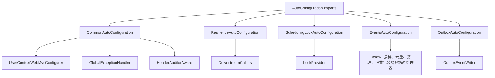
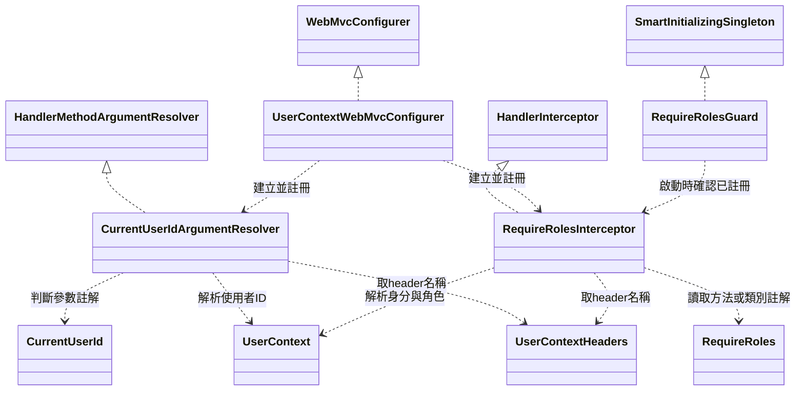
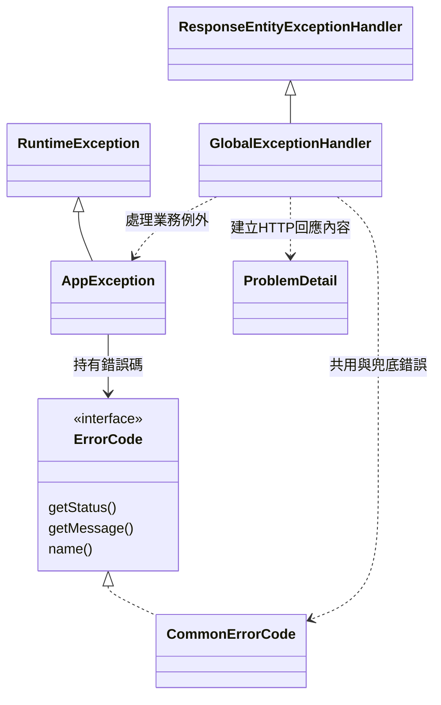
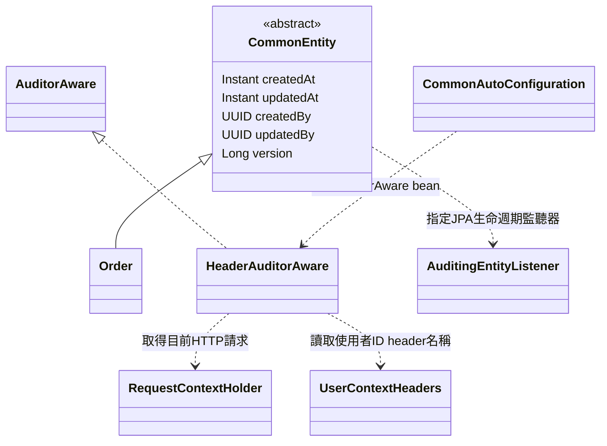
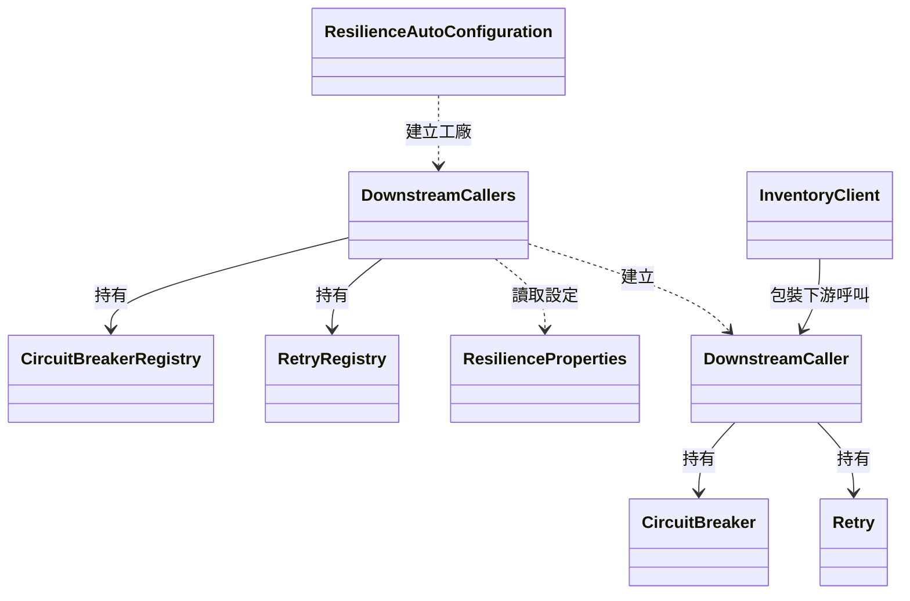
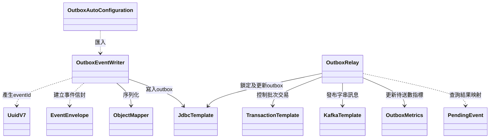
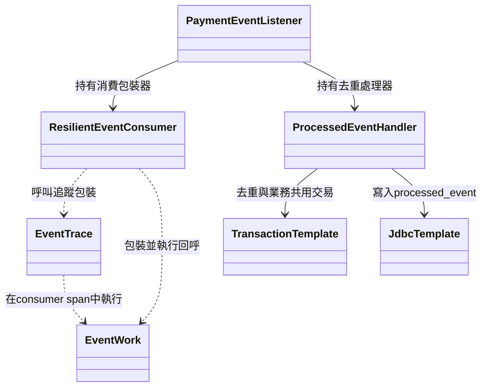
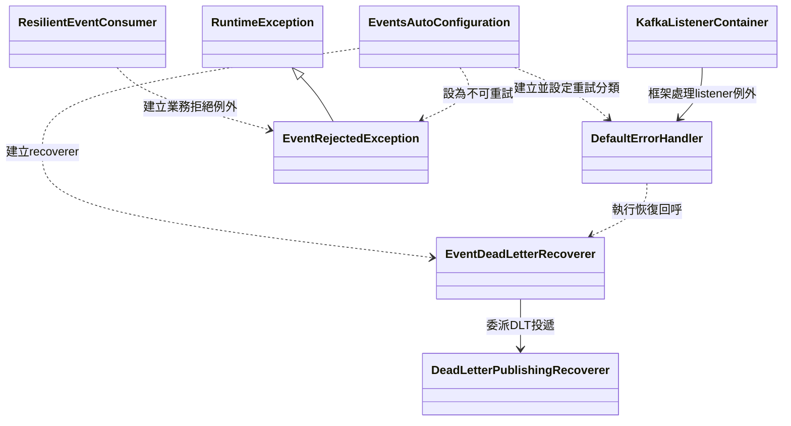
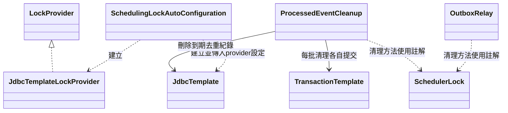

# common 類別關係圖與職責說明

更新日期：2026-11-13。依 `backend/common/src/main` 的 32 個 Java 來源檔整理，另說明重要內部型別。這是一份目前實作的閱讀地圖，不是尚待實作的設計。

## 1. common 在專案中的位置

common 是後端服務引用的技術共用函式庫，產物是一般 JAR，不是可獨立啟動的微服務。它沒有自己的 Controller、業務 Repository、資料庫或 Flyway migration；事件表與鎖表由使用它的服務建立。建置設定見 [pom.xml](../../backend/common/pom.xml)。

| 想追的問題 | 先讀哪一節 |
|---|---|
| 加入依賴後，哪些類別會被建立？ | [自動設定](#2-自動設定如何接起各個類別) |
| Controller 的使用者 ID 與角色從哪裡來？ | [身分與權限](#3-身分-header參數注入與角色檢查) |
| Service 丟出的錯誤如何變成 HTTP 回應？ | [錯誤處理](#4-業務錯誤與-http-錯誤回應) |
| createdBy、updatedBy、version 誰負責？ | [JPA 稽核與樂觀鎖](#5-jpa-稽核與共用實體欄位) |
| 呼叫其他服務時，誰決定熔斷與重試？ | [下游呼叫保護](#6-下游呼叫的熔斷與重試) |
| 事件怎麼寫入、發布、去重與送 DLT？ | [事件處理](#7-事件寫入發布消費與去重) |
| 多個副本如何避免重複執行排程？ | [排程鎖](#8-排程清理與分散式鎖) |

圖的線條意義見[圖例](README.md#圖例)。圖中外部型別與服務範例會在正文標明；略去與主題無關的第三方型別與 getter。

## 2. 自動設定如何接起各個類別

服務不必擴大 `scanBasePackages` 掃描 common。Spring Boot 透過 [AutoConfiguration.imports](../../backend/common/src/main/resources/META-INF/spring/org.springframework.boot.autoconfigure.AutoConfiguration.imports) 找到五個設定入口；下圖是註冊關係，不代表啟動先後順序或 Java 繼承。

| 類別與來源 | 職責 | 啟用條件與責任界線 |
|---|---|---|
| [CommonAutoConfiguration](../../backend/common/src/main/java/com/mymicroservice/common/CommonAutoConfiguration.java) | 建立共用 MVC 設定、例外處理器及 `auditorAware` bean | MVC 兩個 bean 限 Servlet 應用且可由服務覆寫；auditor 依同名 bean 是否存在決定是否建立。**不自行啟用 JPA auditing** |
| [ResilienceAutoConfiguration](../../backend/common/src/main/java/com/mymicroservice/common/resilience/ResilienceAutoConfiguration.java) | 建立 `DownstreamCallers` 工廠，條件符合時綁定熔斷／重試指標 | 工廠可被服務既有 bean 取代；指標綁定還需相關類別與 `MeterRegistry` bean |
| [SchedulingLockAutoConfiguration](../../backend/common/src/main/java/com/mymicroservice/common/scheduling/SchedulingLockAutoConfiguration.java) | 建立 JDBC 型 `LockProvider` 並啟用 ShedLock | 需要 `DataSource` 與 `app.scheduling.lock.table`；既有 `LockProvider` 可覆寫。表本身不由它建立 |
| [EventsAutoConfiguration](../../backend/common/src/main/java/com/mymicroservice/common/events/EventsAutoConfiguration.java) | 啟用排程，匯入事件元件，建立 Kafka `DefaultErrorHandler` | 事件元件需要 JDBC、交易、Kafka 與指標等依賴；不是只在宣告 `@KafkaListener` 時才註冊。去重清理另有條件開關 |
| [OutboxAutoConfiguration](../../backend/common/src/main/java/com/mymicroservice/common/events/OutboxAutoConfiguration.java) | 匯入 `OutboxEventWriter` | 負責事件寫入端的註冊；與建立發布、消費元件的 `EventsAutoConfiguration` 分開 |

`@Component` 是部分元件的標記，但這裡主要由 `@Import` 接進服務。不要將所有元件都理解成「服務自行掃描建立」，也不要把 `CommonAutoConfiguration` 的可覆寫條件套用到其他設定類別。

## 3. 身分 header、參數注入與角色檢查

這一組讀取 Gateway 已建立的身分 header；JWT 的驗簽不在 common 進行。`X-User-Id`、`X-User-Roles` 與 `X-Client-Ip` 的意義集中在 `UserContextHeaders`。

圖中的四個介面是 Spring 型別。兩個處理器是 `UserContextWebMvcConfigurer` 用 `new` 建立後註冊到 MVC，並非各自以 `@Bean` 註冊。

| 類別與來源 | 職責 | 與其他類別的分工 |
|---|---|---|
| [UserContextHeaders](../../backend/common/src/main/java/com/mymicroservice/common/web/UserContextHeaders.java) | 定義三個身分／來源 IP header 名稱 | 只有常數；不讀取請求或驗證 JWT。Gateway 自行定義相同名稱，不依賴此類別 |
| [UserContext](../../backend/common/src/main/java/com/mymicroservice/common/web/UserContext.java) | 靜態解析 UUID 與逗號分隔角色集合 | 缺少或不合法 ID 回傳空值；角色區分大小寫。由 resolver 與 interceptor 共用 |
| [CurrentUserId](../../backend/common/src/main/java/com/mymicroservice/common/web/CurrentUserId.java) | 標記 Controller 的 `UUID` 參數 | 是 annotation，沒有注入邏輯 |
| [CurrentUserIdArgumentResolver](../../backend/common/src/main/java/com/mymicroservice/common/web/CurrentUserIdArgumentResolver.java) | 處理 `@CurrentUserId UUID`，將 header 轉為引數 | 無合法身分時拋 `UNAUTHENTICATED`；不負責角色判斷 |
| [RequireRoles](../../backend/common/src/main/java/com/mymicroservice/common/web/RequireRoles.java) | 宣告方法或類別允許的角色 | 多個角色表示任一符合即可；方法上的設定優先 |
| [RequireRolesInterceptor](../../backend/common/src/main/java/com/mymicroservice/common/web/RequireRolesInterceptor.java) | 在參數綁定、驗證前執行身分與角色檢查 | 無合法 ID 為 401、角色不符為 403；拋出的 `AppException` 交給全域例外處理器 |
| [UserContextWebMvcConfigurer](../../backend/common/src/main/java/com/mymicroservice/common/web/UserContextWebMvcConfigurer.java) | 把 resolver 與 interceptor 接進 Spring MVC | 由 `CommonAutoConfiguration` 建立，不承擔權限規則本身 |
| [RequireRolesGuard](../../backend/common/src/main/java/com/mymicroservice/common/web/RequireRolesGuard.java) | 啟動時檢查 MVC 中是否確實安裝角色 interceptor | 服務須自行 `@Import(RequireRolesGuard.class)`；不會因 common 自動設定就自動啟用此 guard |

閱讀順序：`CommonAutoConfiguration` → `UserContextWebMvcConfigurer` → `RequireRolesInterceptor`／`CurrentUserIdArgumentResolver` → `UserContext`。Guard 是啟動保護，並不是每次 HTTP 請求都會呼叫的權限檢查器。實際使用入口可對照 [OrderServiceApplication](../../backend/spring-order-service/src/main/java/com/mymicroservice/order/OrderServiceApplication.java)。

對照測試：[UserContextTest](../../backend/common/src/test/java/com/mymicroservice/common/web/UserContextTest.java)、[RequireRolesInterceptorTest](../../backend/common/src/test/java/com/mymicroservice/common/web/RequireRolesInterceptorTest.java)、[RequireRolesGuardTest](../../backend/common/src/test/java/com/mymicroservice/common/web/RequireRolesGuardTest.java)。

## 4. 業務錯誤與 HTTP 錯誤回應

`RuntimeException` 是 Java 型別；`ResponseEntityExceptionHandler`、`ProblemDetail` 是 Spring 型別。各服務自己的錯誤 enum 也實作 `ErrorCode`，不用為每種業務錯誤新增一個例外類別。

| 類別與來源 | 職責 | 與其他類別的分工 |
|---|---|---|
| [ErrorCode](../../backend/common/src/main/java/com/mymicroservice/common/exception/ErrorCode.java) | 定義 HTTP 狀態、訊息模板與錯誤名稱的介面 | 讓共用與各服務的 enum 都能交給同一個 `AppException` 處理 |
| [CommonErrorCode](../../backend/common/src/main/java/com/mymicroservice/common/exception/CommonErrorCode.java) | 提供驗證、未登入、無權限、資料衝突與未知錯誤等共用碼 | 業務專屬錯誤留在各服務，例如 [OrderErrorCode](../../backend/spring-order-service/src/main/java/com/mymicroservice/order/exception/OrderErrorCode.java) |
| [AppException](../../backend/common/src/main/java/com/mymicroservice/common/exception/AppException.java) | 持有 `ErrorCode`，將建構參數套入訊息模板 | 不直接建立 HTTP 回應；事件消費路徑也會使用它 |
| [GlobalExceptionHandler](../../backend/common/src/main/java/com/mymicroservice/common/exception/GlobalExceptionHandler.java) | 將 MVC 例外、業務錯誤、樂觀鎖與資料約束錯誤轉成一致回應 | 輸出 `ProblemDetail` 加 `code`；優先序最低，讓服務自己的 advice 可先處理。未知例外記錄 log，回應共用 500 訊息 |

HTTP 路徑的協作是「Controller／Service 拋出 `AppException` → Spring MVC 選擇 `GlobalExceptionHandler` → 回應 `application/problem+json`」。Kafka listener 的例外則由後述 Kafka 錯誤處理器處理，不會經過這個 HTTP advice。

對照測試：[GlobalExceptionHandlerErrorFormatTest](../../backend/common/src/test/java/com/mymicroservice/common/exception/GlobalExceptionHandlerErrorFormatTest.java)。

## 5. JPA 稽核與共用實體欄位

`Order` 是 order-service 的實體範例；`AuditorAware`、`AuditingEntityListener` 與 `RequestContextHolder` 是 Spring 型別。圖中兩組關係由服務的 `@EnableJpaAuditing(auditorAwareRef = "auditorAware")` 接起來，**不是 CommonEntity 直接呼叫 HeaderAuditorAware**。

| 類別與來源 | 職責 | 與其他類別的分工 |
|---|---|---|
| [CommonEntity](../../backend/common/src/main/java/com/mymicroservice/common/entity/CommonEntity.java) | 以 `@MappedSuperclass` 提供建立／修改時間、操作人及 `@Version` 欄位 | 不定義主鍵或業務狀態；子類別自行定義。`version` 使用可為 null 的 `Long`，配合新實體判斷 |
| [HeaderAuditorAware](../../backend/common/src/main/java/com/mymicroservice/common/audit/HeaderAuditorAware.java) | 實作 `AuditorAware<UUID>`，提供稽核操作人 | 有合法 header 用該 UUID；沒有 HTTP 請求、缺少 header 或格式錯誤時用全零的 `SYSTEM_USER_ID`；格式錯誤另記 warn |

實際接線可讀 [Order](../../backend/spring-order-service/src/main/java/com/mymicroservice/order/entities/Order.java) 與 [JpaAuditingConfig](../../backend/spring-order-service/src/main/java/com/mymicroservice/order/configs/JpaAuditingConfig.java)。其他子類別包括 User、Product、Category、ProductImage、Stock、Reservation、Payment。

要注意：批次／條件式 JPQL UPDATE 不會走實體的稽核生命週期；服務仍須自行更新操作人、時間與 version，不能只靠繼承 `CommonEntity`。對照測試：[HeaderAuditorAwareTest](../../backend/common/src/test/java/com/mymicroservice/common/audit/HeaderAuditorAwareTest.java)。

## 6. 下游呼叫的熔斷與重試

四個 registry／保護器型別來自 Resilience4j；`InventoryClient` 是 order-service 的外部範例。它在建構時向工廠取得 caller，實際 HTTP 呼叫與業務錯誤轉換仍留在服務內。

| 類別與來源 | 職責 | 與其他類別的分工 |
|---|---|---|
| [ResilienceProperties](../../backend/common/src/main/java/com/mymicroservice/common/resilience/ResilienceProperties.java) | 保存滑動視窗、失敗門檻、開啟時間、半開放行數與重試參數 | 由服務自己的設定物件承載；不是自動為每個下游建立設定 |
| [DownstreamCallers](../../backend/common/src/main/java/com/mymicroservice/common/resilience/DownstreamCallers.java) | 持有 registry，依名稱與設定建立 `DownstreamCaller` | 同一 registry 中相同名稱會共用保護器狀態；名稱應代表同一個下游 |
| [DownstreamCaller](../../backend/common/src/main/java/com/mymicroservice/common/resilience/DownstreamCaller.java) | 將 `Supplier` 包上熔斷，必要時再包重試 | `call` 只有熔斷；`callIdempotent` 才重試。每次嘗試都經熔斷器，熔斷拒絕不再重試 |
| [ResilienceAutoConfiguration](../../backend/common/src/main/java/com/mymicroservice/common/resilience/ResilienceAutoConfiguration.java) | 提供工廠與條件式指標綁定 | 內部 `MetricsConfiguration` 在 Micrometer 條件符合時，建立 `ResilienceMetricsBinder` 作為綁定標記；它們不是業務呼叫入口 |

失敗率記錄的是 `ResourceAccessException` 與 `HttpServerErrorException`。重試範圍更小：連線拒絕或 HTTP 502／503／504；連線／讀取逾時不重試，避免把完整等待時間再放大。4xx 交由呼叫端處理，不當成下游故障。

實際使用可讀 [InventoryClient](../../backend/spring-order-service/src/main/java/com/mymicroservice/order/clients/InventoryClient.java)。對照測試：[DownstreamCallerTest](../../backend/common/src/test/java/com/mymicroservice/common/resilience/DownstreamCallerTest.java)。這套 HTTP 重試與下一節 Kafka 的事件重試是兩套不同機制。

## 7. 事件寫入、發布、消費與去重

### 7.1 寫入端與發布端

`ObjectMapper` 來自 Jackson，`JdbcTemplate`、`TransactionTemplate`、`KafkaTemplate` 來自 Spring。Writer 與 relay 透過同一服務的 outbox 表協作，**沒有互相持有或直接呼叫的關係**。`PendingEvent` 是 relay 內部的 private record，不是對外事件契約。

| 類別與來源 | 職責 | 與其他類別的分工 |
|---|---|---|
| [EventEnvelope](../../backend/common/src/main/java/com/mymicroservice/common/events/EventEnvelope.java) | 泛型 record，保存 eventId、type、version、occurredAt、aggregateId、payload | 描述事件信封，不負責發布、解析或業務驗證 |
| [UuidV7](../../backend/common/src/main/java/com/mymicroservice/common/events/UuidV7.java) | 產生時間戳搭配亂數的 UUIDv7 | 由 writer 產生 eventId；relay 的資料庫排序依據是 sequence_id，不是此 UUID |
| [OutboxEventWriter](../../backend/common/src/main/java/com/mymicroservice/common/events/OutboxEventWriter.java) | 建立信封、保存當前 traceparent、序列化並寫入 outbox | `append` 加入呼叫者交易；呼叫者必須把業務寫入放在同一交易，才能一起提交或回滾。它不直接呼叫 Kafka |
| [OutboxRelay](../../backend/common/src/main/java/com/mymicroservice/common/events/OutboxRelay.java) | 排程領取待送事件、發布到 Kafka、將成功 ACK 批次標記 | 每個 topic／aggregate 只取最早待送事件，使用列鎖與 SKIP LOCKED；送出與 ACK 共用截止時間。也提供指標刷新與已發布資料清理排程 |
| [OutboxMetrics](../../backend/common/src/main/java/com/mymicroservice/common/events/OutboxMetrics.java) | 保存並暴露 `events.outbox.pending` gauge | 由 relay 的獨立排程查詢待送數；不是每次 publish 都查 count |
| [OutboxAutoConfiguration](../../backend/common/src/main/java/com/mymicroservice/common/events/OutboxAutoConfiguration.java) | 註冊 writer | 不負責 relay 的排程或 consumer 的錯誤策略 |

主要責任界線：業務服務決定 topic、事件型別、aggregate 與 payload；writer 保證事件寫入能加入本地交易；relay 處理投遞。Kafka ACK 後資料庫提交仍可能失敗，所以整體是至少一次投遞，不是天然的跨資料庫／Kafka exactly-once。

對照測試：[OutboxEventWriterTest](../../backend/common/src/test/java/com/mymicroservice/common/events/OutboxEventWriterTest.java)、[OutboxRelayIntegrationTests](../../backend/common/src/test/java/com/mymicroservice/common/events/OutboxRelayIntegrationTests.java)。事件 schema、保留期與順序細節以[事件契約](../architecture/event-contracts.md)為準。

### 7.2 消費端、追蹤與本地去重

`PaymentEventListener` 是 order-service 的實際範例，來源見[PaymentEventListener.java](../../backend/spring-order-service/src/main/java/com/mymicroservice/order/messaging/PaymentEventListener.java)。`EventWork` 是 `ResilientEventConsumer` 內部的 functional interface，允許回呼拋出 checked exception。

| 類別與來源 | 職責 | 與其他類別的分工 |
|---|---|---|
| [ResilientEventConsumer](../../backend/common/src/main/java/com/mymicroservice/common/events/ResilientEventConsumer.java) | 包裝一次 listener 工作，建立追蹤範圍並分類 `AppException` | 非 5xx 業務錯誤轉成內部 `EventRejectedException`；5xx 原樣拋出。它自己不迴圈重試、不解析 JSON，也不自動去重 |
| [EventTrace](../../backend/common/src/main/java/com/mymicroservice/common/events/EventTrace.java) | 從 Kafka headers 還原 W3C trace context，建立 consumer span，執行工作並記錄例外 | 接受 `OpenTelemetry` 與 `EventWork`；scope 內產生的新 outbox 可延續該 trace。未提供 telemetry 時消費包裝器使用 no-op |
| [ProcessedEventHandler](../../backend/common/src/main/java/com/mymicroservice/common/events/ProcessedEventHandler.java) | 同一交易內插入去重紀錄並執行業務 `Runnable` | eventId 重複回傳 false，不執行回呼；回呼失敗連去重紀錄一起回滾。它不直接處理 Kafka offset 或 JSON |

實際協作順序：listener 先把整段工作交給 `ResilientEventConsumer`；回呼內由 listener 解析信封與驗證事件，再呼叫 `ProcessedEventHandler.handle`，最後在去重交易內呼叫業務 Service。這些是 listener 主動組合的能力，不是一個 common 類別自動完成所有步驟。

搜尋索引消費者是不同的實作：它依商品版本處理冪等與舊事件，不應推論所有 listener 都使用 `processed_event`。

對照測試：[ResilientEventConsumerTest](../../backend/common/src/test/java/com/mymicroservice/common/events/ResilientEventConsumerTest.java)、[EventTraceTest](../../backend/common/src/test/java/com/mymicroservice/common/events/EventTraceTest.java)、[ProcessedEventHandlerTest](../../backend/common/src/test/java/com/mymicroservice/common/events/ProcessedEventHandlerTest.java)。

### 7.3 失敗重試與 DLT

`KafkaListenerContainer` 表示 Spring Kafka 的容器角色，`DefaultErrorHandler` 與 `DeadLetterPublishingRecoverer` 也是框架型別。這是框架回呼接線：**ResilientEventConsumer 不直接呼叫 DefaultErrorHandler 或 recoverer**。

| 類別與來源 | 職責 | 與其他類別的分工 |
|---|---|---|
| [EventsAutoConfiguration](../../backend/common/src/main/java/com/mymicroservice/common/events/EventsAutoConfiguration.java) | 建立 error handler，透過 `isTransient`／`retryBackOff` 選擇策略 | Spring／JDBC 暫時性或可恢復錯誤、交易建立失敗及 5xx AppException 採持續指數退避；未知錯誤採三次有限重試；參數、JSON、業務拒絕例外不重試 |
| [EventDeadLetterRecoverer](../../backend/common/src/main/java/com/mymicroservice/common/events/EventDeadLetterRecoverer.java) | 包裝框架的 DLT 發布器，送至原 topic 加 `.DLT` 的相同 partition | 送達成功才增加 `events.dlt.published`；發送失敗往外拋，避免把恢復失敗當成已處理 |
| [ResilientEventConsumer.EventRejectedException](../../backend/common/src/main/java/com/mymicroservice/common/events/ResilientEventConsumer.java) | 表達重試無益的業務拒絕 | 是內部例外型別；被 error handler 分類為不重試，不是 HTTP 的另一種回應格式 |

追一個失敗案例時，依序看「listener 是否正確拋出錯誤」→ `ResilientEventConsumer` 的業務分類 → `EventsAutoConfiguration` 的重試策略 → `EventDeadLetterRecoverer`。HTTP 下游的 `DownstreamCaller` 重試不能代替這段 Kafka 策略。

對照測試：[EventsAutoConfigurationTest](../../backend/common/src/test/java/com/mymicroservice/common/events/EventsAutoConfigurationTest.java)；真實 Kafka 重試、DLT 與重放案例在 [OutboxRelayIntegrationTests](../../backend/common/src/test/java/com/mymicroservice/common/events/OutboxRelayIntegrationTests.java)。

## 8. 排程清理與分散式鎖

`LockProvider`、`JdbcTemplateLockProvider` 與 `SchedulerLock` 是 ShedLock 型別。清理類別沒有注入 `LockProvider`；鎖的攔截由 ShedLock 框架依註解執行。圖中的 JDBC provider 與介面是實作關係，其餘線條則是欄位或使用關係。

| 類別與來源 | 職責 | 啟用方式與界線 |
|---|---|---|
| [ProcessedEventCleanup](../../backend/common/src/main/java/com/mymicroservice/common/events/ProcessedEventCleanup.java) | 分批刪除到期的 processed_event，每批獨立交易 | 只在 `app.events.processed-cleanup-enabled=true` 時建立；目前由 order、inventory、notification 啟用。預設保留 14 天、每批 5000 筆 |
| [SchedulingLockAutoConfiguration](../../backend/common/src/main/java/com/mymicroservice/common/scheduling/SchedulingLockAutoConfiguration.java) | 提供採資料庫時間的 JDBC LockProvider | 使用服務自己的鎖表；預設 lockAtMostFor 為五分鐘，方法可覆寫。提供鎖機制，不負責業務排程或建立資料表 |

`OutboxRelay.purgePublishedEvents` 與 `ProcessedEventCleanup.purge` 各有獨立鎖名，避免同一清理工作在不同副本重複執行。`publishPending` 則以資料庫列鎖與 SKIP LOCKED 協調副本，不使用同一把排程鎖。

目前六個 outbox 服務在各自設定檔把排程池設為四條執行緒；這不是此自動設定類別替所有服務強制設定的值。多執行緒與分散式鎖也不代表整個服務「所有排程全都串行」。

對照測試：common 的分批提交與保留邊界在 [OutboxRelayIntegrationTests](../../backend/common/src/test/java/com/mymicroservice/common/events/OutboxRelayIntegrationTests.java)；跨副本競爭可讀 order-service 的 [SchedulerLockIntegrationTests](../../backend/spring-order-service/src/test/java/com/mymicroservice/order/jobs/SchedulerLockIntegrationTests.java)。

## 9. 如何用這份文件定位修改位置

| 需求或現象 | 優先查看 | 同時核對 |
|---|---|---|
| 新增一種業務錯誤 | 服務自己的 ErrorCode enum、AppException | GlobalExceptionHandler 的回應格式，以及事件路徑的錯誤分類 |
| Controller 需要目前使用者／限制角色 | CurrentUserId、RequireRoles | MVC 註冊與服務啟動類別的 RequireRolesGuard import |
| 稽核操作人不正確 | HeaderAuditorAware | Gateway headers、服務 JpaAuditingConfig、是否為批次 UPDATE |
| 下游故障時延遲或重試不合理 | DownstreamCaller、ResilienceProperties | 呼叫是否冪等、服務 HTTP timeout、使用的 caller 名稱 |
| 事件沒有送出或一直重送 | OutboxEventWriter、OutboxRelay | 業務交易、outbox 資料、Kafka ACK、消費端去重 |
| 事件失敗後進 DLT | ResilientEventConsumer、EventsAutoConfiguration | 原始 cause、listener 業務驗證、EventDeadLetterRecoverer |
| 去重表成長或清理未執行 | ProcessedEventCleanup | 啟用開關、保留期、batch size、服務 migration 與 ShedLock 表 |

本次文件依程式靜態核對類別與接線，沒有因新增文件重新宣稱應用程式測試通過。驗證實作行為時，以本節連結的測試與各階段驗證紀錄為準。
