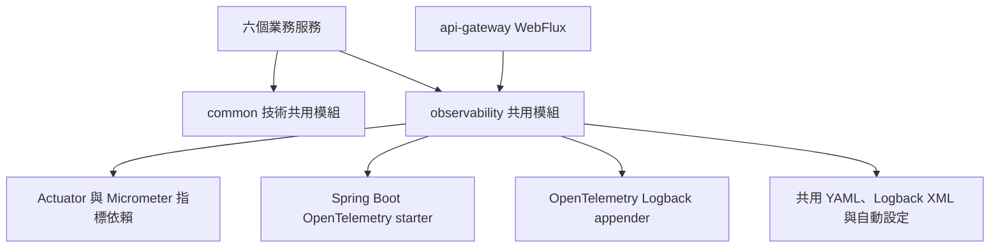
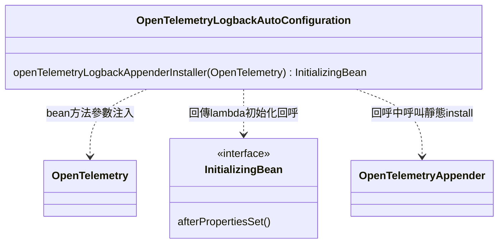
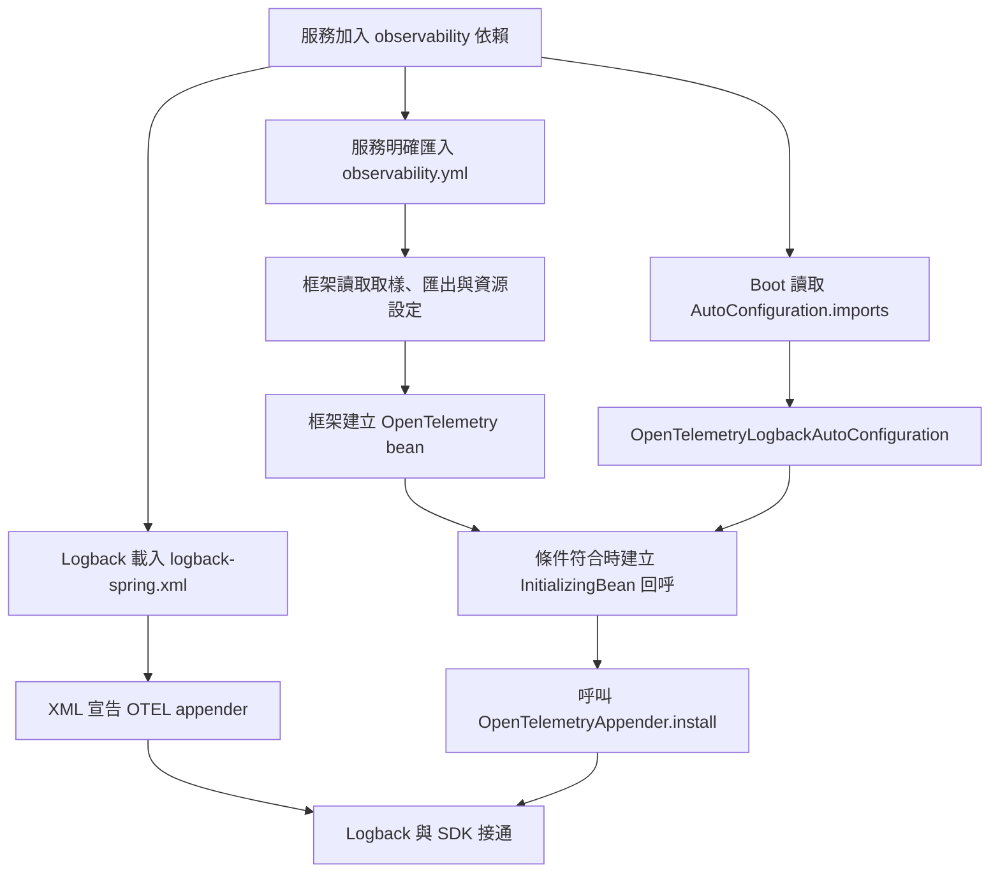
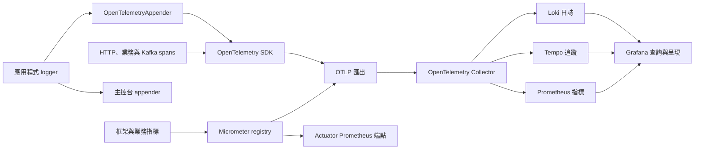

# observability 類別關係圖與職責說明

更新日期：2026-11-13。依 `backend/observability` 的一個 Java 來源檔、三個設定資源與 Maven 設定整理；外部框架型別會另外標明。

## 1. 模組位置與閱讀順序

observability 是後端服務共用的可觀測性函式庫，提供指標、追蹤與日誌所需的依賴、設定及 Logback 接線。它不是獨立啟動的服務，也不是部署在 `infra` 裡的 Collector／Grafana。

本模組只有一個自訂 Java 類別 `OpenTelemetryLogbackAutoConfiguration`，其餘能力主要由 Spring Boot、Micrometer、OpenTelemetry 與 Logback 提供。不要把設定檔或框架建立的 exporter 當成本專案自行實作的類別。

建議依序讀：本節的模組邊界 → [來源與職責表](#2-來源檔與職責) → [類別接線](#3-唯一自訂類別如何接起-logback-與-opentelemetry) → [啟動流程](#4-啟動時三種設定如何配合) → [資料流](#5-指標追蹤與日誌的資料流)。圖例沿用[類別關係文件索引](README.md#圖例)。

上圖是 Maven 模組依賴與能力分工，不是 Java 繼承：

- product、user、inventory、order、payment、notification 六個業務服務使用 common 與 observability。
- Gateway 是 WebFlux 應用，直接使用 observability，不引入 common 的 Servlet／JPA 元件。
- common 與 observability 之間沒有直接 Maven 模組依賴；服務將兩者組合後，common 才能使用框架提供的 `MeterRegistry`、`OpenTelemetry` 等能力。

## 2. 來源檔與職責

| 來源 | 職責 | 不由它負責的部分 |
|---|---|---|
| [pom.xml](../../backend/observability/pom.xml) | 引入 Actuator、OpenTelemetry starter、Prometheus registry、Resilience4j 指標橋接及 OTel Logback appender；管理 appender 版本 | 不定義業務指標、不部署監控後端。檔案仍留有「沒有程式碼」的歷史註解，目前實作已包含下列 Java 自動設定 |
| [OpenTelemetryLogbackAutoConfiguration.java](../../backend/observability/src/main/java/com/mymicroservice/observability/OpenTelemetryLogbackAutoConfiguration.java) | 在 SDK 自動設定之後，將 Spring 的 OpenTelemetry bean 安裝到 Logback appender | 不自行建立 SDK、span、exporter 或 logger，也不實作 HTTP／Kafka 的追蹤邏輯 |
| [AutoConfiguration.imports](../../backend/observability/src/main/resources/META-INF/spring/org.springframework.boot.autoconfigure.AutoConfiguration.imports) | 告訴 Spring Boot 載入上述自動設定類別 | 不是 Java 類別；也不等於匯入 `observability.yml` |
| [observability.yml](../../backend/observability/src/main/resources/observability.yml) | 集中設定取樣率、OTLP 匯出開關／端點、指標標籤、resource attributes 與 Actuator 預設暴露端點 | 服務須明確以 `spring.config.import` 匯入；它不建立 Logback appender 或業務 counter |
| [logback-spring.xml](../../backend/observability/src/main/resources/logback-spring.xml) | 設定主控台格式與 OTEL appender，將兩者接到 INFO 層級的 root logger | 不建立 Spring 的 OpenTelemetry bean；主控台是否使用 JSON 與 OTLP 是否匯出是不同開關 |

這五個檔案是本模組的主要閱讀範圍。目前 `backend/observability` 沒有獨立的測試來源目錄，相關回歸與部署紀錄分散在使用它的服務及可觀測性實作紀錄中。

## 3. 唯一自訂類別如何接起 Logback 與 OpenTelemetry

圖中只有 `OpenTelemetryLogbackAutoConfiguration` 是本專案類別：

| 型別／物件 | 來源 | 職責與實際關係 |
|---|---|---|
| `OpenTelemetryLogbackAutoConfiguration` | 本模組 | 宣告自動設定與 installer bean 工廠方法；**本身沒有 implements InitializingBean** |
| `InitializingBean` | Spring | 工廠方法回傳此介面的 lambda，Spring 初始化該 bean 時執行 `OpenTelemetryAppender.install(openTelemetry)`；沒有另一個自訂 Installer 類別 |
| `OpenTelemetry` | OpenTelemetry API；bean 由 Spring Boot 的 SDK 設定提供 | 作為方法參數注入，再交給 appender；此設定類別沒有持有它的欄位 |
| `OpenTelemetryAppender` | OTel instrumentation 的 Logback appender 套件 | XML 宣告的 OTEL appender 類型；透過其靜態 `install` 接上傳入的 OpenTelemetry |

接線的三個條件直接寫在來源中：

1. `@AutoConfiguration(afterName = "org.springframework.boot.opentelemetry.autoconfigure.OpenTelemetrySdkAutoConfiguration")`：在框架的 SDK 自動設定之後處理此設定；這是排序關係，不是繼承或注入另一個設定類別。
2. `@ConditionalOnClass(OpenTelemetryAppender.class)`：classpath 有 appender 類別時才啟用本設定。
3. installer 的 `@ConditionalOnBean(OpenTelemetry.class)`：已有 OpenTelemetry bean 才建立初始化回呼；`afterName` 本身不保證一定有該 bean。

這段程式補的是「Logback 與 Spring SDK 的連接」。只有 XML 宣告 appender，與 SDK 建好後完成 `install`，是兩個不同階段。

## 4. 啟動時三種設定如何配合

這張圖描述邏輯協作，不表示三條啟動路徑由本模組自行排程執行。Logback 初始化與 Spring bean 初始化是不同機制；本模組的註解說明 appender 早期日誌會先暫存，但此 installer 並不是自行實作的持久化佇列。

服務的接入有兩個閱讀入口：

- Maven 依賴，例如 [Gateway pom.xml](../../backend/spring-api-gateway/pom.xml) 中的 `com.mymicroservice:observability`。
- 服務設定，例如 [Gateway application.yml](../../backend/spring-api-gateway/src/main/resources/application.yml) 中的 `spring.config.import: classpath:observability.yml`。目前七個後端應用皆有匯入，notification 也包含在內。

`logback-spring.xml` 是 classpath 的日誌設定資源，不是經由 `spring.config.import` 當成 YAML 載入。服務若另有 logging 設定，應核對實際使用的資源，不要只憑模組依賴判斷 OTEL appender 一定已安裝。

## 5. 指標、追蹤與日誌的資料流

這是執行時資料流，箭頭不表示類別欄位。Collector、Prometheus、Tempo、Loki 與 Grafana 都是外部監控系統。本專案以 `grafana/otel-lgtm` 映像提供它們：本機見 [docker-compose.yml](../../infra/docker-compose.yml)，K8s 見 [k8s-deployment.yaml](../../infra/observability/k8s-deployment.yaml)。Collector 的內部管線主要由該映像提供，本模組沒有自行實作 Collector 或它的 Java client。

| 資料 | 誰產生與接線 | 本模組設定的出口 |
|---|---|---|
| 指標 metrics | 框架與各服務登記 counter、gauge 等；Micrometer registry 收集 | OTLP metrics 預設 15 秒匯出一次；另保留 `/actuator/prometheus` 拉取式端點 |
| 追蹤 traces | 框架的追蹤整合、服務呼叫及 common 的手動 span | OTLP traces；取樣率由 `management.tracing.sampling.probability` 設定 |
| 日誌 logs | 應用程式 logger → Logback root logger → CONSOLE 與 OTEL appender | 主控台照常輸出；OTEL 路徑經 SDK 使用 OTLP logs 匯出 |

關閉 OTLP 匯出，不等於關閉 tracing 或主控台日誌。反過來說，啟用 tracing 也不保證每一筆 log 都有 traceId：啟動、排程或其他沒有 active span 的工作，未必帶有請求追蹤脈絡。

### 主控台格式與 OTEL appender

[logback-spring.xml](../../backend/observability/src/main/resources/logback-spring.xml) 的兩種 profile 分支只決定主控台輸出：

| 條件 | 主控台實作 | OTEL appender |
|---|---|---|
| 啟用 `json-logs` profile | `ConsoleAppender` 搭配 Boot 的 `StructuredLogEncoder`，格式為 logstash JSON | 仍然掛在 root logger |
| 沒啟用 `json-logs` | 引用 Boot 的 `console-appender.xml` | 仍然掛在 root logger |

root logger 層級為 INFO。OTEL appender 設定擷取 structured key-value attributes 與 MDC attributes；tracing 的脈絡與這些屬性共同協助查詢日誌。`spring.main.banner-mode=log` 則讓啟動 banner 經過 logger。

## 6. 設定與來源對照

以下是本模組 YAML 中的預設值與環境變數，不代表部署環境的有效值一定相同；查問題時也要看服務設定與部署注入值。

| 設定／環境變數 | 本模組預設 | 用途 |
|---|---|---|
| `OBSERVABILITY_EXPORT_ENABLED` | `false` | 同時控制 traces、logs 與 metrics 的 OTLP 匯出設定；不是 JSON 主控台的開關 |
| `OTEL_EXPORTER_OTLP_ENDPOINT` | `http://localhost:4318` | HTTP 基底位址；YAML 各自加上 `/v1/metrics`、`/v1/traces`、`/v1/logs` |
| `TRACING_SAMPLING_PROBABILITY` | `1.0` | trace 取樣機率；不是三種資料共同的匯出開關 |
| `management.otlp.metrics.export.step` | `15s` | OTLP 指標匯出週期，不是每個業務 counter 的更新頻率 |
| `management.metrics.tags.application` | `${spring.application.name}` | 加在 Micrometer 指標上的應用程式標籤 |
| `service.namespace` resource attribute | `my-microservice` | OTel resource 的系統識別，不是 Maven package 名稱 |
| `service.instance.id` resource attribute | `${HOSTNAME:${spring.application.name}}` | 有 HOSTNAME 時使用它，否則回退服務名稱；K8s 中用來區分 Pod |
| `DEPLOYMENT_ENVIRONMENT` | `local` | 寫入 `deployment.environment.name` resource attribute |
| `management.endpoints.web.exposure.include` | `health,prometheus` | Actuator 的共用預設暴露清單；各服務另有自己的設定 |
| `json-logs` profile | 未在此模組強制啟用 | 由部署或啟動設定選擇主控台 JSON 格式 |

實際部署對照：

- [Gateway K8s manifest](../../infra/k8s/services/api-gateway.yaml) 注入匯出開關、`http://observability:4318`、`kind` 環境名稱與 `json-logs` profile；它們是部署設定，不是 Java 類別的預設欄位。
- [local-backend.sh](../../infra/scripts/local-backend.sh) 在 `OBSERVE=1` 時設定 OTLP 匯出變數；此腳本啟動 Gateway 與五個業務服務，**不會因此自動啟動 notification-service**。
- Grafana 儀表板與告警規則見 [overview dashboard](../../infra/observability/dashboards/my-microservice-overview.json)、[dashboards.yaml](../../infra/observability/dashboards.yaml) 與 [alerting.yaml](../../infra/observability/alerting.yaml)，不在後端 Java 類別中定義。

## 7. 與 common 及服務類別的責任交界

| 元件／來源 | 自己負責什麼 | observability 提供的背景能力 |
|---|---|---|
| common 的 [ResilienceAutoConfiguration](../../backend/common/src/main/java/com/mymicroservice/common/resilience/ResilienceAutoConfiguration.java) | 條件符合時，將 Resilience4j registry 的指標綁定到 `MeterRegistry` | 依賴帶入 metrics 套件與 registry；真正的綁定程式仍在 common |
| common 的 [OutboxMetrics](../../backend/common/src/main/java/com/mymicroservice/common/events/OutboxMetrics.java) | 定義 outbox 待送數 gauge 與更新方式 | 提供指標收集／匯出基礎設施，不決定 gauge 的業務數值 |
| common 的 [EventTrace](../../backend/common/src/main/java/com/mymicroservice/common/events/EventTrace.java) | 從 Kafka headers 還原脈絡，建立 consumer span | 由框架管理的 OpenTelemetry 提供 SDK 能力；事件包裝邏輯仍在 common |
| common 的 [OutboxRelay](../../backend/common/src/main/java/com/mymicroservice/common/events/OutboxRelay.java) | 發布事件時還原父 span；有注入 OpenTelemetry 時使用它，否則 no-op | 不由 observability 代為發布 Kafka 訊息或管理 outbox 交易 |
| 服務的 [RestClientConfig](../../backend/spring-order-service/src/main/java/com/mymicroservice/order/configs/RestClientConfig.java) | 使用注入的 `RestClient.Builder` 建立下游 HTTP client | 框架追蹤整合與匯出設定；observability 沒有另寫 HTTP client wrapper |

上述 common 類別的完整分工可接續讀 [common 文件](common.md)。本模組不決定業務事件、重試、去重或 HTTP 權限，也不會因有 OpenTelemetry 依賴就自動包住任意手動建立的工作。

## 8. 版本接線、測試與問題定位

Gateway 與其他服務使用不同的 Boot parent，因此「都有依賴 observability」不代表最終解析的 OTel 版本自然相同。以目前 [observability pom.xml](../../backend/observability/pom.xml) 與 [Gateway pom.xml](../../backend/spring-api-gateway/pom.xml) 為準：

- observability 的 parent 為 Boot 4.1.1，Logback appender instrumentation 版本為 `2.28.0-alpha`。
- Gateway 的 parent 為 Boot 4.0.9，其 POM 明確設定 `opentelemetry.version=1.62.0` 及 `opentelemetry-semconv=1.41.1`，對齊 appender 所需 API。
- [OpenTelemetryVersionAlignmentTest](../../backend/spring-api-gateway/src/test/java/com/mymicroservice/gateway/OpenTelemetryVersionAlignmentTest.java) 檢查 `LogRecordBuilder.setException(Throwable)` 是否存在；這是 API 相容性回歸，不是 Collector、三種資料匯出或 semconv 所有欄位的完整驗收。

| 現象 | 優先核對 |
|---|---|
| 有主控台 log，Loki 沒有資料 | `observability.yml` 是否匯入、匯出開關與端點、OTEL appender 是否載入、installer 條件是否成立，以及 Collector 是否能接收 |
| 主控台不是 JSON | `json-logs` profile 與實際 Logback 設定；不要先把問題歸因於 OTLP 匯出開關 |
| 一筆 log 沒有 traceId | 產生 log 時有沒有 active span、追蹤脈絡是否傳遞；啟動日誌不一定屬於請求 span |
| 指標沒有出現在儀表板 | 指標是否有登記、registry／匯出是否啟用、application 與 resource 標籤、儀表板查詢條件 |
| 記錄例外時發生 NoSuchMethodError／NoSuchFieldError | 最終依賴解析中的 OpenTelemetry API、SDK、instrumentation 與 semconv 版本，不只看 observability 自己的 POM |

歷史的本機與 kind 驗收、操作方式見[可觀測性實作紀錄](../implementation-plans/middleware/observability-implementation-plan.md)。該紀錄保留當時服務數量與版本；本文件描述此次閱讀的目前來源。此次僅靜態核對類別、設定與連結，未重跑應用程式測試、啟動 Collector 或重新宣稱端到端匯出驗證通過。
