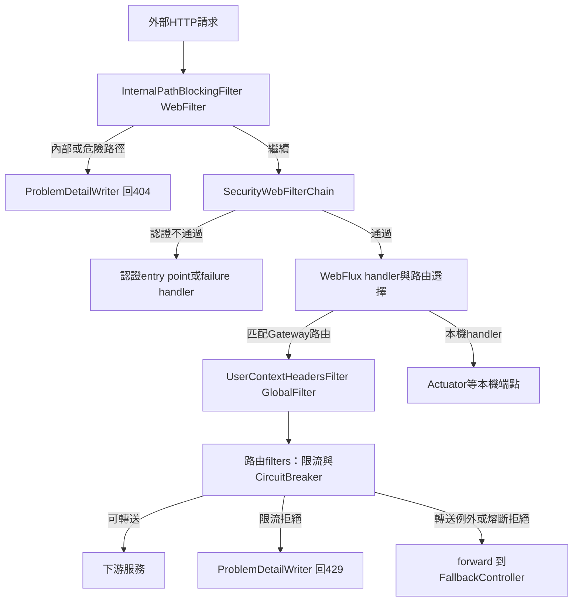
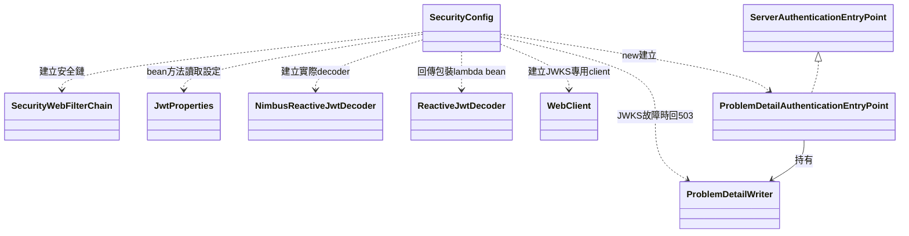
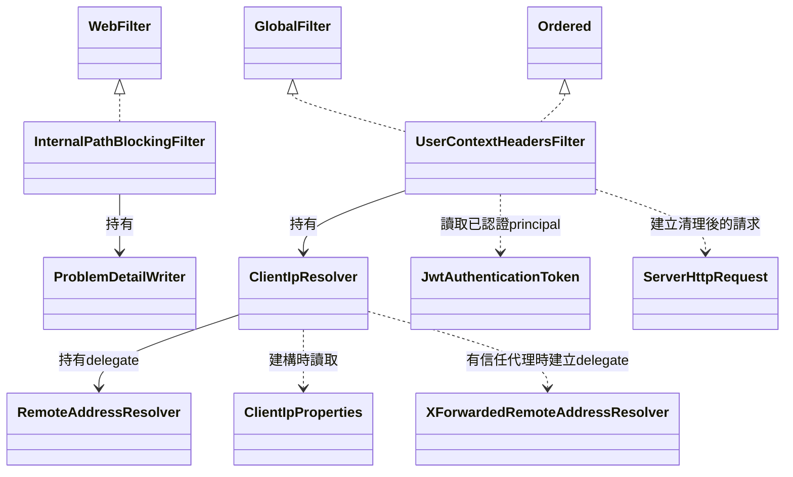
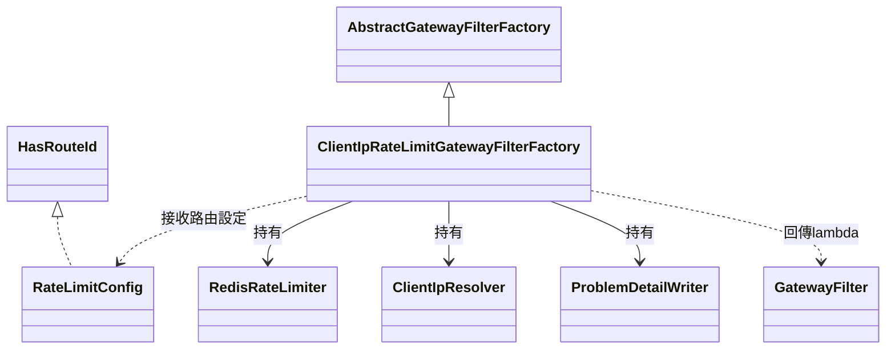
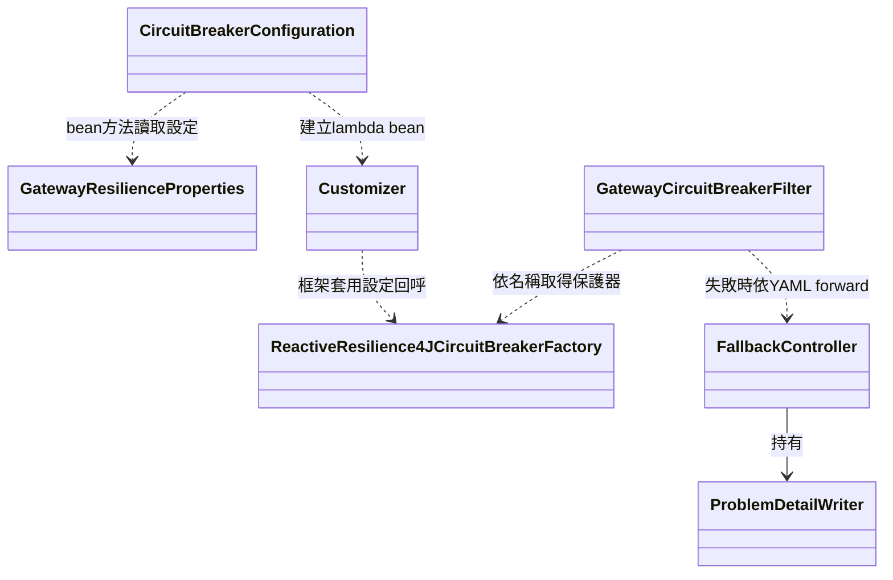
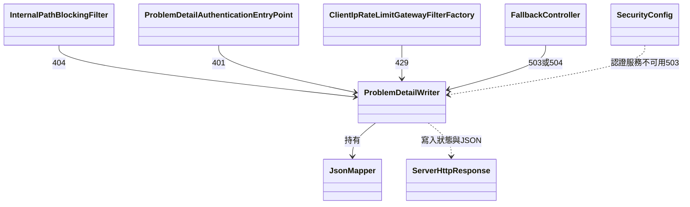

# spring-api-gateway 類別關係圖與職責說明

更新日期：2026-11-13。依 `backend/spring-api-gateway/src/main` 的 13 個 Java 來源檔、`application.yml` 與 Maven 設定整理；另說明限流工廠的內部 `Config`。外部框架型別不計入自訂來源檔數，圖例見[分類索引](README.md#圖例)。

## 1. 專案位置與入口

Gateway 是可獨立啟動的 WebFlux 應用，預設 port 為 8080。它負責入口認證、封鎖內部路徑、清理身分 header、依來源 IP 限流，以及轉送與故障回應。角色授權與業務資料仍由下游服務處理。

它直接依賴 [observability](observability.md)，不依賴 [common](common.md) 的 Servlet／JPA 元件；沒有自己的業務 Entity、JPA Repository 或資料庫 migration。Redis 的用途是入口限流，不是儲存帳號、訂單或 refresh token。

| 來源 | 職責 | 建立與接線方式 |
|---|---|---|
| [ApiGatewayApplication](../../backend/spring-api-gateway/src/main/java/com/mymicroservice/gateway/ApiGatewayApplication.java) | 應用程式入口，啟動 Spring Boot | `@SpringBootApplication` 掃描本專案元件；`@ConfigurationPropertiesScan` 註冊三個設定 record |
| [pom.xml](../../backend/spring-api-gateway/pom.xml) | 引入 WebFlux Gateway、Reactive Security／JWT、Redis、Reactive CircuitBreaker 與 observability | 目前 Boot parent 為 4.0.9、Spring Cloud 為 2025.1.4；OTel 相容性設定沿用 [observability 文件](observability.md#8-版本接線測試與問題定位)的說明 |
| [application.yml](../../backend/spring-api-gateway/src/main/resources/application.yml) | 定義下游 URI、七條路由、路由 filters、JWT／代理／限流／熔斷設定 | 路由不是自訂 Java RouteLocator 類別；由 Spring Cloud Gateway 讀取設定建立 |

建議閱讀順序：下節請求路徑 → SecurityConfig → 身分 header 與來源 IP → 限流工廠 → 熔斷與 fallback。遇到錯誤回應格式時，回頭看 `ProblemDetailWriter`。

## 2. 請求經過哪些類別

這是執行時的邏輯路徑，並非每個方塊都是自訂類別：

- `InternalPathBlockingFilter` 是 **WebFilter**，以最高優先序在 Security 之前阻擋請求。因此未登入者呼叫被封鎖路徑也收到 404，而不是先收到 401。
- `SecurityConfig` 建立的 `SecurityWebFilterChain` 屬於 Spring Security 的 WebFlux 機制。
- `UserContextHeadersFilter` 是 **GlobalFilter**，在 Gateway 的路由過濾鏈中執行，當時 Security 已處理認證。
- `ClientIpRateLimitGatewayFilterFactory` 回傳的是每條指定路由的 **GatewayFilter**。它不會自動套在所有路徑。
- `FallbackController` 是本機 WebFlux Controller，路由以 `forward:` 轉交它；不是又發一個 HTTP 請求到某個下游。

兩個自訂 filter 都使用 `Ordered.HIGHEST_PRECEDENCE`，但分屬不同過濾鏈，不能據此推論它們同時執行或由 GlobalFilter 跑在 Security 前面。未匹配路由也不代表一定先回 404：受保護路徑沒有身分時，Security 會先回 401。

## 3. 認證與 JWT：SecurityConfig 的接線

Security、decoder、WebClient 與介面都是 Spring 型別。`SecurityConfig` 沒有實作 `ReactiveJwtDecoder`；它先建立 Nimbus decoder，再回傳會轉換部分錯誤的 lambda。Entry point 也不是獨立的 component bean，而是在安全鏈工廠方法內用 `new` 建立。

| 類別與來源 | 職責 | 主要協作對象 |
|---|---|---|
| [SecurityConfig](../../backend/spring-api-gateway/src/main/java/com/mymicroservice/gateway/configs/SecurityConfig.java) | 建立安全鏈、JWT decoder、Bearer token 轉換與認證失敗回呼 | 從 JwtProperties 讀取 JWKS 設定；使用 entry point 與 writer 回應失敗 |
| [JwtProperties](../../backend/spring-api-gateway/src/main/java/com/mymicroservice/gateway/properties/JwtProperties.java) | 綁定 `gateway.security.jwt`：JWKS URI、issuer、連線與回應逾時 | 是設定 record，不會自己下載公鑰或驗 token |
| [ProblemDetailAuthenticationEntryPoint](../../backend/spring-api-gateway/src/main/java/com/mymicroservice/gateway/security/ProblemDetailAuthenticationEntryPoint.java) | 處理未認證／無效 token 的 401 回應，設定 `WWW-Authenticate` | 委派 ProblemDetailWriter 寫 JSON；不建立或刷新 token |

### 哪些路徑公開

| 條件 | Gateway 的認證政策 |
|---|---|
| `/api/v1/auth/**` | 允許匿名，且 Bearer converter **不讀取 Authorization** |
| GET `/api/v1/products/**`、`/api/v1/categories/**`、`/api/v1/inventory/**` | 允許匿名；若主動附上無效 token，仍可能因驗證失敗回 401 |
| `/actuator/health` | 允許匿名 |
| 其餘路徑 | 必須已認證，包括不在路由表的路徑 |

`permitAll` 是存取政策，不等於任意 JWT 都會被忽略。`/api/v1/auth/**` 額外跳過 Bearer 解析，是為了讓帶著過期 access token 的 refresh／logout 請求仍能到 user-service。refresh cookie 與相關請求檢查由 [AuthController](../../backend/spring-user-service/src/main/java/com/mymicroservice/user/controller/AuthController.java) 處理，不由 Gateway 驗證 refresh token。

Gateway 驗證 RS256 簽章、預設時間條件、issuer，並要求 `sub` 非空；此處不額外驗證 `sub` 是否為 UUID，也不檢查 ADMIN 角色。下游 common 的 UUID 解析與 `@RequireRoles` 是後續責任。

### 兩種認證失敗不能混為一談

缺少／無效 access token 走 entry point，回 401、`UNAUTHENTICATED`；缺少 token 與 `InvalidBearerTokenException` 的 detail、`WWW-Authenticate` 內容不同。驗證服務不可用所形成的 `AuthenticationServiceException` 則由 SecurityConfig 的 failure handler 回 503、`SERVICE_UNAVAILABLE`，避免前端把暫時無法驗證誤認為必須登出。

JWKS 使用獨立 WebClient，預設連線 1 秒、回應 2 秒。這不是一般路由轉送的 HTTP client，也不是 application.yml 中的 10 秒下游回應逾時。

對照測試：[GatewayJwtIntegrationTests](../../backend/spring-api-gateway/src/test/java/com/mymicroservice/gateway/GatewayJwtIntegrationTests.java)。

## 4. 封鎖內部路徑與建立可信任的 header

| 類別與來源 | 職責 | 與其他類別的分工 |
|---|---|---|
| [InternalPathBlockingFilter](../../backend/spring-api-gateway/src/main/java/com/mymicroservice/gateway/filters/InternalPathBlockingFilter.java) | 在 Security 前檢查 raw path，阻擋內部 API 與可造成路徑穿越的片段 | 自己檢查解碼與路徑片段，拒絕時交給 writer 回 404；不負責 JWT 或角色 |
| [UserContextHeadersFilter](../../backend/spring-api-gateway/src/main/java/com/mymicroservice/gateway/filters/UserContextHeadersFilter.java) | 對已匹配 Gateway 路由的請求移除偽造身分 header，再依 principal 與來源 IP 重建 | 持有 ClientIpResolver；不自己 decode 或驗簽 JWT |
| [ClientIpResolver](../../backend/spring-api-gateway/src/main/java/com/mymicroservice/gateway/ratelimit/ClientIpResolver.java) | 將遠端連線或信任代理資訊轉成來源 IP 字串 | 同時供 header filter 與限流工廠使用；讀設定選擇框架 delegate，使用 getHostString，不做反向 DNS |
| [ClientIpProperties](../../backend/spring-api-gateway/src/main/java/com/mymicroservice/gateway/properties/ClientIpProperties.java) | 綁定 `gateway.client-ip.trusted-proxies`，限制不得小於零 | 設定代理信任層數，不是信任用戶端提供的 X-Client-Ip |

內部路徑檢查會處理解碼、反斜線與分號路徑參數；首個非空片段為 `internal`（忽略大小寫），或任一片段為 `.`／`..` 時拒絕。解碼不合法或超出允許的多重解碼情況也會拒絕。路由表沒有 `/internal/**`，而這個 filter 是另外一層明確封鎖。

header filter 對公開路由也先移除 `X-User-Id`、`X-User-Roles`、`X-Client-Ip` 的用戶端值。有 `JwtAuthenticationToken` 才以 `sub` 與 roles claim 填入身分；來源 IP 則獨立由 resolver 取得。`/api/v1/auth/**` 不讀 Bearer，所以這裡不會把它當成已認證 JWT 來建立身分 header。

`trusted-proxies=0` 時只使用連線 IP，忽略 X-Forwarded-For；大於零時使用 `maxTrustedIndex(N)`。這個設定必須對應實際代理拓樸，不能只因請求帶了 X-Forwarded-For 就信任它。無法解析 IP 時，header 不填入來源值；限流路徑則會使用下一節的 `unknown` key。

Gateway 不引用 common 的 `UserContextHeaders`，而是在本地定義相同 header 名稱；下游如何解析與授權見 [common 身分與權限](common.md#3-身分-header參數注入與角色檢查)。

對照測試：[GatewayInternalPathIntegrationTests](../../backend/spring-api-gateway/src/test/java/com/mymicroservice/gateway/GatewayInternalPathIntegrationTests.java)、[GatewayUserContextHeadersIntegrationTests](../../backend/spring-api-gateway/src/test/java/com/mymicroservice/gateway/GatewayUserContextHeadersIntegrationTests.java)、[GatewayLoginRateLimitBehindProxyIntegrationTests](../../backend/spring-api-gateway/src/test/java/com/mymicroservice/gateway/GatewayLoginRateLimitBehindProxyIntegrationTests.java)。

## 5. 路由限流：工廠、Config 與 RedisRateLimiter

`RateLimitConfig` 在圖中代表內部 `ClientIpRateLimitGatewayFilterFactory.Config`，不是另一個 Java 檔；其餘基底、介面與 RedisRateLimiter 都是 Spring Cloud Gateway 型別。

| 類別／型別與來源 | 職責 | 重要界線 |
|---|---|---|
| [ClientIpRateLimitGatewayFilterFactory](../../backend/spring-api-gateway/src/main/java/com/mymicroservice/gateway/ratelimit/ClientIpRateLimitGatewayFilterFactory.java) | 以 routeId 設定 RedisRateLimiter，回傳依 IP 判斷是否放行的 GatewayFilter | 路由 YAML 使用 `name: ClientIpRateLimit` 才套用；它不是全域限流，也不讀密碼或登入結果 |
| 同檔案內的 `Config` | 保存 routeId、每秒補充量、bucket 容量與每請求 token 消耗量 | 實作 HasRouteId，由框架填入 routeId；不是 `@ConfigurationPropertiesScan` 掃描的三個 record 之一 |
| `RedisRateLimiter`（框架） | 用 Redis token bucket／Lua 管理多實例共用的限流狀態 | token 判斷與 Redis 故障放行由框架實作；自訂工廠主要補上 IP key 與一致的錯誤回應 |

`apply(Config)` 在建立路由 filter 時寫入 rate limiter 的 routeId 設定，計算 Retry-After，並回傳請求處理 lambda。每次請求才呼叫 `isAllowed(routeId, ip)`：允許時繼續 chain，拒絕時回 429、`TOO_MANY_REQUESTS` 與 `Retry-After`。

兩條路由各自計數，即使 IP 相同也不共用同一個登入／註冊 bucket：

| 路由 | YAML 的 replenish-rate / burst-capacity / requested-tokens | 行為 |
|---|---|---|
| `user-service-login`，POST login | `1 / 60 / 6` | bucket 滿時可連續十次，補足一次請求需六秒 |
| `user-service-register`，POST register | `1 / 60 / 20` | bucket 滿時可連續三次，補足一次請求需二十秒 |

內部 Config 的初值都是 1，上表是 application.yml 指定的有效路由參數，不能混為一談。解析不到 IP 時共用 `unknown` key，避免這些請求完全不受限。Redis 無法使用時採放行；Redis health 也被設定為不影響 Gateway 整體 health。Gateway 的入口限流與 user-service 的登入失敗計數是不同機制。

對照測試：[GatewayLoginRateLimitIntegrationTests](../../backend/spring-api-gateway/src/test/java/com/mymicroservice/gateway/GatewayLoginRateLimitIntegrationTests.java)、[GatewayRegisterRateLimitIntegrationTests](../../backend/spring-api-gateway/src/test/java/com/mymicroservice/gateway/GatewayRegisterRateLimitIntegrationTests.java)、[GatewayLoginRateLimitRedisDownIntegrationTests](../../backend/spring-api-gateway/src/test/java/com/mymicroservice/gateway/GatewayLoginRateLimitRedisDownIntegrationTests.java)。

## 6. 路由、熔斷設定與 fallback 的關係

`GatewayCircuitBreakerFilter` 是圖中對框架 CircuitBreaker 路由 filter 的角色名稱，不是本專案類別。Customizer 也是框架介面；`CircuitBreakerConfiguration` 回傳 lambda bean，而不是自己 implements Customizer。FallbackController 與設定類別之間沒有直接呼叫關係，接線來自 YAML 的 `fallbackUri`。

| 類別與來源 | 職責 | 與其他類別的分工 |
|---|---|---|
| [CircuitBreakerConfiguration](../../backend/spring-api-gateway/src/main/java/com/mymicroservice/gateway/resilience/CircuitBreakerConfiguration.java) | 建立 ReactiveResilience4JCircuitBreakerFactory 的預設設定回呼 | 設定 CircuitBreaker 與 TimeLimiter；不處理 HTTP 回應，也沒有建立 common 的 DownstreamCaller |
| [GatewayResilienceProperties](../../backend/spring-api-gateway/src/main/java/com/mymicroservice/gateway/properties/GatewayResilienceProperties.java) | 綁定 `gateway.resilience` 的視窗、門檻、開啟時間、半開請求數與 time-limit | 設定 record，不持有熔斷器執行狀態 |
| [FallbackController](../../backend/spring-api-gateway/src/main/java/com/mymicroservice/gateway/resilience/FallbackController.java) | 讀取框架放在 exchange 的熔斷執行例外，區分 503 與 504 | 真正 timeout 判斷在它自己的原因鏈巡訪方法；不會呼叫設定類別內參考用的 `isTimeout` |

### 七條路由，五個下游保護器名稱

| routeId | 路徑／條件 | 下游與 CircuitBreaker name |
|---|---|---|
| `user-service-login` | POST `/api/v1/auth/login`，order -1 | user-service；先限流再進該路由的 CircuitBreaker |
| `user-service-register` | POST `/api/v1/auth/register`，order -1 | user-service；獨立註冊限流，熔斷名稱仍相同 |
| `user-service` | `/api/v1/auth/**`、`/api/v1/users/**` | user-service |
| `product-service` | `/api/v1/products/**`、`/api/v1/categories/**` | product-service |
| `inventory-service` | `/api/v1/inventory/**` | inventory-service |
| `order-service` | `/api/v1/orders/**` | order-service |
| `payment-service` | `/api/v1/payments/**` | payment-service |

三條 user 路由共用 `user-service` 名稱，所以不能把七條 route 解讀成七個彼此獨立的熔斷器。notification-service 沒有出現在目前路由表；也沒有 `/internal/**` 路由。

目前設定使用 20 筆視窗、最少十次呼叫、50% 失敗率門檻、開啟十秒與半開三次請求。路由沒有設定將特定 HTTP status 視為熔斷失敗；下游正常回傳的 HTTP 錯誤（含 5xx）會原樣轉送，而不是全部改成 fallback 503。這與 common 的 HTTP caller 將 5xx 記為失敗的策略不同。

逾時也分三個層次：JWT 公鑰查詢是 1 秒／2 秒；一般下游 HTTP client 是連線 2000ms、回應 10 秒；Reactive TimeLimiter 是 15 秒。三者不是同一個設定或同一個 client。

Fallback 預設對所有路由 forward 至 `/fallback/unavailable`：熔斷拒絕與一般轉送失敗回 503；原因鏈有 `TimeoutException`，或直接的 ResponseStatusException 為 504，回 504。內部 forward 不會重跑一次外部安全鏈；直接從外部呼叫 fallback 路徑仍受 `anyExchange().authenticated()` 約束。

對照測試：[GatewayCircuitBreakerIntegrationTests](../../backend/spring-api-gateway/src/test/java/com/mymicroservice/gateway/GatewayCircuitBreakerIntegrationTests.java)、[GatewayTimeoutIntegrationTests](../../backend/spring-api-gateway/src/test/java/com/mymicroservice/gateway/GatewayTimeoutIntegrationTests.java)、[GatewayRoutingIntegrationTests](../../backend/spring-api-gateway/src/test/java/com/mymicroservice/gateway/GatewayRoutingIntegrationTests.java)。

## 7. 錯誤回應由誰寫出

| 類別與來源 | 職責 | 責任界線 |
|---|---|---|
| [ProblemDetailWriter](../../backend/spring-api-gateway/src/main/java/com/mymicroservice/gateway/web/ProblemDetailWriter.java) | 用 JsonMapper 序列化 Map，寫入 WebFlux response 與 `application/problem+json` | 是被呼叫的工具 component，沒有實作全域例外處理介面，也沒有繼承 common 的例外處理器 |

回應欄位為 `type`、`title`、`status`、`detail`、`instance` 與額外的 `code`。各呼叫者決定狀態、錯誤碼、訊息及特有 header，writer 只負責共用格式與寫出。

不要因此推論所有 Gateway／下游錯誤都會經過 writer：下游正常產生的錯誤內容會原樣轉送；框架自己的未匹配路徑等錯誤也不等於 InternalPathBlockingFilter 寫出的 404。這裡刻意不依賴 common 的 Servlet `GlobalExceptionHandler`。

## 8. 設定與測試的閱讀地圖

三個設定 record 都由入口的 ConfigurationPropertiesScan 接進 Spring，均有 `@Validated`。以下前綴與使用者可用來定位設定，不代表每個 YAML 區塊都會對應一個自訂設定類別。

| 設定前綴／區塊 | 自訂類別或使用者 |
|---|---|
| `gateway.security.jwt` | JwtProperties → SecurityConfig |
| `gateway.client-ip` | ClientIpProperties → ClientIpResolver |
| `gateway.resilience` | GatewayResilienceProperties → CircuitBreakerConfiguration |
| `gateway.login-rate-limit`、`gateway.register-rate-limit` | YAML 以 placeholder 傳給路由 filter 的內部 Config；沒有另外的同名 properties record |
| `gateway.services` | YAML 路由 URI 與 JWKS URI 的 placeholder；沒有自訂 GatewayServicesProperties |
| `spring.cloud.gateway.server.webflux.routes` | 框架建立路由與 filter，不是由 ApiGatewayApplication 手寫路由 |
| `spring.data.redis` | 框架建立 reactive Redis／rate limiter 相關能力 |
| `spring.config.import` | 引入 observability 共用設定；不是 common 的自動設定入口 |

| 想追的現象 | 來源與測試入口 |
|---|---|
| 未登入、過期 token、JWKS 暫時不可用 | SecurityConfig、entry point、GatewayJwtIntegrationTests |
| 身分 header 偽造或公開請求仍帶身分 | UserContextHeadersFilter、GatewayUserContextHeadersIntegrationTests |
| internal 或編碼路徑被拒絕 | InternalPathBlockingFilter、GatewayInternalPathIntegrationTests |
| 代理後的 IP 或限流 key 不正確 | ClientIpResolver、ClientIpProperties、GatewayLoginRateLimitBehindProxyIntegrationTests |
| Redis 故障時行為、429 的 body／Retry-After | 限流工廠、RedisRateLimiter，以及登入／註冊／RedisDown 測試 |
| 503、504、熔斷是否共用、下游 5xx 是否被改寫 | CircuitBreakerConfiguration、FallbackController、CircuitBreaker／Timeout／Routing 測試 |
| OTel API 相容性 | [OpenTelemetryVersionAlignmentTest](../../backend/spring-api-gateway/src/test/java/com/mymicroservice/gateway/OpenTelemetryVersionAlignmentTest.java)，細節見 observability 文件 |

測試共用的 [TestJwts](../../backend/spring-api-gateway/src/test/java/com/mymicroservice/gateway/TestJwts.java) 與 [TestRedis](../../backend/spring-api-gateway/src/test/java/com/mymicroservice/gateway/TestRedis.java) 是測試支援，不是 production 的簽發 token 或 Redis 管理服務。

更多歷史決策與驗收見[Gateway 實作紀錄](../implementation-plans/backend/api-gateway-implementation-plan.md)；跨服務 API 與 port 見[架構參考](../architecture/microservice-architecture.md)。本文件僅靜態核對目前類別、路由及設定，未因新增文件重新執行測試、渲染 Mermaid 或啟動服務驗收。
