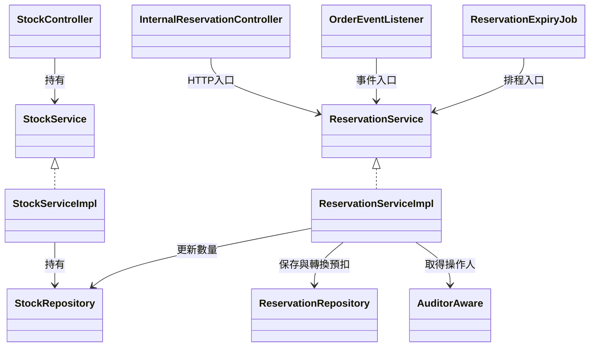
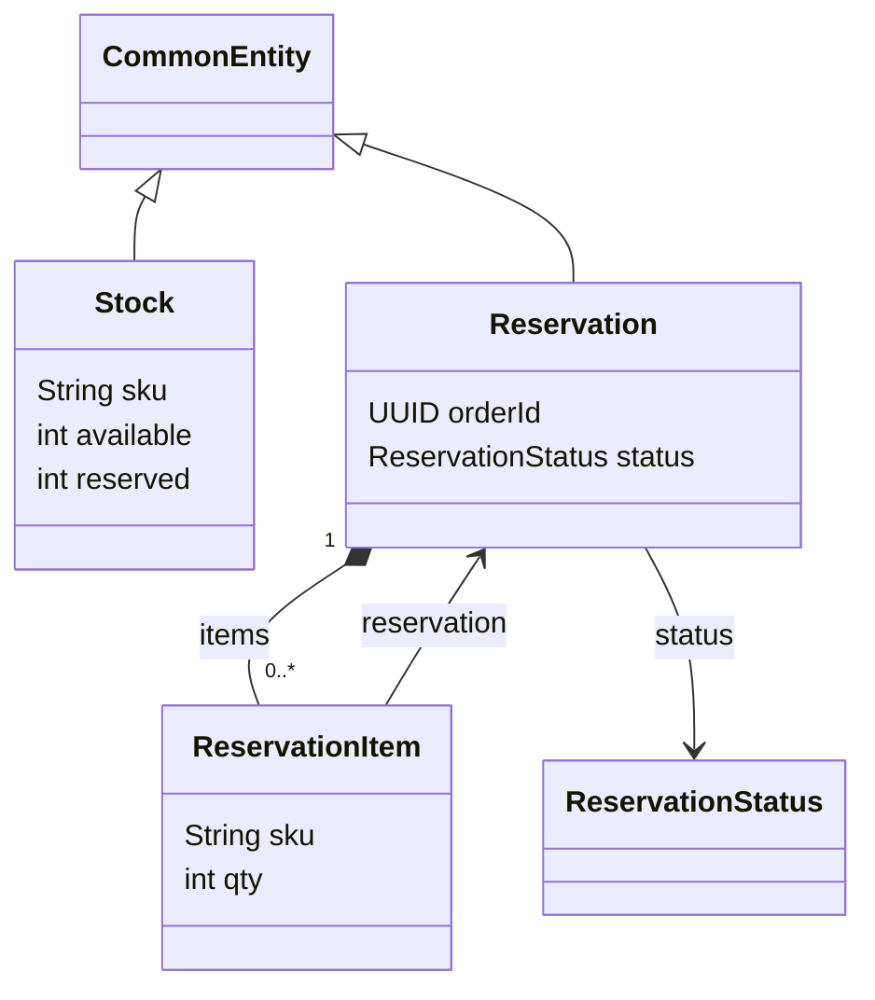
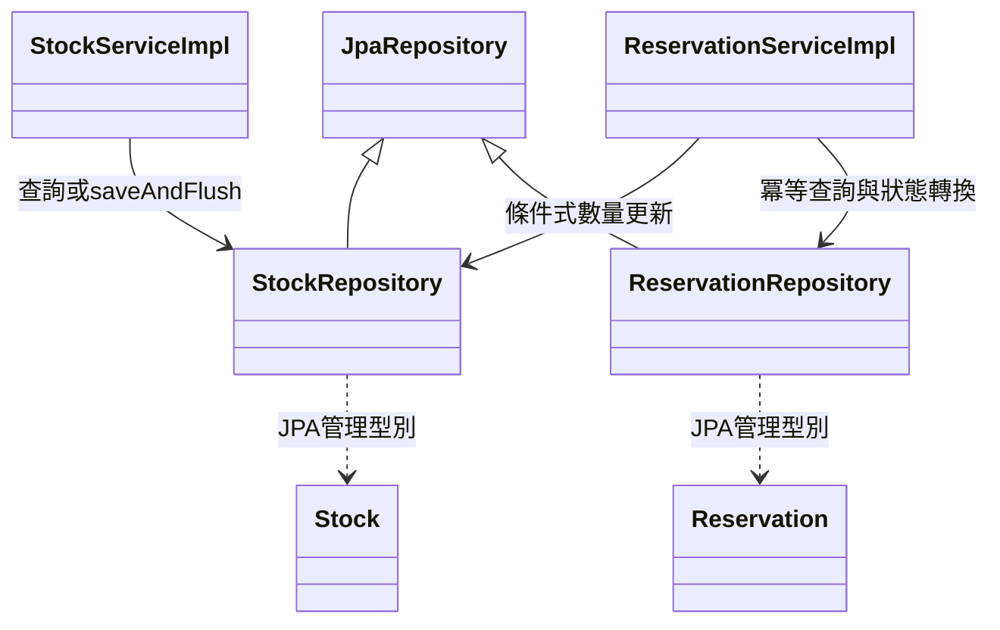
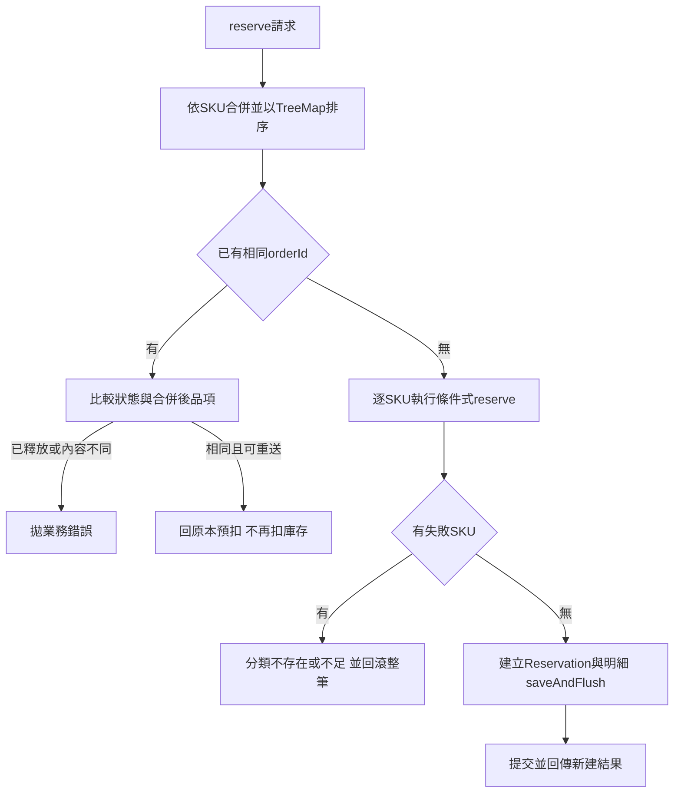
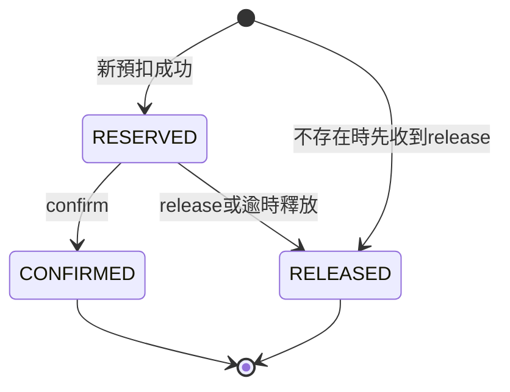
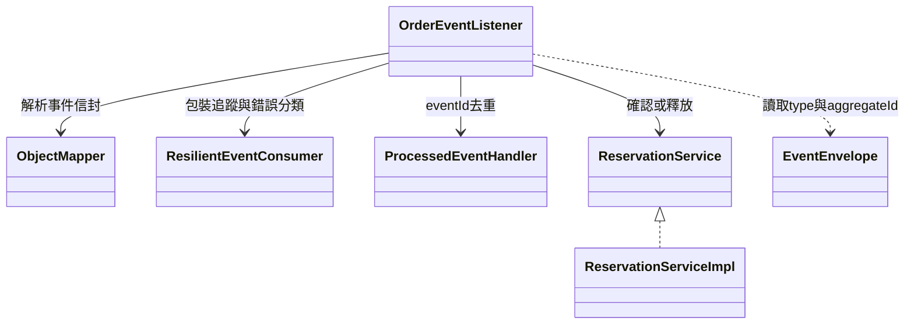
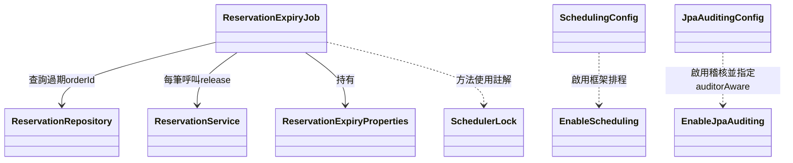

# spring-inventory-service 類別關係圖與職責說明

更新日期：2026-11-13。依本模組 25 個 Java 主程式來源檔、六個 migration、application.yml 與 pom.xml 整理，共 33 個來源／設定檔；另說明三個內部 record。圖例見[分類索引](README.md#圖例)。

## 1. 服務位置與三個預扣入口

inventory-service 是 Servlet／JPA 應用，預設 port 為 8083，使用自己的 `inventory_db` 與 `inventory_service` schema。它保存 SKU 的可賣／預扣數量，以及每張訂單的預扣紀錄；不保存商品目錄、訂單主體或金流結果。

| 來源 | 職責與接線 |
|---|---|
| [InventoryServiceApplication](../../backend/spring-inventory-service/src/main/java/com/mymicroservice/inventory/InventoryServiceApplication.java) | 啟動 Boot、掃描本模組元件與設定 record，明確匯入 common 的 RequireRolesGuard，檢查角色 interceptor 是否確實安裝 |
| [pom.xml](../../backend/spring-inventory-service/pom.xml) | 引入 common、observability、Web MVC、JPA、Flyway、PostgreSQL、驗證與 springdoc；目前 parent 為 Boot 4.1.1 |
| [application.yml](../../backend/spring-inventory-service/src/main/resources/application.yml) | 設定資料庫與 schema、Kafka、預扣逾時、四條排程執行緒、ShedLock 與共用 observability 匯入 |

三個預扣入口都呼叫同一個 `ReservationService` 介面；庫存數量與狀態的規則集中在其實作，沒有在 listener、Controller 或 job 各寫一套。Spring Data 建立 Repository 的實作，並非本專案另有手寫 `RepositoryImpl`。

目前正常付款／取消通知以 `order.events` 為入口。內部 HTTP 的 confirm／release 端點仍存在，但不能沿用舊註解將所有通知都理解成 order-service 同步 HTTP 呼叫。建單預扣與建單失敗時的釋放仍可經 order-service 的 [InventoryClient](../../backend/spring-order-service/src/main/java/com/mymicroservice/order/clients/InventoryClient.java) 呼叫。

## 2. HTTP Controller 與 Service 介面

| 類別與來源 | 職責 | 不在這層處理的部分 |
|---|---|---|
| [StockController](../../backend/spring-inventory-service/src/main/java/com/mymicroservice/inventory/controller/StockController.java) | 提供查詢／設定可賣數量 API；PUT 標記 `@RequireRoles("ADMIN")`，依 created 選擇 201 或 200 | 不自行驗 JWT、不做預扣數量運算、不直接呼叫 Repository |
| [InternalReservationController](../../backend/spring-inventory-service/src/main/java/com/mymicroservice/inventory/controller/InternalReservationController.java) | 提供內部 reserve、confirm、release API，綁定／驗證請求並選擇回應狀態 | 不自己實作冪等、庫存扣減或事件消費 |
| [StockService](../../backend/spring-inventory-service/src/main/java/com/mymicroservice/inventory/service/StockService.java) | 定義 getStock、setStock 的服務介面 | 與實作、HTTP Controller 分離 |
| [ReservationService](../../backend/spring-inventory-service/src/main/java/com/mymicroservice/inventory/service/ReservationService.java) | 定義 reserve、confirm、release 的共用操作 | HTTP、事件與排程共用；reserve 接收 ReserveReqDto，confirm／release 只需 orderId，不接收 Servlet request |

| HTTP API | 成功回應 | 存取與行為 |
|---|---|---|
| GET `/api/v1/inventory/{sku}` | 200 | 經 Gateway 的讀取公開，回傳 available 與 reserved |
| PUT `/api/v1/inventory/{sku}` | 新建 201、既有 200 | ADMIN；設定的是 **available 的絕對值**，不是總庫存、增量或 reserved |
| POST `/internal/v1/inventory/reservations` | 新建 201、重送 200 | orderId 是冪等鍵，放在 body，不是通用 Idempotency-Key header |
| POST `/internal/v1/inventory/reservations/{orderId}/confirm` | 200 | 確認預扣；不存在或狀態衝突仍會回錯誤 |
| POST `/internal/v1/inventory/reservations/{orderId}/release` | 200 | 釋放預扣；不存在時留下 RELEASED 紀錄，詳見狀態說明 |

庫存服務信任 Gateway 的身分 headers，common 負責角色檢查、參數驗證錯誤與 ProblemDetail。內部 Controller 沒有使用者角色註解；Gateway 封鎖 `/internal/**`，部署清單另有 [NetworkPolicy](../../infra/k8s/network-policies.yaml) 用來限制來源 Pod。NetworkPolicy 控制連線來源，不是依 URL 授權，也不是 Controller 自己完成的驗證。

## 3. 實體關係：數量、預扣與明細

CommonEntity 來自 common；其餘是本模組型別。ReservationItem 的 sku 雖有資料庫外鍵指向 stock，但 Java 欄位是 String，**沒有指向 Stock 的 JPA 關聯欄位**。同樣地，orderId 是跨服務識別值，不是指向 order-service 的 JPA Order 關聯。

| 類別與來源 | 保存內容與職責 | 關係與生命週期 |
|---|---|---|
| [Stock](../../backend/spring-inventory-service/src/main/java/com/mymicroservice/inventory/entities/Stock.java) | 以 sku 為自然主鍵，保存 available、reserved | 繼承稽核／version；預扣、確認、釋放透過 Repository SQL 更新，不是先載入此實體再逐筆改數量 |
| [Reservation](../../backend/spring-inventory-service/src/main/java/com/mymicroservice/inventory/entities/Reservation.java) | 以外部提供的 orderId 為主鍵，保存整張預扣狀態 | 繼承 CommonEntity；items 使用 cascade ALL、orphanRemoval 與 `@OrderBy("sku")`，由 addItem 建立雙向關係 |
| [ReservationItem](../../backend/spring-inventory-service/src/main/java/com/mymicroservice/inventory/entities/ReservationItem.java) | 保存一張預扣中的 sku 與 qty | 不繼承 CommonEntity；建立後沒有修改明細的服務流程；以 lazy ManyToOne 指回 Reservation |
| 同檔案內的 `ReservationItem.Key` | Serializable record，作為複合主鍵 `(order_id, sku)` | Key 的 `reservation` 欄位型別是 UUID，對應 Reservation 的主鍵，而不是放一個 Reservation 實體 |
| [ReservationStatus](../../backend/spring-inventory-service/src/main/java/com/mymicroservice/inventory/enums/ReservationStatus.java) | 定義 RESERVED、CONFIRMED、RELEASED | 只是狀態 enum；轉換規則在 Service 與條件式 UPDATE，不在 enum 方法裡 |

`available` 是尚可販售的數量；`reserved` 是已從 available 移出、仍待確認或釋放的數量。確認時不會再扣一次 available，也不能把 `available + reserved` 當成這個模型額外保存的總庫存欄位。

## 4. Repository 與交易責任

| 類別與來源 | 職責 | 交易與並行界線 |
|---|---|---|
| [StockServiceImpl](../../backend/spring-inventory-service/src/main/java/com/mymicroservice/inventory/service/impl/StockServiceImpl.java) | 查詢 Stock；不存在就建立、存在則設定 available，回傳 SetStockResult；不向 product-service 查驗 SKU | 類別層級交易，getStock 為唯讀。saveAndFlush 讓版本／主鍵衝突在服務呼叫中浮現 |
| [ReservationServiceImpl](../../backend/spring-inventory-service/src/main/java/com/mymicroservice/inventory/service/impl/ReservationServiceImpl.java) | 合併 SKU、預扣冪等比對、確認／釋放、錯誤分類與 DTO 組裝 | 類別層級交易，使一筆操作的多個 SKU 與預扣狀態一起提交／回滾；透過具名 auditorAware 取得操作人 |
| [StockRepository](../../backend/spring-inventory-service/src/main/java/com/mymicroservice/inventory/repositories/StockRepository.java) | JpaRepository<Stock, String>，另外提供 reserve、confirmReserved、releaseReserved | 數量檢查與變更在同一條 SQL；自訂 UPDATE 同時遞增 version、更新時間與操作人 |
| [ReservationRepository](../../backend/spring-inventory-service/src/main/java/com/mymicroservice/inventory/repositories/ReservationRepository.java) | JpaRepository<Reservation, UUID>；帶明細查詢、條件式 transition、逾時 orderId 查詢 | EntityGraph 載入 items；transition 只在目前狀態等於 from 時更新，回傳異動筆數供服務判斷 |

StockServiceImpl 的樂觀鎖保護的是伺服器「讀取到 flush」期間的競爭：預扣若已改變 version，管理者的更新會衝突。`SetStockReqDto` 沒有要求用戶端傳入 version，不能把它解讀成完整的「從畫面讀取起算」版本檢查。

三種數量更新如下，若更新不到資料，Service 會判斷原因或拋出錯誤，讓整筆交易回滾：

| StockRepository 方法 | 條件 | available 變化 | reserved 變化 |
|---|---|---|---|
| reserve | SKU 存在且 available ≥ qty | 減 qty | 加 qty |
| confirmReserved | SKU 存在且 reserved ≥ qty | 不變 | 減 qty |
| releaseReserved | SKU 存在且 reserved ≥ qty | 加 qty | 減 qty |

自訂 UPDATE 不走實體的 JPA 稽核 callback，因此上述欄位由 Repository query 明確寫入；稽核與樂觀鎖基礎見 [common 文件](common.md#5-jpa-稽核與共用實體欄位)。

## 5. 預扣的全有全無與兩種終止狀態

排序讓這條預扣流程用一致的 SKU 順序更新，降低不同請求鎖定順序相反的風險。確認／釋放則以實體明細的 `@OrderBy("sku")` 順序操作。這不是宣稱整個資料庫永遠不會發生任何死結。

Service 會收集所有更新失敗的 SKU：其中有不存在的 SKU 時回 STOCK_NOT_FOUND，否則回 INSUFFICIENT_STOCK。已更新成功的其他 SKU 也因例外一起回滾，不留下部分扣庫存的結果。

兩個相同 orderId 的新請求若都尚未讀到既有預扣，最後以 reservation 主鍵阻擋第二筆；第二筆的扣庫存一起回滾，可能收到共用 DATA_CONFLICT。之後重試才走既有預扣的冪等路徑，不保證每次並行重送都直接收到 200。

上圖表示目前允許的狀態建立／轉換；終點不表示刪除資料列。

| 既有情況 | 操作與結果 |
|---|---|
| RESERVED 或 CONFIRMED，reserve 內容相同 | 回傳原本結果，created=false，不再扣數量 |
| 已有預扣，reserve 品項／數量不同 | RESERVATION_MISMATCH；若狀態已 RELEASED，優先回 ALREADY_RELEASED |
| CONFIRMED 再 confirm | 冪等回傳，不重複減 reserved |
| RELEASED 再 release | 冪等回傳，不重複加 available |
| RELEASED 要 confirm | RESERVATION_ALREADY_RELEASED |
| CONFIRMED 要 release | RESERVATION_ALREADY_CONFIRMED，不在這裡實作退貨 |
| 不存在要 confirm | RESERVATION_NOT_FOUND |
| 不存在先 release | 建立沒有明細的 RELEASED 紀錄，擋住之後才送達的 reserve |

confirm／release 會先做 RESERVED 到目標狀態的條件式 transition，再讀取預扣與明細。只有成功取得狀態轉換的呼叫才更新 SKU 數量；數量更新異常時，狀態轉換也一起回滾。空明細的 RELEASED 是刻意保留的取消標記，不是「一定漏存明細」的資料錯誤。

## 6. DTO 與錯誤碼的分工

| 類別與來源 | 職責 |
|---|---|
| [SetStockReqDto](../../backend/spring-inventory-service/src/main/java/com/mymicroservice/inventory/dtos/stock/SetStockReqDto.java) | 接收非 null、非負的 available；不接受 reserved 或 version |
| [StockResDto](../../backend/spring-inventory-service/src/main/java/com/mymicroservice/inventory/dtos/stock/StockResDto.java) | 從 Stock 取出 sku、available、reserved、updatedAt；不把 JPA 實體直接當 HTTP body |
| [SetStockResult](../../backend/spring-inventory-service/src/main/java/com/mymicroservice/inventory/dtos/stock/SetStockResult.java) | Service 到 Controller 的內部結果；created 決定 HTTP 201／200，body 只回 stock |
| [ReserveReqDto](../../backend/spring-inventory-service/src/main/java/com/mymicroservice/inventory/dtos/reservation/ReserveReqDto.java) | 接收非 null orderId 與 1～100 筆明細；內部 Item 要求非空 SKU（最多 64 字元）及 1～1,000,000 的 qty |
| [ReservationResDto](../../backend/spring-inventory-service/src/main/java/com/mymicroservice/inventory/dtos/reservation/ReservationResDto.java) | 從 Reservation 組裝 orderId、status、items；內部 Item 是回應用的 sku／qty record，不是 JPA ReservationItem |
| [ReserveResult](../../backend/spring-inventory-service/src/main/java/com/mymicroservice/inventory/dtos/reservation/ReserveResult.java) | Service 到 Controller 的 created／reservation 包裝；created 不直接放進回應 body |
| [InventoryErrorCode](../../backend/spring-inventory-service/src/main/java/com/mymicroservice/inventory/exception/InventoryErrorCode.java) | 實作 common 的 ErrorCode，宣告庫存不存在／不足、預扣不存在／不一致與兩種終止狀態衝突 |

DTO 明細型別 `ReserveReqDto.Item`、`ReservationResDto.Item` 與 JPA key `ReservationItem.Key` 是三個內部 record，未另計來源檔數。資料驗證主要在 Controller 的 `@Valid` 邊界；事件與排程不會自動經過這些 HTTP DTO 驗證。

application.yml 設定 Jackson 不接受浮點數轉整數，避免把 1.5 數量默默改成 1。資料庫另有數量非負、明細 qty 大於零與狀態值的 CHECK。HTTP 例外由 common 的 GlobalExceptionHandler 轉成 ProblemDetail；Kafka 例外走不同的共用事件錯誤處理器。

## 7. 訂單事件：同一個本地交易內去重與改庫存

ObjectMapper 來自 Jackson；EventEnvelope、ResilientEventConsumer、ProcessedEventHandler 來自 common。listener 自己組合這些能力，而不是其中一個 common 類別自動解析並執行所有業務。

| 類別與來源 | 職責 |
|---|---|
| [OrderEventListener](../../backend/spring-inventory-service/src/main/java/com/mymicroservice/inventory/messaging/OrderEventListener.java) | 以 inventory-service 群組消費 `order.events`，解析 EventEnvelope，將 aggregateId 轉成 orderId，再以 eventId 去重並呼叫 ReservationService |

| 事件 type | 去重交易中的行為 |
|---|---|
| OrderPaid | confirm(orderId) |
| OrderCancelled | release(orderId) |
| OrderCreated、OrderShipped | 已知但不改庫存，仍留下去重紀錄 |
| 其他 type | 拋 IllegalArgumentException，交易回滾並交給共用錯誤策略 |

兩種冪等不要混為一談：`processed_event.event_id` 防止同一事件反覆執行；Reservation 的 orderId、狀態條件與內容比對，防止不同事件或 HTTP 重送重複改數量。ProcessedEventHandler 的交易與 ReservationService 的交易會在這條呼叫路徑中加入同一本地交易，因此業務失敗不會留下「已消費」的去重紀錄。

本 listener 不直接消費 PaymentSucceeded，也不在此產生 InventoryReserved／InventoryConfirmed 等新事件。模組雖有 common 的 outbox 元件與資料表，不能據此畫出業務 Service 呼叫 OutboxEventWriter 的關係；目前這些類別沒有該欄位或呼叫。

事件重試、DLT 與追蹤的共同實作見 [common 事件處理](common.md#7-事件寫入發布消費與去重)，跨服務事件契約見[事件契約](../architecture/event-contracts.md)。

## 8. 逾時排程、稽核與 common 接線

圖中的三個註解型別來自 Spring／ShedLock，不是本專案類別。job 不自己建立交易或 LockProvider；透過注入的服務代理進入 release 交易，鎖則由框架依註解攔截。

| 類別與來源 | 職責 | 重要界線 |
|---|---|---|
| [ReservationExpiryJob](../../backend/spring-inventory-service/src/main/java/com/mymicroservice/inventory/service/impl/ReservationExpiryJob.java) | 以固定 cutoff 分批讀取過期 RESERVED orderId，逐筆呼叫 release，記錄異常 | run 不加整批交易；一筆失敗不回滾其他筆。不足一批或整批都失敗時停止 |
| [ReservationExpiryProperties](../../backend/spring-inventory-service/src/main/java/com/mymicroservice/inventory/properties/ReservationExpiryProperties.java) | 綁定 `app.reservation-expiry` 的 cron、ttl、batchSize | record 有驗證，batchSize 為 1～1000；cron 的 `-` 可停用。TTL 比付款期限長是配置要求，不是這個 record 自動查另一服務驗證 |
| [SchedulingConfig](../../backend/spring-inventory-service/src/main/java/com/mymicroservice/inventory/configs/SchedulingConfig.java) | 透過 EnableScheduling 啟用排程處理 | 不自行實作 executor 或 ShedLock；執行緒池由服務設定配置 |
| [JpaAuditingConfig](../../backend/spring-inventory-service/src/main/java/com/mymicroservice/inventory/configs/JpaAuditingConfig.java) | 啟用 auditing，指定 common 的具名 auditorAware bean | 提供 Stock／Reservation 的實體稽核接線；Repository 的批次 UPDATE 仍自行填欄位 |

目前 YAML 的 job 設定為每五分鐘、UTC 執行，TTL 一小時、每批 100 筆。每輪反覆讀第零頁，因成功釋放的資料已離開 RESERVED 集合，不以增加 page offset 跳過尚待處理的資料。ShedLock 使用 reservationExpiry 鎖名，預設最久五分鐘、至少十秒。

job 只看本地狀態與 `createdAt`，不查訂單或金流，也不因重送而重新起算 TTL；它是殘留預扣的回收工作，不是付款對帳器。內部請求、事件與排程通常沒有 HTTP 使用者身分，稽核由 common 回退到系統 UUID；若 HTTP 請求確有合法身分 header，則仍依 HeaderAuditorAware 的規則決定。

服務的四條排程執行緒，還會供 common relay、指標刷新、事件歷史清理等排程使用。`app.events.processed-cleanup-enabled=true`、14 天去重保留與 `inventory_service.shedlock` 設定，是 common 的功能接線，不是另有一份本模組的清理類別。

## 9. 資料表與 migration 對照

| migration | 建立或調整的責任 |
|---|---|
| [V1__create_inventory_tables.sql](../../backend/spring-inventory-service/src/main/resources/db/migration/V1__create_inventory_tables.sql) | stock、reservation、reservation_item；主鍵、狀態與數量約束，明細的 reservation／stock 外鍵及 sku 索引 |
| [V2__add_reservation_expiry_index.sql](../../backend/spring-inventory-service/src/main/resources/db/migration/V2__add_reservation_expiry_index.sql) | RESERVED 的 created_at 部分索引，配合逾時 job 查詢 |
| [V3__create_shedlock_table.sql](../../backend/spring-inventory-service/src/main/resources/db/migration/V3__create_shedlock_table.sql) | 本服務的 shedlock 表，供 common 的 JDBC LockProvider 使用 |
| [V4__create_event_tables.sql](../../backend/spring-inventory-service/src/main/resources/db/migration/V4__create_event_tables.sql) | outbox_event、processed_event 與初始索引；這兩張表由 common 的 JDBC 元件操作，沒有本模組 JPA Entity／Repository |
| [V5__order_outbox_by_sequence.sql](../../backend/spring-inventory-service/src/main/resources/db/migration/V5__order_outbox_by_sequence.sql) | outbox sequence_id 與待送 sequence 索引 |
| [V6__optimize_event_indexes_and_cleanup.sql](../../backend/spring-inventory-service/src/main/resources/db/migration/V6__optimize_event_indexes_and_cleanup.sql) | 以 topic／aggregate／sequence 待送索引取代舊索引，新增 processed_at BRIN 供清理使用 |

JPA 設為 `ddl-auto=validate`，資料表結構由 Flyway migration 管理，不由 Java 實體在啟動時任意新增。`open-in-view=false`，需要明細的查詢使用 EntityGraph，並在服務交易內組裝 DTO。

## 10. 對照測試與修改入口

| 想理解或修改的行為 | 測試閱讀入口 |
|---|---|
| 應用程式與 JPA 接線 | [InventoryServiceApplicationIntegrationTests](../../backend/spring-inventory-service/src/test/java/com/mymicroservice/inventory/InventoryServiceApplicationIntegrationTests.java) |
| 可賣數量的查詢、建立與設定 | [StockControllerGetIntegrationTests](../../backend/spring-inventory-service/src/test/java/com/mymicroservice/inventory/controller/StockControllerGetIntegrationTests.java)、[StockControllerSetIntegrationTests](../../backend/spring-inventory-service/src/test/java/com/mymicroservice/inventory/controller/StockControllerSetIntegrationTests.java) |
| 管理者設定與預扣的並行衝突 | [StockControllerSetConflictIntegrationTests](../../backend/spring-inventory-service/src/test/java/com/mymicroservice/inventory/controller/StockControllerSetConflictIntegrationTests.java) |
| 多 SKU、重送、部分不足與並行預扣 | [InternalReservationReserveIntegrationTests](../../backend/spring-inventory-service/src/test/java/com/mymicroservice/inventory/controller/InternalReservationReserveIntegrationTests.java) |
| 確認的狀態與數量變化 | [InternalReservationConfirmIntegrationTests](../../backend/spring-inventory-service/src/test/java/com/mymicroservice/inventory/controller/InternalReservationConfirmIntegrationTests.java) |
| 釋放、冪等與先釋放後預扣 | [InternalReservationReleaseIntegrationTests](../../backend/spring-inventory-service/src/test/java/com/mymicroservice/inventory/controller/InternalReservationReleaseIntegrationTests.java) |
| listener 的本地去重／業務交易 | [OrderEventIntegrationTests](../../backend/spring-inventory-service/src/test/java/com/mymicroservice/inventory/OrderEventIntegrationTests.java) |
| 實際 Kafka 與 DLT 行為 | [OrderEventKafkaIntegrationTests](../../backend/spring-inventory-service/src/test/java/com/mymicroservice/inventory/OrderEventKafkaIntegrationTests.java) |
| 逾時回收與排程註冊 | [ReservationExpiryJobIntegrationTests](../../backend/spring-inventory-service/src/test/java/com/mymicroservice/inventory/service/impl/ReservationExpiryJobIntegrationTests.java) |

歷史實作與驗收見[庫存服務實作紀錄](../implementation-plans/backend/inventory-service-implementation-plan.md)；支援的事件以事件契約與目前 listener 為準，不將舊的同步通知註解當成現行跨服務流程。此次僅靜態核對來源、設定、圖形區塊及連結，未重新執行服務測試、啟動 Kafka／資料庫或渲染 Mermaid。
