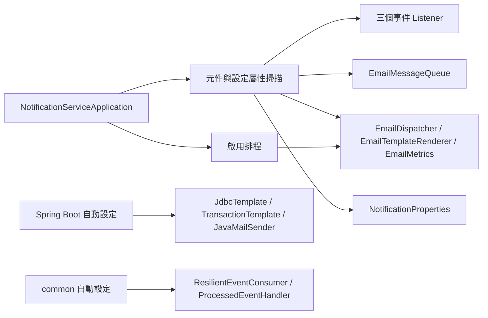
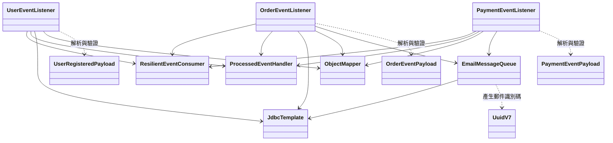
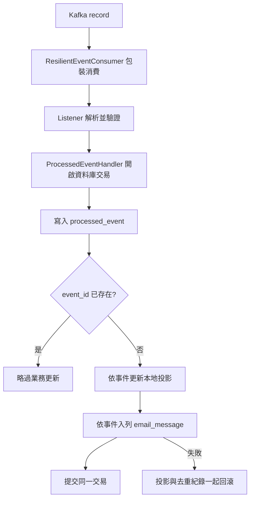
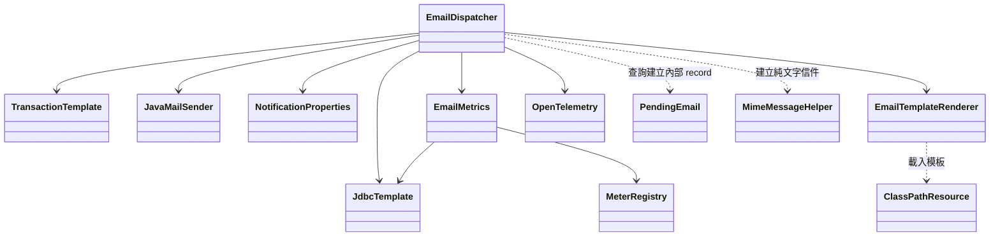
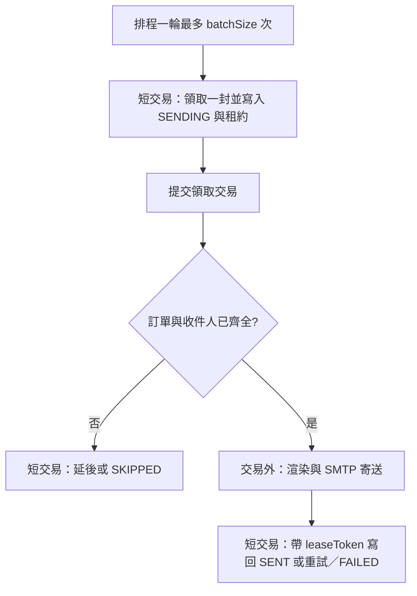
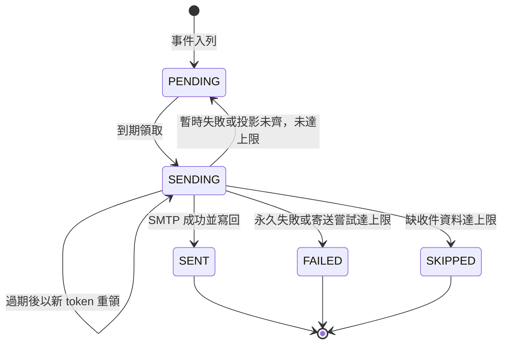

# spring-notification-service 類別關係圖與職責說明

核對日期：2026-11-13。涵蓋 12 個 Java 主程式來源檔、三個內部 record、五個 migration、五份信件模板、application.yml 與 Maven 設定，共 24 個主程式／資源／設定檔。

通知服務消費使用者、訂單與付款事件，以 JDBC 保存本地投影及待寄郵件，再由排程透過 SMTP 寄送。模組雖依賴 JPA 與 Web MVC starter，目前沒有自訂 Entity、Repository 或業務 Controller；表之間的查詢關係也不是 Java 物件關聯。

先讀[事件契約](../architecture/event-contracts.md)，共用消費與去重機制見 [common 導讀](common.md)，遙測接線見 [observability 導讀](observability.md)。

## 啟動與建立方式

這是 Spring 建立與排程的概念圖，方框中的集合名稱不是額外的自訂類別。除設定 record 外，服務元件均由 `@Component` 與建構子注入建立；Kafka container 呼叫 Listener，排程器呼叫 Dispatcher。

| 類別／設定 | 職責與閱讀重點 |
|---|---|
| [NotificationServiceApplication](../../backend/spring-notification-service/src/main/java/com/mymicroservice/notification/NotificationServiceApplication.java) | Boot 入口，啟用設定屬性掃描與排程；不在啟動方法內執行寄信。 |
| [NotificationProperties](../../backend/spring-notification-service/src/main/java/com/mymicroservice/notification/config/NotificationProperties.java) | 綁定 `notification`；內部 `Mail` 保存寄件人，`Dispatch` 保存批次、重試與逾時設定。補上缺省值並複製 retryDelays 清單。 |
| [application.yml](../../backend/spring-notification-service/src/main/resources/application.yml) | port 8086、Kafka group `notification-service`、資料庫與 Flyway schema、SMTP、四個排程執行緒、observability 匯入及 Actuator。SMTP 三種逾時由 `spring.mail.properties` 引用 notification 設定，不是自訂 MailSender 工廠。 |
| [pom.xml](../../backend/spring-notification-service/pom.xml) | common／observability、Kafka、JDBC 所需的 JPA starter、Flyway、Mail、Web MVC、Actuator 與測試依賴。Java 21；MailSender 等基礎設施由框架提供。 |

`Dispatch.interval` 有綁定欄位，但排程註解直接讀 `${notification.dispatch.interval:5s}`。預設每輪最多依序處理 10 封，每封各自領取，不會一次鎖住整批。排程執行緒數不代表單一 Dispatcher 會平行寄出 10 封。

## 事件消費與本地投影

圖中的共用類別與框架類別是協作者，不計入本模組 12 個來源檔。

| 類別 | 職責 |
|---|---|
| [UserEventListener](../../backend/spring-notification-service/src/main/java/com/mymicroservice/notification/messaging/UserEventListener.java) | 消費 `user.events` 的 `UserRegistered`；驗證版本、必要欄位、UUID、aggregate 與 userId 一致、姓名與 email 非空白，再 upsert `user_contact`。不寄註冊信。 |
| [UserRegisteredPayload](../../backend/spring-notification-service/src/main/java/com/mymicroservice/notification/messaging/UserRegisteredPayload.java) | 使用者 ID、email、displayName 的反序列化 record；本身沒有驗證或資料存取行為。 |
| [OrderEventListener](../../backend/spring-notification-service/src/main/java/com/mymicroservice/notification/messaging/OrderEventListener.java) | 消費 `order.events`；`OrderCreated` upsert `order_ref` 並入列；付款、出貨、取消事件直接入列對應模板。aggregateId 為訂單 ID；payload.orderId 若存在須相符。建立事件要求 userId 與非負金額。 |
| [OrderEventPayload](../../backend/spring-notification-service/src/main/java/com/mymicroservice/notification/messaging/OrderEventPayload.java) | orderId、userId、totalAmount、reason；欄位是否必要由不同事件分支決定。 |
| [PaymentEventListener](../../backend/spring-notification-service/src/main/java/com/mymicroservice/notification/messaging/PaymentEventListener.java) | 消費 `payment.events`，只將有效的 `PaymentFailed` 入列；驗證訂單 ID 一致、paymentId 非 null、非負金額與 `FAILED` 狀態。`PaymentSucceeded` 在完整 envelope 驗證前直接返回，不寫去重紀錄；成功通知由 `OrderPaid` 觸發。 |
| [PaymentEventPayload](../../backend/spring-notification-service/src/main/java/com/mymicroservice/notification/messaging/PaymentEventPayload.java) | paymentId、orderId、status、amount；付款失敗信使用此 amount，優先於訂單總額。 |
| [EmailMessageQueue](../../backend/spring-notification-service/src/main/java/com/mymicroservice/notification/messaging/EmailMessageQueue.java) | 以 UUIDv7 建立 `email_message`，保存 eventId、模板、orderId、可選 reason／amount；`ON CONFLICT (event_id,template) DO NOTHING`。不開自己的交易、不呼叫 SMTP。 |

| 事件 | 本地資料效果 | 模板 |
|---|---|---|
| UserRegistered | upsert user_contact | 無 |
| OrderCreated | upsert order_ref，加郵件 | order-created |
| OrderPaid | 加郵件 | order-paid |
| OrderShipped | 加郵件 | order-shipped |
| OrderCancelled | 加郵件並保存 reason | order-cancelled |
| PaymentFailed | 加郵件並保存付款 amount | payment-failed |
| PaymentSucceeded | 直接忽略 | 無 |

其餘事件類型或無效資料拋出 `IllegalArgumentException`。共用 Kafka 錯誤處理負責 DLT／重試，郵件重試則由 Dispatcher 的資料庫狀態管理，兩者是不同流程。

## 去重與交易邊界

流程中的投影／入列是依事件選擇執行，不是每種事件都做兩者。[ProcessedEventHandler](../../backend/common/src/main/java/com/mymicroservice/common/events/ProcessedEventHandler.java) 將去重寫入與 callback 放在同一 `TransactionTemplate` 中；Queue 使用同一資料來源的 JdbcTemplate 加入交易。郵件唯一鍵另外防止同 eventId／模板重複入列。

不同 topic 沒有跨 topic 的到達順序保證。付款或訂單後續事件可能先於 order_ref／user_contact 到達；領取郵件時以 LEFT JOIN 查本地投影，缺收件資料則延後處理，超過上限 SKIPPED。服務不會同步呼叫使用者或訂單服務補查，也不會在投影稍後補齊後自動重啟已 SKIPPED 的郵件。

## 寄送協作與租約

| 類別／內部型別 | 職責 |
|---|---|
| [EmailDispatcher](../../backend/spring-notification-service/src/main/java/com/mymicroservice/notification/mail/EmailDispatcher.java) | 排程領取、查收件資料、寄信、帶 token 寫回、分類失敗與安排重試；OpenTelemetry 由 provider 取得，沒有 bean 時使用 noop。 |
| `EmailDispatcher.PendingEmail` | 領取時的不可變快照，包含郵件、收件人、金額、attempts、投影解析結果與本次 leaseToken。不是 JPA Entity，也不是即時資料庫狀態。 |
| [EmailTemplateRenderer](../../backend/spring-notification-service/src/main/java/com/mymicroservice/notification/mail/EmailTemplateRenderer.java) | 固定主旨表與 classpath 純文字模板，以字串替換渲染；不執行模板運算。 |
| [EmailMetrics](../../backend/spring-notification-service/src/main/java/com/mymicroservice/notification/mail/EmailMetrics.java) | 結果 counter、SMTP timer，以及查詢資料庫的 PENDING 數量／最舊年齡 gauge。 |

領取 SQL 依 `created_at,id` 選取一封到期 PENDING 或租約已過期的 SENDING，使用 `FOR UPDATE SKIP LOCKED`，更新隨機 token 與固定兩分鐘 lease。多實例可領不同郵件；有效租約中的郵件不會被此查詢重新領取。沒有租約續期。

所有寫回都要求 `id`、`status='SENDING'` 與相同 token，防止舊工作者覆寫新租約。不過 SMTP 成功後若程序中斷、寫回失敗或寄送超過租約，仍可能再次寄出。固定 `Message-ID` 使用郵件 UUID，只提供穩定識別，無法保證收件端去重。結果 counter 也沒有依 SQL 更新列數判斷，因此不能當作精確的已提交寄送筆數。

## 狀態與重試

每次成功、缺收件資料或寄送失敗的處理均增加 attempts；共用同一計數，並非兩組獨立重試次數。缺投影預設第 5 次變 SKIPPED，原因為 `unknown_order` 或 `unknown_user`。暫時寄送失敗預設第 8 次變 FAILED；上限取 retryDelays 清單長度。

預設延遲清單為 10s、30s、1m、2m、5m、10m、30m、1h。重試索引取 `attempt-1` 並限制在清單範圍內；一般寄送失敗在第 8 次直接終止，因此不會再安排第八項 1h 的延遲。SENT／回到 PENDING 清除 lease 欄位，FAILED／SKIPPED 可保留租約資料，但終止狀態不再符合領取條件。

永久錯誤包括 MailAuthenticationException、MailParseException、MailPreparationException、AddressException、依簡名識別的 SMTPAddressFailedException，以及 SMTPSendFailedException 回應碼至少 500。分類會查看 cause、MessagingException 的 nextException 與 MailSendException 的 failedMessages；SMTP 實作類型只在執行期可見，因此以反射讀取回應碼。其他錯誤採暫時失敗處理。

## 模板、觀測與資料表

主旨固定為訂單已成立、付款成功、訂單已出貨、訂單已取消、付款失敗。內文替換 orderId、amount、reason，最後才放 name，避免名稱中的模板符號再次展開；名稱移除控制／格式字元並壓成單行，空值使用「顧客」。取消 reason 等於 `timeout` 時顯示「逾時未付款」，其他值顯示「已取消」。每次渲染重新讀取資源，使用 UTF-8 純文字寄送。

| 模板來源 | 對應事件 |
|---|---|
| [order-created.txt](../../backend/spring-notification-service/src/main/resources/templates/mail/order-created.txt) | OrderCreated |
| [order-paid.txt](../../backend/spring-notification-service/src/main/resources/templates/mail/order-paid.txt) | OrderPaid |
| [order-shipped.txt](../../backend/spring-notification-service/src/main/resources/templates/mail/order-shipped.txt) | OrderShipped |
| [order-cancelled.txt](../../backend/spring-notification-service/src/main/resources/templates/mail/order-cancelled.txt) | OrderCancelled |
| [payment-failed.txt](../../backend/spring-notification-service/src/main/resources/templates/mail/payment-failed.txt) | PaymentFailed |

`notification.email.send` span 包住渲染與 SMTP，附 template 屬性並記錄例外；同一範圍計入 `notification.email.send.duration`。`notification.emails` 以 template／result 分類。兩個 gauge 只查 PENDING，包含尚未到重試時間的郵件，不包含 SENDING，也不等於所有未完成工作。寄送排程不會從 email_message 還原原始事件的 trace context。

| Migration | 資料責任 |
|---|---|
| [V1](../../backend/spring-notification-service/src/main/resources/db/migration/V1__create_notification_tables.sql) | processed_event 去重、user_contact 收件人投影、order_ref 訂單投影、email_message 佇列與 eventId／template 唯一鍵。表間沒有宣告外鍵。 |
| [V2](../../backend/spring-notification-service/src/main/resources/db/migration/V2__create_outbox_event.sql) | 建立共用 outbox 表與索引。通知的 Listener／Queue 沒有寫入 outbox；email_message 由 SMTP Dispatcher 消費，兩張表用途不同。 |
| [V3](../../backend/spring-notification-service/src/main/resources/db/migration/V3__add_email_message_reason.sql) | email_message 增加 reason 與 amount。 |
| [V4](../../backend/spring-notification-service/src/main/resources/db/migration/V4__optimize_event_indexes_and_cleanup.sql) | outbox sequence 索引、processed_event 時間 BRIN 索引與 shedlock 表。 |
| [V5](../../backend/spring-notification-service/src/main/resources/db/migration/V5__lease_email_dispatch.sql) | 加入 SENDING、lease_until、lease_token 及 SENDING 租約索引。 |

共用事件自動設定提供 outbox relay、去重清理與消費基礎設施；此模組設定去重保留 14 天與 `notification_service.shedlock`。郵件 Dispatcher 沒有使用 ShedLock 註解，其並行協調依靠資料庫列鎖與租約。去重紀錄清理後不再提供永久 eventId 去重；郵件入列仍受保留中的郵件唯一鍵約束。

## 建議閱讀順序與測試對照

先從 OrderEventListener 看入列，再讀 EmailMessageQueue、EmailDispatcher 的 claim／dispatch／retry 分支，最後對照 Renderer、Properties 與 migration。只查使用者資料同步時，從 UserEventListener 開始即可。

| 測試來源 | 可對照的實作行為 |
|---|---|
| [UserEventIntegrationTests](../../backend/spring-notification-service/src/test/java/com/mymicroservice/notification/messaging/UserEventIntegrationTests.java) | 同事件去重、後續註冊事件更新資料、無效欄位送 DLT。 |
| [NotificationEmailIntegrationTests](../../backend/spring-notification-service/src/test/java/com/mymicroservice/notification/messaging/NotificationEmailIntegrationTests.java) | 五種模板、事件去重、雙實例領取、缺投影終止、暫時失敗上限、過期租約回收、SMTP 在交易外執行。 |
| [EmailDispatcherFailureClassificationTests](../../backend/spring-notification-service/src/test/java/com/mymicroservice/notification/mail/EmailDispatcherFailureClassificationTests.java) | SMTP 5xx／4xx 與無效地址的失敗分類。 |
| [TestcontainersConfiguration](../../backend/spring-notification-service/src/test/java/com/mymicroservice/notification/messaging/TestcontainersConfiguration.java) | 測試 PostgreSQL 連線設定；測試容器與啟動流程詳見各整合測試。 |

本次僅更新文件並靜態核對來源、相對連結、編碼與 Mermaid 區塊結構；未重新執行服務測試或渲染 Mermaid。測試名稱是閱讀入口，不代表本次重新驗收通過。
