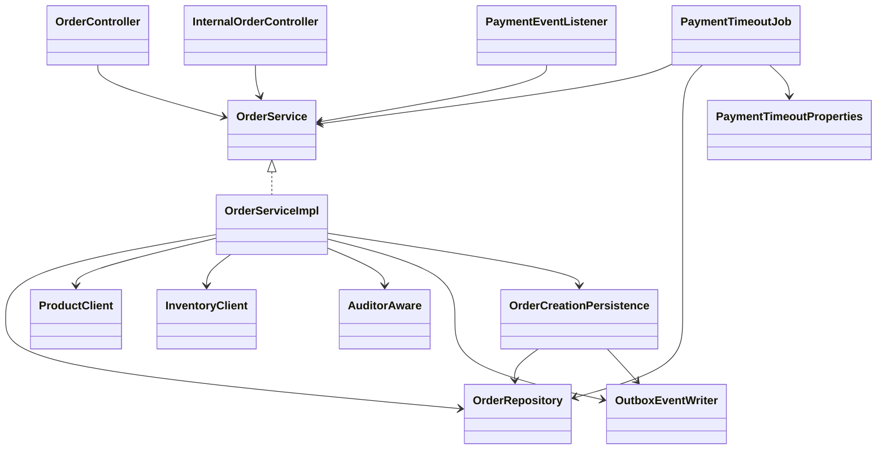
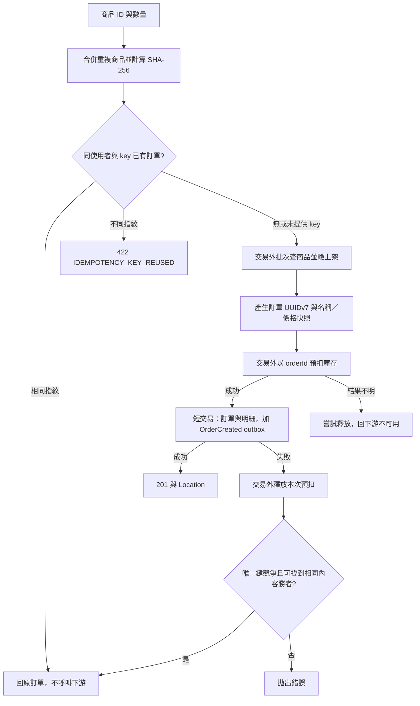
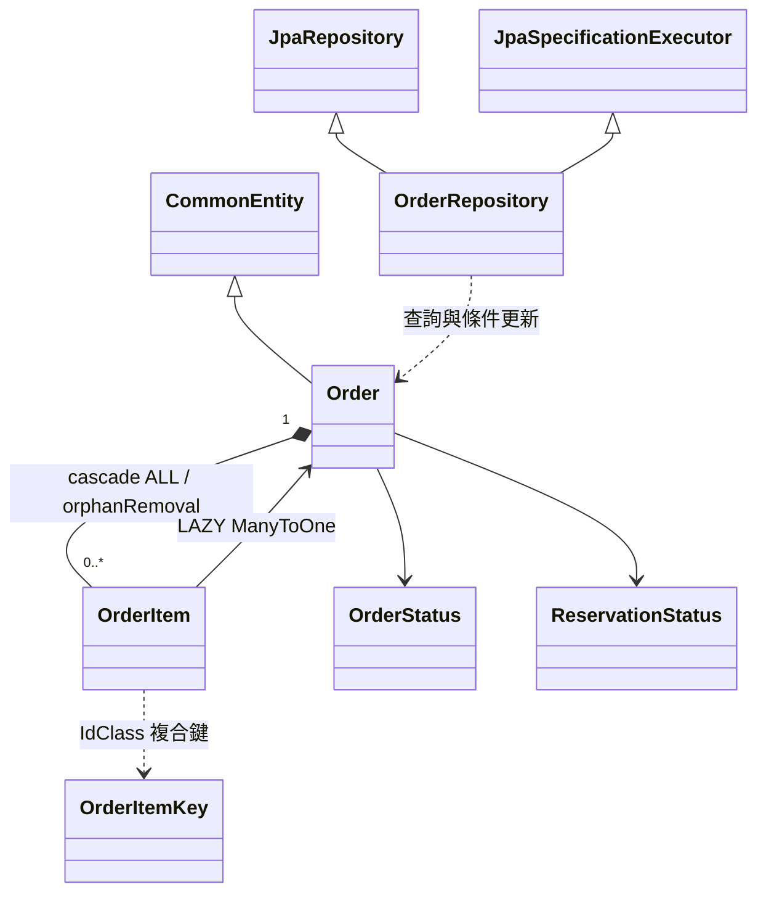
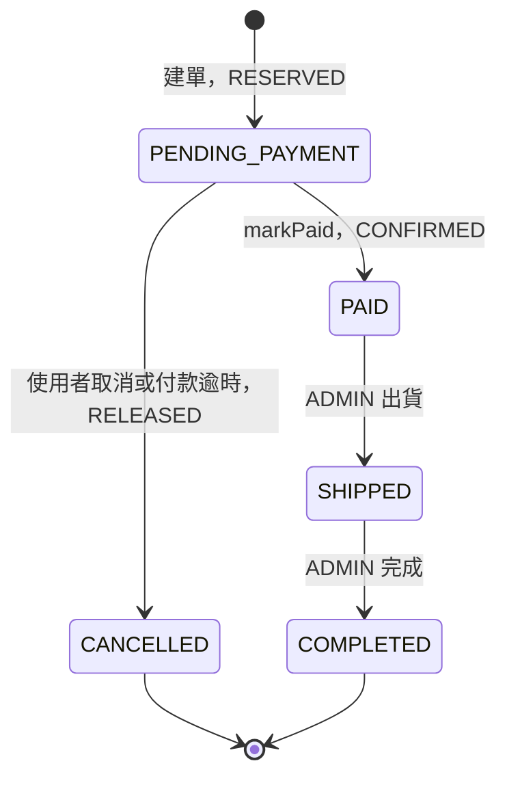
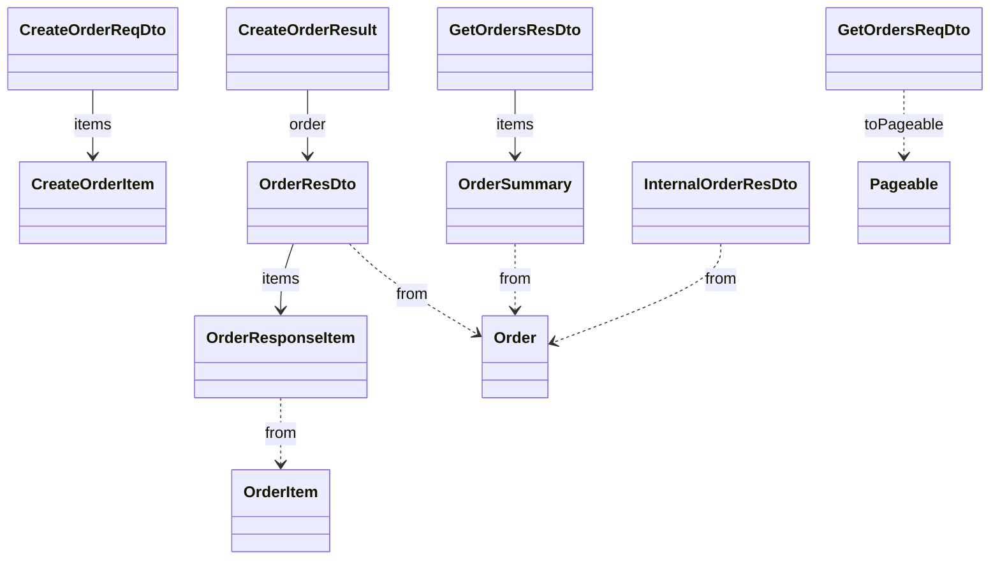
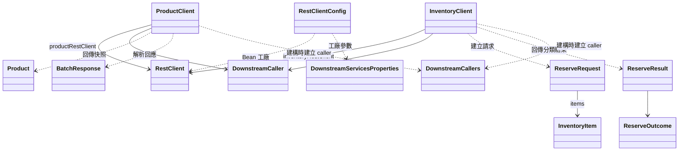
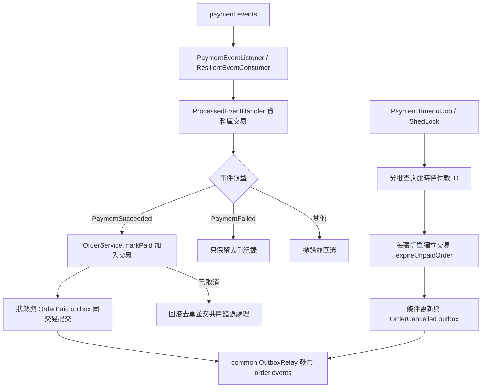

# spring-order-service 類別關係圖與職責說明

核對日期：2026-11-13。涵蓋 28 個 Java 主程式來源檔、九個內部 record、一個內部 enum、九個 migration、application.yml 與 Maven 設定，共 39 個主程式／資源／設定檔。

訂單服務負責商品快照、訂單金額、訂單狀態與付款期限。建單同步呼叫商品與庫存服務；付款、取消及出貨在本地交易中保存狀態與 outbox，再由共用 relay 發布事件。庫存的確認／釋放由庫存服務消費訂單事件處理，訂單的 reservationStatus 表示期望狀態，不能當成遠端已完成同步的證明。

跨服務契約見[事件契約](../architecture/event-contracts.md)，共用身分、交易事件與下游保護見 [common 導讀](common.md)，庫存端行為見[庫存服務導讀](spring-inventory-service.md)。

## 入口與應用服務

Spring 掃描 Controller、Service、Component 與 Configuration，以建構子注入建立元件；OrderRepository 實作由 Spring Data 產生。框架與 common 型別僅作協作背景，不算本模組來源檔。

| 來源 | 職責與界線 |
|---|---|
| [OrderServiceApplication](../../backend/spring-order-service/src/main/java/com/mymicroservice/order/OrderServiceApplication.java) | Boot 與設定屬性掃描入口，匯入 RequireRolesGuard，避免角色攔截器缺席時默默放行。 |
| [OrderController](../../backend/spring-order-service/src/main/java/com/mymicroservice/order/controller/OrderController.java) | `/api/v1/orders` 建單、列表、詳情、取消、出貨、完成；轉接身分、角色、驗證與 HTTP 回應，不管理交易。 |
| [InternalOrderController](../../backend/spring-order-service/src/main/java/com/mymicroservice/order/controller/InternalOrderController.java) | `/internal/v1/orders/{id}` 查詢與 `/{id}/paid` 通知；不驗擁有者，依賴內部路由與部署存取邊界。 |
| [OrderService](../../backend/spring-order-service/src/main/java/com/mymicroservice/order/service/OrderService.java) | HTTP、Kafka 與排程共用的業務介面。 |
| [OrderServiceImpl](../../backend/spring-order-service/src/main/java/com/mymicroservice/order/service/impl/OrderServiceImpl.java) | 建單協調、可見性、狀態轉移與事件寫入；查詢 readOnly，狀態修改各有交易，建單整體沒有外層交易。 |
| [OrderCreationPersistence](../../backend/spring-order-service/src/main/java/com/mymicroservice/order/service/impl/OrderCreationPersistence.java) | 獨立 Spring bean 的交易方法，`saveAndFlush` 訂單與明細，再 append OrderCreated。使建單 HTTP 呼叫留在交易外，並讓唯一鍵失敗在此交易結束後交由呼叫方處理。 |

服務信任 Gateway 的使用者 header，不自行驗 JWT。一般使用者只查／取消自己的訂單，其他人的 ID 回 404；ADMIN 可查全部並以 userId 篩選。出貨與完成使用 `@RequireRoles("ADMIN")`；擁有者限制則由 Service 執行。內部 Controller 的存在不等於自帶服務身分驗證。

## 建單、冪等與補償

沒帶 key 時仍計算指紋，但不存冪等欄位。指紋只涵蓋合併後、依商品 ID 排序的數量，與品項順序及下單後的商品價格變動無關。key 限 8–64 個英數字、`_`、`-`，唯一範圍為 `(user_id,idempotency_key)`。重播回 200 與 `Idempotent-Replayed: true`；首次成功回 201。

建單先查商品，拒絕不存在或非 ACTIVE 商品；金額由查回的價格乘數量，前端不能指定名稱或價格。庫存預扣後若資料庫儲存／outbox 寫入失敗，會釋放本次 orderId 的預扣。並行同 key 請求可能各自預扣不同 orderId，資料庫唯一索引決定勝者，敗者先補償再查勝者。

下游庫存結果分四種：RESERVED 繼續；OUT_OF_STOCK 回業務衝突；UNAVAILABLE 表示熔斷拒絕，不釋放；UNKNOWN 表示可能已預扣，嘗試釋放再回 503。補償失敗只記錄 log，後續依靠庫存逾時回收；這不是跨服務原子交易，程序在預扣後中斷也可能留下待回收預扣。

## Entity、Repository 與狀態

`OrderItemKey` 是圖中的別名，對應 `OrderItem.Key`。userId、productId 為跨服務識別碼，沒有映射 User 或 Product Entity。composition 表示明細跟隨訂單保存／移除；程式建單至少一項，圖的 `0..*` 則描述集合的型別關係。

| 來源 | 職責 |
|---|---|
| [Order](../../backend/spring-order-service/src/main/java/com/mymicroservice/order/entities/Order.java) | orders 聚合，繼承 CommonEntity 的版本與稽核欄位；保存使用者、狀態、金額、冪等欄位與各階段時間。addItem 同時設定雙向關聯，明細依 sku 排序。equals 以非 null ID 及 Hibernate 類型判斷。 |
| [OrderItem](../../backend/spring-order-service/src/main/java/com/mymicroservice/order/entities/OrderItem.java) | 商品名稱、SKU、單價、數量與小計快照；內部 `Key(UUID order, UUID productId)` 是可序列化複合主鍵，沒有獨立 version／稽核欄位。 |
| [OrderRepository](../../backend/spring-order-service/src/main/java/com/mymicroservice/order/repositories/OrderRepository.java) | JPA CRUD／Specification、帶明細查詢、冪等查詢、待付款逾時 ID 查詢與四種條件更新。EntityGraph 只用於詳情／重播，列表 DTO 不讀明細。 |
| [OrderStatus](../../backend/spring-order-service/src/main/java/com/mymicroservice/order/enums/OrderStatus.java) | 待付款、已付款、已出貨、已完成、已取消。 |
| [ReservationStatus](../../backend/spring-order-service/src/main/java/com/mymicroservice/order/enums/ReservationStatus.java) | RESERVED／CONFIRMED／RELEASED，表示庫存預扣應有的狀態；不暴露在公開詳情 DTO。 |
| [UuidV7](../../backend/spring-order-service/src/main/java/com/mymicroservice/order/support/UuidV7.java) | 此模組自己的靜態 ID 工具，在預扣前產生訂單 ID；毫秒時間戳加隨機位元，不承諾同毫秒內嚴格遞增。 |
| [OrderErrorCode](../../backend/spring-order-service/src/main/java/com/mymicroservice/order/exception/OrderErrorCode.java) | 實作 common ErrorCode，定義 404、409、422、503 等訂單錯誤，透過 AppException 交由共用錯誤處理輸出。 |

狀態轉移由 Repository 的 `UPDATE ... WHERE status=...` 執行，不靠先讀再寫。付款與取消競爭時只有符合原狀態的一方更新成功；bulk update 自行增加 version 與設定 updatedAt／updatedBy，並 flush／clear persistence context，後續重新讀取結果。

重複取消已 CANCELLED、重複出貨已 SHIPPED、重複完成已 COMPLETED 都成功返回；對其他不允許狀態回 409。markPaid 在 PAID／SHIPPED／COMPLETED 返回目前狀態且不再寫 OrderPaid，CANCELLED 則拒絕；expireUnpaidOrder 更新不到資料時回 false。沒有自動把取消訂單恢復付款的轉移，也沒有退款實作。

| 成功轉移／操作 | 同交易寫入的 order.events |
|---|---|
| 建單 | OrderCreated：userId、totalAmount，aggregateId 為訂單 ID |
| 待付款 → 已付款 | OrderPaid：orderId |
| 使用者取消 | OrderCancelled：orderId |
| 付款逾時取消 | OrderCancelled：orderId、reason=timeout |
| 出貨 | OrderShipped：orderId |
| 完成 | 無 OrderCompleted 事件 |

## HTTP 資料型別

圖中的 CreateOrderItem、OrderResponseItem、OrderSummary 分別是三個 DTO 內部 `Item` record 的別名；DTO 的 from 是靜態轉換，不是對 Entity 的持有關係。

| 來源 | 職責與內部型別 |
|---|---|
| [CreateOrderReqDto](../../backend/spring-order-service/src/main/java/com/mymicroservice/order/dtos/CreateOrderReqDto.java) | 非空、最多 50 筆；內部 Item 僅接受非 null productId 與 1–99 的整數 qty。重複商品在 Service 合併，此範圍是每筆輸入的限制。 |
| [CreateOrderResult](../../backend/spring-order-service/src/main/java/com/mymicroservice/order/dtos/CreateOrderResult.java) | 詳情加 created，供 Controller 區分 201 與冪等重播 200。 |
| [OrderResDto](../../backend/spring-order-service/src/main/java/com/mymicroservice/order/dtos/OrderResDto.java) | 公開詳情、狀態時間與內部 Item 快照，不含冪等指紋及 reservationStatus。 |
| [GetOrdersReqDto](../../backend/spring-order-service/src/main/java/com/mymicroservice/order/dtos/GetOrdersReqDto.java) | status／userId 篩選，page 預設 0、size 預設 20 且最多 100；固定 createdAt、id 降冪。一般使用者的 userId 篩選由 Service 覆蓋。 |
| [GetOrdersResDto](../../backend/spring-order-service/src/main/java/com/mymicroservice/order/dtos/GetOrdersResDto.java) | 分頁結果與內部 Item 摘要，不載入品項，避免列表逐單查明細。 |
| [InternalOrderResDto](../../backend/spring-order-service/src/main/java/com/mymicroservice/order/dtos/InternalOrderResDto.java) | 供付款服務使用的 ID、userId、狀態及總額；付款金額以此為準。 |

## 下游 Client 與設定

Product、BatchResponse 是 ProductClient 的內部 record；ReserveRequest、ReserveResult、InventoryItem（實際名 Item）與 ReserveOutcome 隸屬 InventoryClient。Clients 不依賴其他服務的 Java DTO。

| 來源 | 職責 |
|---|---|
| [ProductClient](../../backend/spring-order-service/src/main/java/com/mymicroservice/order/clients/ProductClient.java) | 批次 GET 商品，回傳內部 Product 清單；BatchResponse 包裝回應。Product.isActive 只接受 ACTIVE。空 body／products 視為空清單；連線、5xx 或熔斷轉 PRODUCT_SERVICE_UNAVAILABLE，非預期 4xx 交外層錯誤處理。 |
| [InventoryClient](../../backend/spring-order-service/src/main/java/com/mymicroservice/order/clients/InventoryClient.java) | 預扣結果分類、以 orderId 釋放／確認。庫存不足依 ProblemDetail.code 判斷；其他 4xx 拋出非預期錯誤。confirm 方法仍存在，但目前 OrderServiceImpl 的付款流程不呼叫它。 |
| [RestClientConfig](../../backend/spring-order-service/src/main/java/com/mymicroservice/order/configs/RestClientConfig.java) | 用 Boot builder.clone 建立兩個具名 RestClient，設定不同 base URL、JDK HTTP/1.1、連線與讀取逾時。 |
| [DownstreamServicesProperties](../../backend/spring-order-service/src/main/java/com/mymicroservice/order/properties/DownstreamServicesProperties.java) | 綁定 order.services 的 URI、逾時與共用 ResilienceProperties；商品／庫存 caller 各自命名與維護熔斷狀態。 |

下游呼叫走 common 的 callIdempotent，重試條件與熔斷細節由 common 管理。預設連線 2s、讀取 5s 是單次呼叫參數，不能把兩個服務的 read-timeout 相加當成包含所有重試的總請求時限。

## 付款事件與逾時排程

| 來源 | 職責 |
|---|---|
| [PaymentEventListener](../../backend/spring-order-service/src/main/java/com/mymicroservice/order/messaging/PaymentEventListener.java) | group order-service；用原始 EventEnvelope 解析 aggregateId 為 UUID。成功事件呼叫 markPaid，失敗事件只去重，其他類型拒絕；不像通知服務，這裡沒有逐欄驗證版本、時間與 payload。取消後收到付款會記錄人工退款檢視訊息並重拋，不會自動退款。 |
| [PaymentTimeoutJob](../../backend/spring-order-service/src/main/java/com/mymicroservice/order/jobs/PaymentTimeoutJob.java) | 固定 cutoff，反覆查第 0 頁最舊待付款 ID；逐單呼叫 Service，單筆例外記 log 後繼續，最後一批或整批無一處理成功時停止。run 沒有整批交易。 |
| [PaymentTimeoutProperties](../../backend/spring-order-service/src/main/java/com/mymicroservice/order/properties/PaymentTimeoutProperties.java) | cron、timeout、batchSize（1–1000）綁定與驗證；預設每分鐘、30 分鐘、100 筆。timeout 與庫存預扣期限的大小關係是設定約定，沒有跨服務自動驗證。 |
| [SchedulingConfig](../../backend/spring-order-service/src/main/java/com/mymicroservice/order/configs/SchedulingConfig.java) | 啟用排程；分散式 LockProvider 由 common 提供。 |
| [JpaAuditingConfig](../../backend/spring-order-service/src/main/java/com/mymicroservice/order/configs/JpaAuditingConfig.java) | 指定 common AuditorAware 供 JPA 稽核；bulk 狀態更新則由 Service 取得 auditor 並明確傳入。 |

PaymentTimeoutJob 使用 UTC cron 與名為 paymentTimeout 的 ShedLock，預設最多五分鐘、最少十秒。超過鎖期限仍可能與另一實例重疊，最終狀態正確性仍靠條件更新。取消只保存本地狀態與事件，不在此排程內同步呼叫庫存。

付款成功有 HTTP 與 Kafka 兩個入口，共用 markPaid；重複進入不重發 OrderPaid。Kafka 路徑的去重、訂單更新及 outbox 加入同一交易，失敗一起回滾，再由 common 的錯誤處理決定重試／DLT。去重紀錄預設保留 14 天，不是永久 eventId 保證；條件狀態轉移另提供業務上的冪等保護。

## 設定與資料演進

| 來源 | 對應責任 |
|---|---|
| [application.yml](../../backend/spring-order-service/src/main/resources/application.yml) | port 8082、下游位置、Kafka、observability 匯入、四個排程執行緒、order_service schema、付款期限及 ShedLock。OSIV 關閉、DDL validate、拒絕浮點數轉整數；springdoc 預設關閉。 |
| [pom.xml](../../backend/spring-order-service/pom.xml) | Java 21、common／observability、JPA、Flyway、RestClient、Validation、Web MVC、springdoc 與 WireMock／Testcontainers 等測試依賴。 |
| [V1](../../backend/spring-order-service/src/main/resources/db/migration/V1__create_order_tables.sql) | orders／order_item、外鍵、金額數量檢查、稽核欄位與列表／逾時索引；包含後續退役的 reservation_synced。 |
| [V2](../../backend/spring-order-service/src/main/resources/db/migration/V2__add_order_shipped_at.sql) | 增加 shipped_at。 |
| [V3](../../backend/spring-order-service/src/main/resources/db/migration/V3__add_order_completed_at.sql) | 增加 completed_at。 |
| [V4](../../backend/spring-order-service/src/main/resources/db/migration/V4__add_order_idempotency.sql) | 冪等 key／hash 必須同為 null 或非 null，建立使用者範圍的部分唯一索引。 |
| [V5](../../backend/spring-order-service/src/main/resources/db/migration/V5__create_shedlock_table.sql) | 共用排程鎖表。 |
| [V6](../../backend/spring-order-service/src/main/resources/db/migration/V6__create_event_tables.sql) | outbox_event 與 processed_event。 |
| [V7](../../backend/spring-order-service/src/main/resources/db/migration/V7__order_outbox_by_sequence.sql) | outbox sequence_id 與未發布序號索引。 |
| [V8](../../backend/spring-order-service/src/main/resources/db/migration/V8__retire_reservation_sync.sql) | 把未同步的歷史 CONFIRMED／RELEASED 補為缺少的 OrderPaid／OrderCancelled，再移除 reservation_synced。 |
| [V9](../../backend/spring-order-service/src/main/resources/db/migration/V9__optimize_event_indexes_and_cleanup.sql) | outbox aggregate sequence 索引與 processed_event 時間 BRIN 索引。 |

V1 的舊同步欄位註解及 Repository 部分舊註解描述的是歷史方案；目前沒有 ReservationSyncJob、reservation_synced 欄位或訂單側同步重試流程。現況應以 V8 之後的 schema 與 Service 呼叫為準。

## 閱讀順序與測試對照

從 OrderController → OrderServiceImpl.createOrder → Clients → OrderCreationPersistence 開始；接著看 Repository 條件更新、PaymentEventListener 與 PaymentTimeoutJob，最後對照 migration。以下連結是現有測試的閱讀入口，不代表本次重新執行通過。

| 測試 | 可對照行為 |
|---|---|
| [Create](../../backend/spring-order-service/src/test/java/com/mymicroservice/order/controller/OrderControllerCreateIntegrationTests.java) | 建單、驗證、快照與預扣。 |
| [Idempotency](../../backend/spring-order-service/src/test/java/com/mymicroservice/order/controller/OrderControllerCreateIdempotencyIntegrationTests.java) | key 重播、內容衝突與並行競爭。 |
| [Resilience](../../backend/spring-order-service/src/test/java/com/mymicroservice/order/controller/OrderControllerCreateResilienceIntegrationTests.java) | 下游錯誤、重試與熔斷。 |
| [Get](../../backend/spring-order-service/src/test/java/com/mymicroservice/order/controller/OrderControllerGetIntegrationTests.java)、[List](../../backend/spring-order-service/src/test/java/com/mymicroservice/order/controller/OrderControllerListIntegrationTests.java) | 擁有者、管理員與分頁。 |
| [Cancel](../../backend/spring-order-service/src/test/java/com/mymicroservice/order/controller/OrderControllerCancelIntegrationTests.java)、[Ship](../../backend/spring-order-service/src/test/java/com/mymicroservice/order/controller/OrderControllerShipIntegrationTests.java)、[Complete](../../backend/spring-order-service/src/test/java/com/mymicroservice/order/controller/OrderControllerCompleteIntegrationTests.java) | 轉移條件、權限與重複操作。 |
| [Internal get](../../backend/spring-order-service/src/test/java/com/mymicroservice/order/controller/InternalOrderGetIntegrationTests.java)、[Internal paid](../../backend/spring-order-service/src/test/java/com/mymicroservice/order/controller/InternalOrderPaidIntegrationTests.java) | 內部查詢及付款通知。 |
| [Payment events](../../backend/spring-order-service/src/test/java/com/mymicroservice/order/PaymentEventIntegrationTests.java) | 去重、取消後付款回滾、取消／逾時事件。 |
| [Jobs](../../backend/spring-order-service/src/test/java/com/mymicroservice/order/jobs/OrderJobsIntegrationTests.java)、[Scheduler lock](../../backend/spring-order-service/src/test/java/com/mymicroservice/order/jobs/SchedulerLockIntegrationTests.java) | 逾時取消與排程鎖。 |
| [Retire reservation sync](../../backend/spring-order-service/src/test/java/com/mymicroservice/order/RetireReservationSyncMigrationTests.java) | 歷史同步狀態轉 outbox 並避免重複補事件。 |

本次僅更新文件，靜態核對所有主程式／設定來源、相對連結、UTF-8 無 BOM 與 Mermaid 區塊結構；未重新執行服務測試或渲染 Mermaid。
