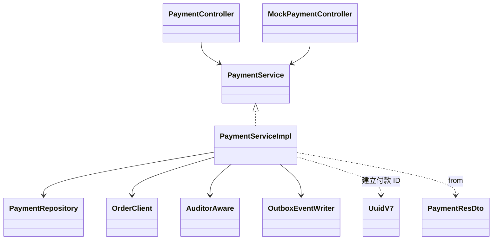
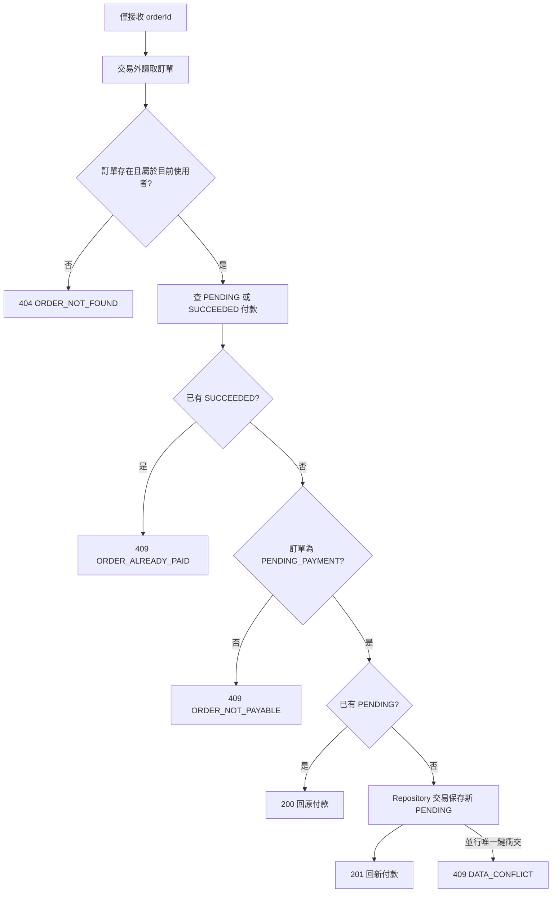
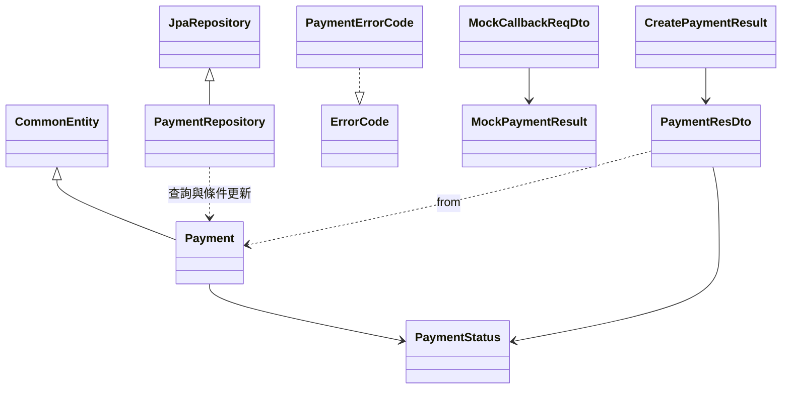
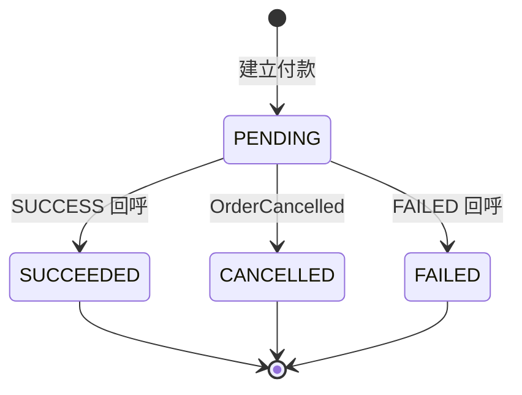
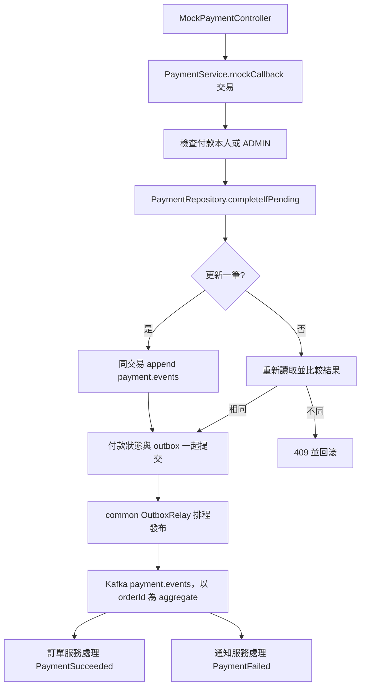
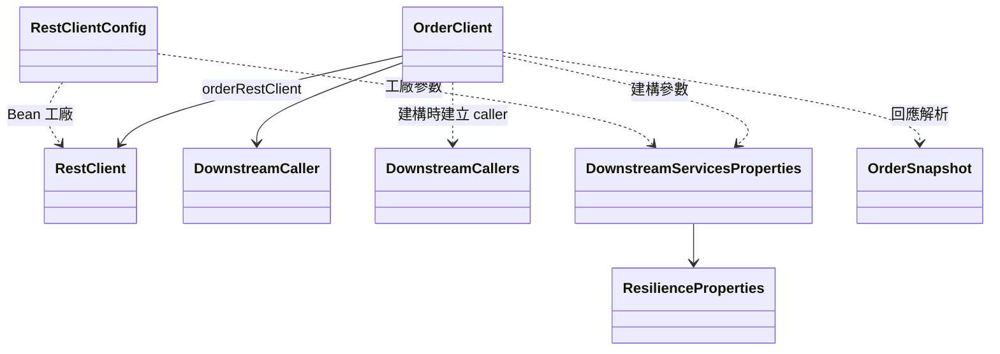

# spring-payment-service 類別關係圖與職責說明

核對日期：2026-11-13。涵蓋 20 個 Java 主程式來源檔、一個內部 record、八個 migration、application.yml 與 Maven 設定，共 30 個主程式／資源／設定檔。

付款服務保存付款金額與結果。建立付款時同步讀訂單，模擬回呼則在本地交易中更新付款並寫入 outbox，由 common relay 發布 payment.events。訂單服務消費成功事件後更新訂單；付款 SUCCEEDED 不代表訂單已經 PAID，也不代表庫存已確認。此模組目前沒有真實金流 API、回呼簽章驗證或自動退款實作。

跨服務格式見[事件契約](../architecture/event-contracts.md)，共用身分／錯誤／outbox／下游保護見 [common 導讀](common.md)，接收端見[訂單服務導讀](spring-order-service.md)，付款失敗信見[通知服務導讀](spring-notification-service.md)。

## 入口與建立方式

除介面、enum、Entity 與 DTO 外，應用元件由 Spring 元件掃描與建構子注入建立。PaymentRepository 由 Spring Data 提供實作；AuditorAware、OutboxEventWriter、UuidV7 屬於 common，未計入本模組 20 個來源檔。

| 來源 | 職責與界線 |
|---|---|
| [PaymentServiceApplication](../../backend/spring-payment-service/src/main/java/com/mymicroservice/payment/PaymentServiceApplication.java) | Boot、設定屬性掃描及 RequireRolesGuard 匯入；共用角色基礎設施缺席時啟動失敗。 |
| [PaymentController](../../backend/spring-payment-service/src/main/java/com/mymicroservice/payment/controller/PaymentController.java) | `/api/v1/payments` 建立付款、`/{id}` 查詢；新建回 201 與 Location，沿用待付款回 200。 |
| [MockPaymentController](../../backend/spring-payment-service/src/main/java/com/mymicroservice/payment/controller/MockPaymentController.java) | `/{id}/mock-callback` 模擬結果；只有 `payment.mock-callback.enabled=true` 才註冊，啟動時記警告。預設路徑不存在；這個開關限制 Controller 註冊，不會移除 Service 方法。 |
| [PaymentService](../../backend/spring-payment-service/src/main/java/com/mymicroservice/payment/service/PaymentService.java) | 建立、查詢與模擬回呼的應用介面。 |
| [PaymentServiceImpl](../../backend/spring-payment-service/src/main/java/com/mymicroservice/payment/service/impl/PaymentServiceImpl.java) | 驗訂單擁有者、沿用有效付款、保存金額、付款可見性與結果轉移；回呼交易內寫事件，不同步通知訂單。 |

服務信任 Gateway 的使用者 header，不自行驗 JWT。建立付款永遠要求訂單擁有者為目前使用者，ADMIN 沒有代付分支；查付款與模擬回呼允許本人或 ADMIN，其他人的付款回 404。模擬回呼讓使用者自行指定成功／失敗，是開發與示範能力，不能解讀為已完成真實收款。

## 建立付款與並行唯一性

建立付款整體沒有 `@Transactional`，避免查訂單期間持有付款資料庫交易。金額只取 OrderClient 回傳的 totalAmount；產生 UUIDv7 後呼叫 saveAndFlush，由 Repository 交易持久化。本流程沒有 PaymentCreated 事件，也沒有建立時呼叫第三方金流的步驟。

部分唯一索引限制每張訂單最多一筆 PENDING 或 SUCCEEDED。FAILED 不占有效付款名額，訂單仍待付款時可以另建付款。並行請求可能都先查不到有效付款，最終由索引擋下敗者；程式不在同一次請求內查勝者回傳，而是回共用資料衝突，之後重試才可取得既有 PENDING。

即使已有 PENDING，每次建立請求仍先查訂單；訂單服務不可用時不會直接回既有付款。訂單查詢與付款保存沒有跨服務鎖或原子性；查詢後訂單可能被取消，後續付款成功事件的衝突由訂單端處理。

## Entity、Repository 與狀態

| 來源 | 職責 |
|---|---|
| [Payment](../../backend/spring-payment-service/src/main/java/com/mymicroservice/payment/entities/Payment.java) | payment 表映射，繼承 CommonEntity 的 version／稽核欄位；保存 orderId、userId、amount、status、completedAt。orderId／userId 為識別碼，沒有跨服務 JPA 關聯。equals 以非 null ID 與 Hibernate 類型判斷。 |
| [PaymentRepository](../../backend/spring-payment-service/src/main/java/com/mymicroservice/payment/repositories/PaymentRepository.java) | 查有效付款、cancelPendingByOrderId 與 completeIfPending；後者以 `WHERE status=PENDING` 控制競爭，自行增加 version、寫入時間及 auditor，flush 並 clear persistence context。 |
| [PaymentStatus](../../backend/spring-payment-service/src/main/java/com/mymicroservice/payment/enums/PaymentStatus.java) | PENDING／SUCCEEDED／FAILED／CANCELLED；後三者為終態。 |
| [MockPaymentResult](../../backend/spring-payment-service/src/main/java/com/mymicroservice/payment/enums/MockPaymentResult.java) | 回呼輸入 SUCCESS／FAILED；SUCCESS 映射成付款 SUCCEEDED。 |
| [PaymentErrorCode](../../backend/spring-payment-service/src/main/java/com/mymicroservice/payment/exception/PaymentErrorCode.java) | 實作 common ErrorCode；付款／訂單不可見回 404，狀態衝突回 409，下游不可用回 503。 |

回呼先驗付款可見性，再條件更新。更新成功才增加 payments.completed counter 並寫事件；更新不到時重新讀取，相同結果返回 200，不再寫事件，相反結果回 PAYMENT_ALREADY_COMPLETED。並行兩種結果只有一個可完成 PENDING。成功與失敗都設定 completedAt；沒有把 FAILED 改回 PENDING 的操作，重試付款是建立另一筆資料。

## 回呼交易與事件傳遞

| 事件 | aggregateId | payload |
|---|---|---|
| PaymentSucceeded | orderId | paymentId、orderId、status=SUCCEEDED、amount |
| PaymentFailed | orderId | paymentId、orderId、status=FAILED、amount |

Outbox 寫入失敗會回滾付款結果；counter 在提交前增加，不能視為精確的已提交交易數。HTTP 成功代表本地交易完成，Kafka 發布及下游處理仍可稍後發生；relay 重送與消費去重由 common／接收服務負責，不保證跨服務 exactly-once。

付款回呼不重新查訂單，也不受訂單服務當下可用性影響。若訂單已取消，付款仍可 SUCCEEDED；訂單端拒絕成功事件並進入錯誤處理／DLT，留下人工退款檢視訊息。付款端沒有通知結果欄位、回寫退款狀態或自動補救交易。付款成功信由訂單端產生的 OrderPaid 觸發，通知服務直接忽略 PaymentSucceeded。

[OrderEventListener](../../backend/spring-payment-service/src/main/java/com/mymicroservice/payment/messaging/OrderEventListener.java) 透過 ResilientEventConsumer 消費 order.events，只處理 OrderCancelled，其餘類型明確忽略。ProcessedEventHandler 將去重與 cancelPendingByOrderId 放在同一交易；只將 PENDING 改為 CANCELLED，補 completedAt、version 與系統稽核，不發事件。取消與回呼競爭時先提交者生效；CANCELLED 的任一回呼均回 409。ProcessedEventCleanup 透過 ShedLock 清除超過 14 天的去重紀錄；沒有付款逾時 Job，逾時仍由 order 發取消事件。

## DTO、下游 Client 與設定

OrderSnapshot 是圖中別名，實際型別為 OrderClient.Order，避免與訂單服務 Entity 混淆。

| 來源 | 職責 |
|---|---|
| [CreatePaymentReqDto](../../backend/spring-payment-service/src/main/java/com/mymicroservice/payment/dtos/CreatePaymentReqDto.java) | 僅接受非 null orderId，沒有前端金額欄位。 |
| [CreatePaymentResult](../../backend/spring-payment-service/src/main/java/com/mymicroservice/payment/dtos/CreatePaymentResult.java) | created 與 PaymentResDto，供 Controller 決定 201／200；created 不在 HTTP body 中。 |
| [MockCallbackReqDto](../../backend/spring-payment-service/src/main/java/com/mymicroservice/payment/dtos/MockCallbackReqDto.java) | 非 null MockPaymentResult；驗證由 Controller 的 @Valid 觸發。 |
| [PaymentResDto](../../backend/spring-payment-service/src/main/java/com/mymicroservice/payment/dtos/PaymentResDto.java) | ID、orderId、amount、status、createdAt、completedAt，靜態 from 轉換；不暴露 auditor 或 version。 |
| [OrderClient](../../backend/spring-payment-service/src/main/java/com/mymicroservice/payment/clients/OrderClient.java) | 以 callIdempotent GET `/internal/v1/orders/{id}`；404 或空 body 回 empty，連線／5xx／熔斷轉 ORDER_SERVICE_UNAVAILABLE，其他 4xx 重拋。內部 Order record 保存 id、userId、字串 status、totalAmount，只將 PENDING_PAYMENT 判為可付款。沒有 markPaid HTTP 呼叫。 |
| [RestClientConfig](../../backend/spring-payment-service/src/main/java/com/mymicroservice/payment/configs/RestClientConfig.java) | clone Boot builder 建立 orderRestClient，設定 base URL、JDK HTTP/1.1、連線與讀取逾時。 |
| [DownstreamServicesProperties](../../backend/spring-payment-service/src/main/java/com/mymicroservice/payment/properties/DownstreamServicesProperties.java) | 綁定 payment.services 的 orderUri、逾時與共用 ResilienceProperties，啟用設定驗證。 |
| [JpaAuditingConfig](../../backend/spring-payment-service/src/main/java/com/mymicroservice/payment/configs/JpaAuditingConfig.java) | 啟用 JPA 稽核並指定 common AuditorAware；bulk 更新由 Service 明確取得 auditor 傳入。 |
| [SchedulingConfig](../../backend/spring-payment-service/src/main/java/com/mymicroservice/payment/configs/SchedulingConfig.java) | 啟用 Spring 排程，沒有自訂通知重試 Job。 |

預設連線 2s、讀取 5s 是單次 HTTP 參數；common 可重試符合條件的冪等查詢，因此不能把 5s 當作整個 createPayment 的總時限。付款與訂單服務各自定義 DTO，不互相依賴 Entity 程式碼。

## 設定與 migration

| 來源 | 資料／設定責任 |
|---|---|
| [application.yml](../../backend/spring-payment-service/src/main/resources/application.yml) | port 8085、mock-callback 預設 false、訂單 URI／逾時、payment_service schema、Kafka、observability 匯入、四個排程執行緒與 ShedLock。OSIV 關閉、DDL validate、springdoc 預設關閉。 |
| [pom.xml](../../backend/spring-payment-service/pom.xml) | Java 21，common／observability、JPA、Flyway、RestClient、Validation、Web MVC、springdoc 與 WireMock／Testcontainers 等測試依賴。 |
| [V1](../../backend/spring-payment-service/src/main/resources/db/migration/V1__create_payment_table.sql) | payment、狀態／金額檢查與有效付款部分唯一索引；包含歷史 order_notification 欄位及索引。 |
| [V2](../../backend/spring-payment-service/src/main/resources/db/migration/V2__create_shedlock_table.sql) | payment_service.shedlock，供共用排程鎖使用。 |
| [V3](../../backend/spring-payment-service/src/main/resources/db/migration/V3__create_outbox_event.sql) | 建立 outbox_event 與發布索引。 |
| [V4](../../backend/spring-payment-service/src/main/resources/db/migration/V4__order_outbox_by_sequence.sql) | 加 sequence_id 與待發布序號索引。 |
| [V5](../../backend/spring-payment-service/src/main/resources/db/migration/V5__allow_event_notification_mode.sql) | 歷史過渡：order_notification 允許 NOT_REQUIRED。 |
| [V6](../../backend/spring-payment-service/src/main/resources/db/migration/V6__retire_order_notification.sql) | 把 SUCCEEDED 且通知 PENDING 的舊付款補為缺少的 PaymentSucceeded，以 payload.paymentId 判斷是否已存在，再移除 order_notification。 |
| [V7](../../backend/spring-payment-service/src/main/resources/db/migration/V7__optimize_event_indexes_and_cleanup.sql) | 將舊待發布索引改為 aggregate／sequence 索引；本檔沒有建立 processed_event 或其清理索引。 |

V1 與 Entity 註解提到的通知結果是歷史設計；現況沒有 order_notification、通知重試 Job 或通知成功／拒絕狀態。資料演進應讀到 V6，而非只看初始 schema。

## 閱讀順序與測試對照

先讀 PaymentController → PaymentServiceImpl.createPayment → OrderClient，再讀 mockCallback → PaymentRepository.completeIfPending → common OutboxEventWriter／OutboxRelay，最後對照 migration 退役流程。

| 測試 | 可對照行為 |
|---|---|
| [Create](../../backend/spring-payment-service/src/test/java/com/mymicroservice/payment/controller/PaymentControllerCreateIntegrationTests.java) | 訂單擁有者、付款金額、沿用待付款與建立限制。 |
| [Get](../../backend/spring-payment-service/src/test/java/com/mymicroservice/payment/controller/PaymentControllerGetIntegrationTests.java) | 本人／ADMIN 可見性與 404。 |
| [Mock callback](../../backend/spring-payment-service/src/test/java/com/mymicroservice/payment/controller/PaymentControllerMockCallbackIntegrationTests.java) | 成功／失敗、重送、衝突與回呼權限。 |
| [Disabled by default](../../backend/spring-payment-service/src/test/java/com/mymicroservice/payment/controller/MockCallbackDisabledByDefaultIntegrationTests.java) | 未啟用模擬回呼時的路由行為。 |
| [Order client resilience](../../backend/spring-payment-service/src/test/java/com/mymicroservice/payment/controller/PaymentOrderClientResilienceIntegrationTests.java) | 下游呼叫的重試與熔斷。 |
| [Payment outbox](../../backend/spring-payment-service/src/test/java/com/mymicroservice/payment/PaymentOutboxIntegrationTests.java) | 訂單不可用時仍提交付款與事件、相同回呼只寫一筆成功事件；這不是 Kafka 端到端送達測試。 |
| [Retire notification migration](../../backend/spring-payment-service/src/test/java/com/mymicroservice/payment/RetireOrderNotificationMigrationTests.java) | 舊通知 PENDING 轉事件、避免重複、移除舊欄位。 |

本次僅更新文件，靜態核對全部主程式／資源／設定來源、相對連結、UTF-8 無 BOM 與 Mermaid 區塊結構；未重新執行服務測試或渲染 Mermaid。上述測試是閱讀入口，不代表本次重新驗收通過。

[V8 migration](../../backend/spring-payment-service/src/main/resources/db/migration/V8__cancel_pending_payments.sql) 擴充狀態 CHECK，建立 processed_event 與時間索引；有效付款唯一索引不改。

[取消整合測試](../../backend/spring-payment-service/src/test/java/com/mymicroservice/payment/OrderCancellationIntegrationTests.java) 涵蓋重送、終態、不存在付款、其他事件忽略及取消後回呼 409、不寫 outbox。
