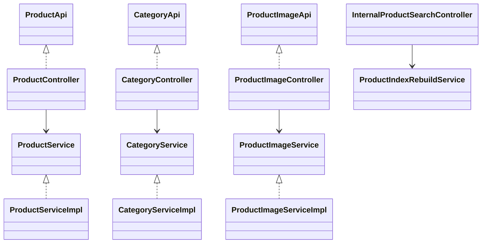
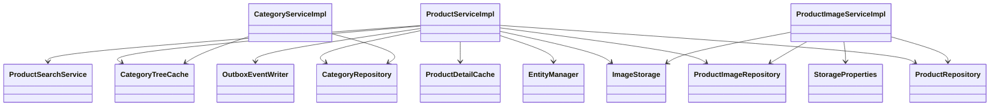
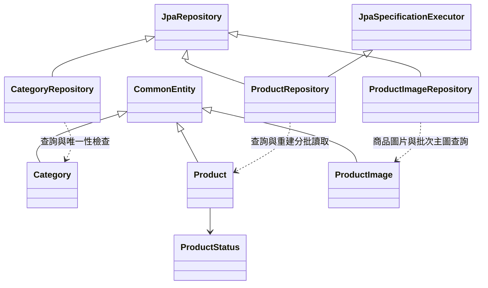
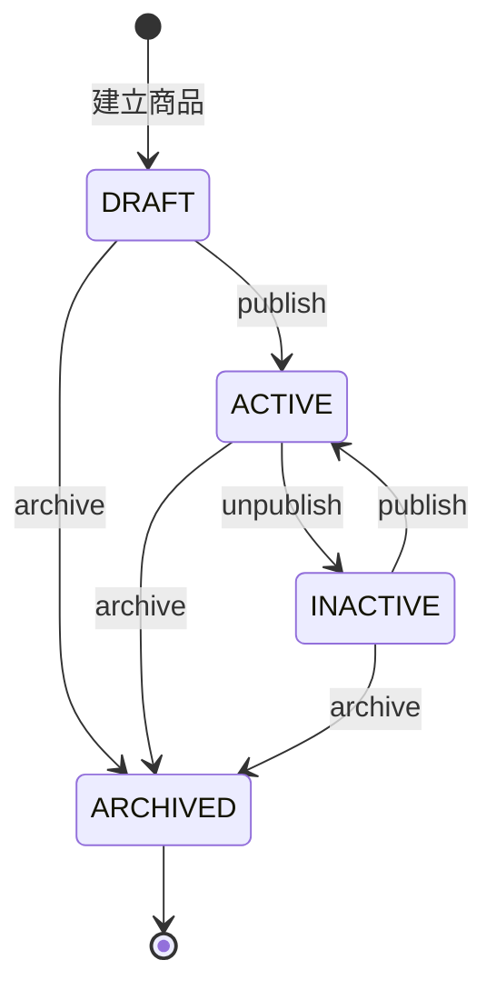
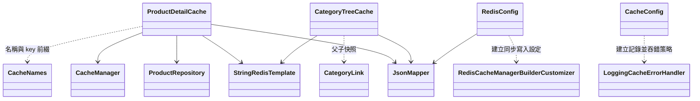
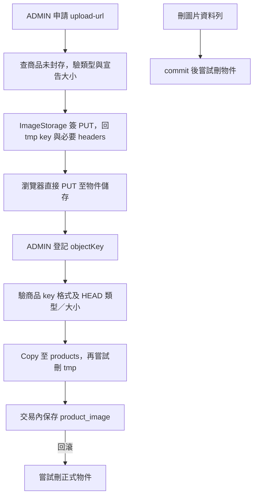
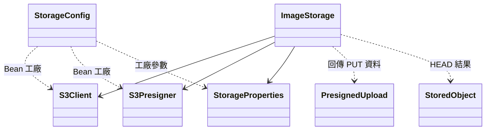
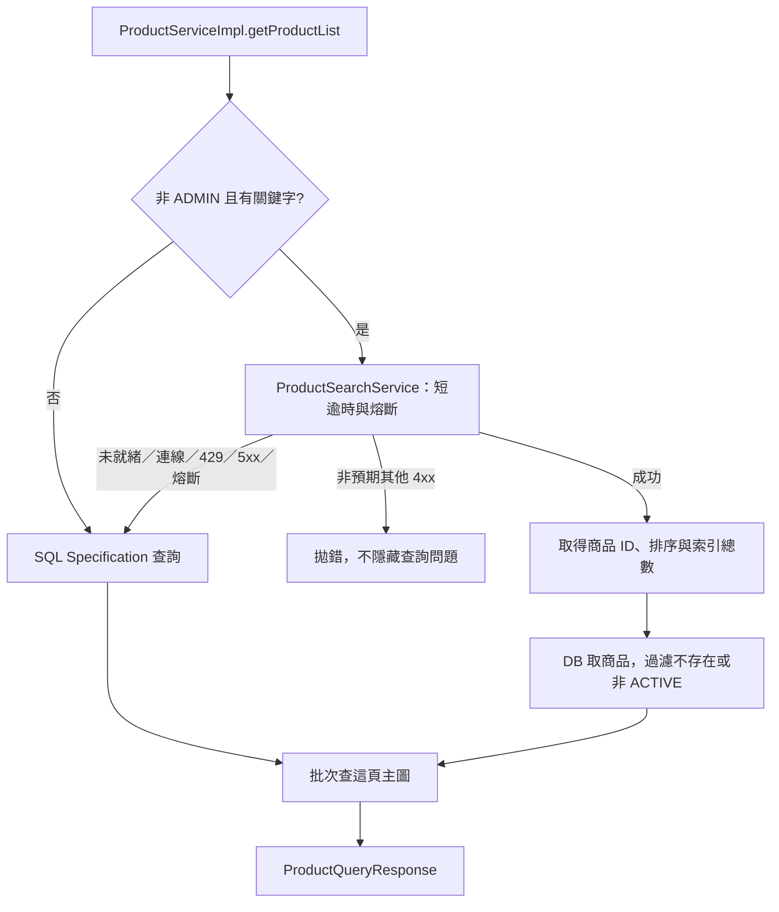
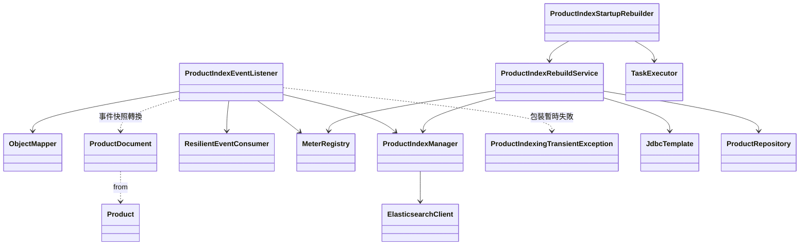
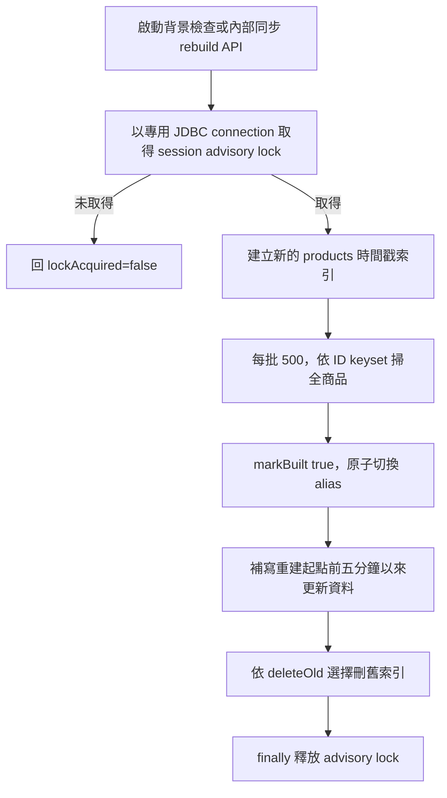

# spring-product-service 類別關係圖與職責說明

核對日期：2026-11-13。本文涵蓋 76 個 Java 主程式來源檔、八個 migration、YAML、搜尋 mapping 與 Maven 設定；共 87 個主程式／資源／設定檔，完整來源及職責對照列於文末。另包含五個內部 record 與一個內部例外類別。

商品服務管理分類、商品與圖片，PostgreSQL 保存業務資料，Redis 加速詳情與分類讀取，Elasticsearch 提供前台關鍵字搜尋，S3 相容儲存保存圖片。商品變更與 outbox 共用交易；快取失效、搜尋索引與物件儲存各有不同的一致性界線。

跨服務格式見[事件契約](../architecture/event-contracts.md)，共用身分、稽核、事件與熔斷見 [common 導讀](common.md)，追蹤接線見 [observability 導讀](observability.md)。

## HTTP 與應用層

API 介面放 OpenAPI 描述與參數驗證，Controller 放路由、綁定、角色與回應；實作 Controller 不重複宣告介面已有的驗證約束。三個 ServiceImpl 是 Spring Service，類別層級啟用交易，個別方法覆寫讀取或停用交易設定。Repositories 由 Spring Data 產生實作，DTO 與 Entity 不直接當作 Controller 的依賴元件。

公開商品與圖片讀取只讓一般訪客看到 ACTIVE，ADMIN 可看非上架商品。新增、修改、狀態切換與圖片管理要求 ADMIN，分類全部列表也要求 ADMIN；分類依 ID 查詢沒有只限啟用的篩選，slug 查詢與公開樹則只呈現啟用資料。服務信任 Gateway 的身分 header，不自行驗 JWT。內部搜尋重建端點依賴內部網路／路由邊界，沒有自訂身分驗證。

## 業務與持久層協作

ProductServiceImpl 負責商品快照寫入、版本檢查、狀態規則與列表路徑選擇；CategoryServiceImpl 驗證父分類、slug、同層名稱，向上走訪避免移到自己或子孫。分類樹依 sortOrder、name 排序，由啟用根節點向下組成，父分類停用時整個子樹不出現在公開樹中；後台平面列表不經公開樹快取。

更新商品／分類／圖片替代文字會先比對請求 version，並透過 CommonEntity 的 JPA 樂觀鎖保護競爭寫入。商品建立時 saveAndFlush 後 refresh，取得 PostgreSQL 微秒精度時間，再寫 ProductCreated 快照，避免事件與重建資料的時間精度不同。

三個 Entity 均以 Hibernate UUIDv7 產生 ID，繼承版本與稽核欄位。Category.parentId、Product.categoryId、ProductImage.productId 是 UUID 欄位，沒有 JPA ManyToOne／OneToMany 關聯；資料庫有分類自關聯、商品分類與圖片商品外鍵，不能把資料表關係畫成 Java 持有另一 Entity。圖片表的部分唯一索引限制每個商品最多一張主圖。

上架要求啟用分類與主圖；ACTIVE 修改不能清空分類，指定分類須啟用。封存後不能修改商品或管理圖片，沒有解除封存操作。重複上架、下架或封存不是成功重播，而是狀態錯誤。建立固定 DRAFT，不接受輸入 status。

建立、更新與切換狀態分別寫 ProductCreated、ProductUpdated、ProductStatusChanged，topic 為 product.events，aggregateId 為商品 ID。payload 包含 productId、sku、name、description、brand、createdAt、price、categoryId、status、version；沒有分類或圖片事件。狀態／商品與 outbox 同交易，Kafka 發布由 common relay 稍後執行。

## 快取讀取與失效

詳情以 ID 保存 GetProductByIdRes；SKU 快取只保存 ID，避免重複存整份詳情。可見性在取回完整快照後判斷，不能把特定使用者看不到的結果寫成全域查無資料。SKU 對照若與詳情不符，會刪對照再查一次。一般批次查詢對非 ACTIVE 商品保留 ID／status，隱藏 sku／name／price；不存在 ID 不在結果中，並非所有不可購買品項都直接省略。

單筆方法以 @Cacheable 與唯讀交易代理載入，Service 讀取方法使用 NOT_SUPPORTED。批次改用 MGET，缺項一次查 DB 後逐筆回填；負快取值解析成 null 時會視為未命中，批次路徑仍可能重查不存在 ID，不能宣稱與單筆負快取效果完全相同。

商品正快取 TTL 為 30 分鐘加 0–299 秒，null 為 90 秒；分類公開樹與含停用分類的父子 links 分別保存，TTL 為一小時加 0–299 秒。後者供子孫分類篩選，使用 visited set 防循環。CacheNames 統一 product 前綴與 v1 格式。

商品更新於 commit 後失效詳情；改 SKU 同時刪舊／新對照，建立時刪 SKU 負快取；分類變更後刪樹與 links。同步 Redis writer 讓操作返回前完成寫入／刪除，Redis 失敗記 log 並退 DB。這降低過期資料風險，但不是資料庫與 Redis 的原子提交；失效失敗、並行舊查詢回填仍可能造成短暫舊資料，TTL 是後續界線。圖片不放在商品詳情快取中，列表主圖由圖片表批次讀取。

## 圖片上傳、登記與刪除

StoredObject 是 ImageStorage 的內部 record。預設允許 JPEG／PNG／WebP、最大 5MB、簽名有效 10 分鐘；檔名副檔名由 contentType 決定。HEAD 檢查的是儲存端回報的 metadata 與長度，沒有解碼圖片或檢查檔案內容魔術碼。簽名網址使用瀏覽器可達的 uploadEndpoint，服務端 HEAD／Copy／Delete 使用 endpoint，公開 URL 由 publicBaseUrl 加 key 組成。

第一張圖片自動為主圖，後續追加 sortOrder。切主圖先取消舊主圖並 flush，再啟用新主圖，符合唯一索引；排序請求須包含全部圖片 ID 且不能重複。ACTIVE 的主圖不能直接刪，需先換主圖；altText 更新不更換 objectKey。

物件 Copy／Delete 不是資料庫交易的一部分，且登記流程會在交易中呼叫物件儲存。回滾刪正式物件、commit 後刪已移除圖片物件均屬盡力補償，失敗只記 log，沒有本模組自動對帳清理 Job。tmp 到期刪除與公開讀取權限依賴儲存端生命週期／policy 設定，不是 ImageStorage 自己排程實作；程序中斷仍可能留孤兒物件。

## 搜尋查詢與 SQL 退回

ProductSearchService 持有專用 searchQueryClient、ProductRepository、SearchProperties 與 CircuitBreaker；查詢不做重試，失敗直接退 SQL。索引須有 products alias、built=true 與符合 schemaVersion，readiness 預設快取五秒。ES 分頁 from+size 超過 10000 直接回 400，這項檢查在嘗試 ES 前執行，不會因 ES 不可用而繞過。

ES 依 SKU／名稱／品牌／描述加權搜尋；SQL fallback 只對名稱做跳脫萬用字元的 LIKE，因此相關性與匹配範圍不同。前台固定 ACTIVE，ADMIN 不走 ES，可依 status 查。分類條件可展開所有子孫（含停用分類），商品可見性另依商品狀態決定。

ES 只提供 ID、順序與總數，回應金額／內容取 DB，過期下架 hit 被剔除；不會補滿一頁，總數仍可能偏高。回填不重跑索引時的價格／分類／關鍵字條件，因此只能保證回應內容以 DB 為準，不能承諾延遲期間篩選與總數即時一致。

## 事件索引與重建

索引 Listener 的 group 為 product-service-search，使用專用 containerFactory，接受三種商品事件，檢查 productId 與 aggregateId、快照必要欄位、金額型別與非負商品 version；不是完整 EventEnvelope schema 驗證。它不寫 processed_event，而以商品 version 作 ES ExternalGte：同版本可覆寫，較舊版本 409 視為 stale_skipped。寫 alias 時 requireAlias，避免 alias 消失時自動建立同名索引。

IO、429、5xx 或索引／alias 缺失包為 ProductIndexingTransientException，專用錯誤處理持續指數退避（1s 起、最多 30s 間隔）；其他錯誤交 DLT。這與前台查詢的熔斷／SQL fallback 是不同策略。搜尋事件指標區分 indexed／stale_skipped；另記錄搜尋耗時、fallback、stale hits 及重建耗時／失敗／寫入量。

啟動 ApplicationReady 後預設提交背景工作，索引已就緒則跳過；執行器單執行緒、佇列容量一，背景失敗記 log，沒有持續自動重試迴圈。內部 API 同步執行 rebuild，deleteOld 預設 false。重建鎖是 PostgreSQL session advisory lock，不是 ShedLock，也不是整批 DB 交易；鎖連線會在重建期間持有，分批資料由 Repository 讀取。

alias 切換前失敗會嘗試刪新索引；切換後補寫失敗會嘗試標 built=false，讓查詢在 readiness 更新後退 SQL，沒有自動切回舊 alias。ExternalGte 保護事件與重建寫入的版本順序，但掃描、切換與補寫不是跨 DB／Kafka／ES 的原子快照。RebuildResult 的 scanned／supplemented 是處理筆數，可能重複同商品，不是唯一商品總數。

## DTO 分工與設定來源

DTO 以操作分資料夾，Req 負責驗證及 toEntity／applyTo，Res 的 from 負責轉換。商品列表用 ProductListItem、分類樹用遞迴 CategoryTreeNode、圖片清單用 ProductImageItem；不直接序列化 JPA Entity。ProductQueryRequest 預設 page=0、size=20（最多 100），限定排序欄位並驗證價格範圍；SQL 的 relevance 等同 createdAt，ES 預設相關性並以 ID 穩定排序。

CacheConfig 啟用快取並提供吞錯記錄策略，RedisConfig 設定型別序列化、即時寫入及斷線拒絕排隊；StorageConfig 建 S3Client／S3Presigner，SearchConfig 建兩個 ES client（primary 寫入／重建，具短逾時的具名查詢 client）。ES client 用自己的 Jackson 2 JSON mapper，與應用的 Jackson 3 區分。SearchProperties、StorageProperties 由各自設定類啟用綁定；JpaAuditingConfig 使用 common auditor，OpenApiConfig 只提供 API metadata。

mapping 使用 strict 欄位、smartcn 分析、SKU 小寫 normalizer、價格 scaled_float 及 built／schemaVersion metadata；執行環境須提供 smartcn analyzer。V1–V3 建分類／商品／圖片表；V4 將 URL 改 objectKey，刪除舊圖片並把有圖片的 ACTIVE 商品改 INACTIVE，屬歷史資料遷移，不是現行 API 行為。V5–V7 建 outbox、序號索引與 ShedLock 表，V8 優化列表索引。本模組沒有 processed_event 表，索引去重由 ES 版本處理。

## 完整來源與職責對照

下表逐一連結主程式、資源及設定；框架與 common 協作者不計入來源數。

### controller

| 來源 | 職責 |
|---|---|
| [CategoryApi](../../backend/spring-product-service/src/main/java/com/mymicroservice/product/controller/api/CategoryApi.java) | 分類 API 文件與參數驗證契約。 |
| [ProductApi](../../backend/spring-product-service/src/main/java/com/mymicroservice/product/controller/api/ProductApi.java) | 商品 API 文件與參數驗證契約。 |
| [ProductImageApi](../../backend/spring-product-service/src/main/java/com/mymicroservice/product/controller/api/ProductImageApi.java) | 圖片 API 文件與參數驗證契約。 |
| [CategoryController](../../backend/spring-product-service/src/main/java/com/mymicroservice/product/controller/CategoryController.java) | 分類路由；全部列表及寫入要求 ADMIN。 |
| [InternalProductSearchController](../../backend/spring-product-service/src/main/java/com/mymicroservice/product/controller/InternalProductSearchController.java) | 內部同步搜尋重建入口與 deleteOld 參數。 |
| [ProductController](../../backend/spring-product-service/src/main/java/com/mymicroservice/product/controller/ProductController.java) | 商品路由、ADMIN 寫入權限與讀取可見性轉接。 |
| [ProductImageController](../../backend/spring-product-service/src/main/java/com/mymicroservice/product/controller/ProductImageController.java) | 圖片管理、主圖、排序與上傳網址路由。 |

### service

| 來源 | 職責 |
|---|---|
| [CategoryService](../../backend/spring-product-service/src/main/java/com/mymicroservice/product/service/CategoryService.java) | 分類讀寫與樹狀查詢介面。 |
| [CategoryServiceImpl](../../backend/spring-product-service/src/main/java/com/mymicroservice/product/service/impl/CategoryServiceImpl.java) | 分類交易、父節點／唯一性／循環驗證與公開樹組裝。 |
| [ProductImageServiceImpl](../../backend/spring-product-service/src/main/java/com/mymicroservice/product/service/impl/ProductImageServiceImpl.java) | 圖片資料交易、上傳 metadata 驗證及物件補償。 |
| [ProductServiceImpl](../../backend/spring-product-service/src/main/java/com/mymicroservice/product/service/impl/ProductServiceImpl.java) | 商品交易、版本、可見性、快取失效、搜尋選路與事件快照。 |
| [ProductImageService](../../backend/spring-product-service/src/main/java/com/mymicroservice/product/service/ProductImageService.java) | 圖片登記、查詢、主圖、排序與簽名介面。 |
| [ProductService](../../backend/spring-product-service/src/main/java/com/mymicroservice/product/service/ProductService.java) | 商品讀寫、列表、批次與狀態操作介面。 |

### entity

| 來源 | 職責 |
|---|---|
| [Category](../../backend/spring-product-service/src/main/java/com/mymicroservice/product/entity/Category.java) | 分類 Entity，parentId 為 UUID 欄位。 |
| [Product](../../backend/spring-product-service/src/main/java/com/mymicroservice/product/entity/Product.java) | 商品 Entity、UUIDv7、快照欄位與狀態。 |
| [ProductImage](../../backend/spring-product-service/src/main/java/com/mymicroservice/product/entity/ProductImage.java) | 圖片 Entity，保存 productId、objectKey、主圖與順序。 |
| [ProductStatus](../../backend/spring-product-service/src/main/java/com/mymicroservice/product/entity/ProductStatus.java) | DRAFT／ACTIVE／INACTIVE／ARCHIVED。 |

### repository

| 來源 | 職責 |
|---|---|
| [CategoryRepository](../../backend/spring-product-service/src/main/java/com/mymicroservice/product/repository/CategoryRepository.java) | 分類 CRUD、啟用查詢及 slug／同層名稱檢查。 |
| [ProductImageRepository](../../backend/spring-product-service/src/main/java/com/mymicroservice/product/repository/ProductImageRepository.java) | 圖片 CRUD、商品範圍、主圖與列表批次主圖查詢。 |
| [ProductRepository](../../backend/spring-product-service/src/main/java/com/mymicroservice/product/repository/ProductRepository.java) | 商品 CRUD、Specification、SKU 與每批 500 筆 keyset 索引讀取。 |

### cache

| 來源 | 職責 |
|---|---|
| [CacheNames](../../backend/spring-product-service/src/main/java/com/mymicroservice/product/cache/CacheNames.java) | 快取名稱、版本前綴與 Redis key 工具。 |
| [CategoryTreeCache](../../backend/spring-product-service/src/main/java/com/mymicroservice/product/cache/CategoryTreeCache.java) | 公開樹與父子 links 快取；內部 CategoryLink record 保存 id／parentId。 |
| [ProductDetailCache](../../backend/spring-product-service/src/main/java/com/mymicroservice/product/cache/ProductDetailCache.java) | 單筆代理快取、SKU 對照、批次 MGET 與 commit 後失效。 |

### config

| 來源 | 職責 |
|---|---|
| [CacheConfig](../../backend/spring-product-service/src/main/java/com/mymicroservice/product/config/CacheConfig.java) | 啟用快取並提供 LoggingCacheErrorHandler。 |
| [JpaAuditingConfig](../../backend/spring-product-service/src/main/java/com/mymicroservice/product/config/JpaAuditingConfig.java) | 啟用 JPA auditing，引用 common AuditorAware。 |
| [OpenApiConfig](../../backend/spring-product-service/src/main/java/com/mymicroservice/product/config/OpenApiConfig.java) | 建立商品服務 OpenAPI metadata。 |
| [RedisConfig](../../backend/spring-product-service/src/main/java/com/mymicroservice/product/config/RedisConfig.java) | 型別序列化、TTL、同步寫入與斷線即失敗策略。 |
| [StorageConfig](../../backend/spring-product-service/src/main/java/com/mymicroservice/product/config/StorageConfig.java) | 建立 S3Client／S3Presigner、path-style 與相容儲存 checksum 設定。 |
| [StorageProperties](../../backend/spring-product-service/src/main/java/com/mymicroservice/product/config/StorageProperties.java) | 儲存端點、瀏覽器上傳端點、公開前綴、bucket、憑證與限制。 |

### storage

| 來源 | 職責 |
|---|---|
| [ImageStorage](../../backend/spring-product-service/src/main/java/com/mymicroservice/product/storage/ImageStorage.java) | S3 簽名、HEAD、Copy／Delete、公開 URL；內部 StoredObject 為 metadata 快照。 |
| [PresignedUpload](../../backend/spring-product-service/src/main/java/com/mymicroservice/product/storage/PresignedUpload.java) | objectKey、uploadUrl、必要 headers 與 expiresAt。 |

### search

| 來源 | 職責 |
|---|---|
| [ProductDocument](../../backend/spring-product-service/src/main/java/com/mymicroservice/product/search/ProductDocument.java) | 搜尋欄位快照，from(Product) 用於重建。 |
| [ProductIndexEventListener](../../backend/spring-product-service/src/main/java/com/mymicroservice/product/search/ProductIndexEventListener.java) | 消費商品快照、驗欄位並更新 ES，不使用 processed_event。 |
| [ProductIndexingTransientException](../../backend/spring-product-service/src/main/java/com/mymicroservice/product/search/ProductIndexingTransientException.java) | 標示索引 IO／暫時性 ES 失敗，供專用重試分類。 |
| [ProductIndexManager](../../backend/spring-product-service/src/main/java/com/mymicroservice/product/search/ProductIndexManager.java) | mapping 建立、alias 管理、ExternalGte 單筆／bulk 寫入與 built metadata。 |
| [ProductIndexRebuildService](../../backend/spring-product-service/src/main/java/com/mymicroservice/product/search/ProductIndexRebuildService.java) | advisory lock、keyset 掃描、alias 切換、補寫；內部 RebuildResult。 |
| [ProductIndexStartupRebuilder](../../backend/spring-product-service/src/main/java/com/mymicroservice/product/search/ProductIndexStartupRebuilder.java) | ApplicationReady 後背景檢查與必要重建。 |
| [ProductSearchKafkaConfig](../../backend/spring-product-service/src/main/java/com/mymicroservice/product/search/ProductSearchKafkaConfig.java) | 搜尋專用 Kafka container 與暫時錯誤持續退避策略。 |
| [ProductSearchRebuildConfiguration](../../backend/spring-product-service/src/main/java/com/mymicroservice/product/search/ProductSearchRebuildConfiguration.java) | 單執行緒背景重建 executor。 |
| [ProductSearchService](../../backend/spring-product-service/src/main/java/com/mymicroservice/product/search/ProductSearchService.java) | ES 查詢、readiness、熔斷與 DB 回填；內部 Hits／Readiness record 及 IndexNotReadyException。 |
| [SearchConfig](../../backend/spring-product-service/src/main/java/com/mymicroservice/product/search/SearchConfig.java) | primary ES client 與短逾時 searchQueryClient 工廠。 |
| [SearchProperties](../../backend/spring-product-service/src/main/java/com/mymicroservice/product/search/SearchProperties.java) | ES endpoint、查詢逾時、readiness TTL 與查詢熔斷設定。 |

### exception

| 來源 | 職責 |
|---|---|
| [ProductErrorCode](../../backend/spring-product-service/src/main/java/com/mymicroservice/product/exception/ProductErrorCode.java) | 實作 common ErrorCode，分類／商品／圖片／搜尋業務錯誤。 |

### dto

| 來源 | 職責 |
|---|---|
| [AddOneNewCategoryReq](../../backend/spring-product-service/src/main/java/com/mymicroservice/product/dto/category/addOneNewCategory/AddOneNewCategoryReq.java) | 分類新增驗證、預設值與 toEntity。 |
| [AddOneNewCategoryRes](../../backend/spring-product-service/src/main/java/com/mymicroservice/product/dto/category/addOneNewCategory/AddOneNewCategoryRes.java) | 分類新增結果、版本與建立時間。 |
| [CategoryListItem](../../backend/spring-product-service/src/main/java/com/mymicroservice/product/dto/category/getAllCategories/CategoryListItem.java) | 後台分類平面摘要，包含 active、parentId 與版本。 |
| [GetAllCategoriesRes](../../backend/spring-product-service/src/main/java/com/mymicroservice/product/dto/category/getAllCategories/GetAllCategoriesRes.java) | 包含停用分類的平面列表容器。 |
| [CategoryTreeNode](../../backend/spring-product-service/src/main/java/com/mymicroservice/product/dto/category/getCategoriesTree/CategoryTreeNode.java) | 公開分類節點與遞迴 children。 |
| [GetCategoriesTreeRes](../../backend/spring-product-service/src/main/java/com/mymicroservice/product/dto/category/getCategoriesTree/GetCategoriesTreeRes.java) | 公開分類樹 roots 容器。 |
| [GetCategoryByIdRes](../../backend/spring-product-service/src/main/java/com/mymicroservice/product/dto/category/getCategoryById/GetCategoryByIdRes.java) | 分類詳情與稽核時間、版本。 |
| [GetCategoryBySlugRes](../../backend/spring-product-service/src/main/java/com/mymicroservice/product/dto/category/getCategoryBySlug/GetCategoryBySlugRes.java) | 啟用分類的公開 slug 查詢結果。 |
| [UpdateOneCategoryReq](../../backend/spring-product-service/src/main/java/com/mymicroservice/product/dto/category/updateOneCategory/UpdateOneCategoryReq.java) | 完整替換分類欄位與 version 驗證，applyTo 不覆寫版本。 |
| [UpdateOneCategoryRes](../../backend/spring-product-service/src/main/java/com/mymicroservice/product/dto/category/updateOneCategory/UpdateOneCategoryRes.java) | flush 後分類欄位、新版本與時間。 |
| [AddOneNewProductReq](../../backend/spring-product-service/src/main/java/com/mymicroservice/product/dto/product/addOneNewProduct/AddOneNewProductReq.java) | 商品新增驗證、價格規則與 DRAFT toEntity。 |
| [AddOneNewProductRes](../../backend/spring-product-service/src/main/java/com/mymicroservice/product/dto/product/addOneNewProduct/AddOneNewProductRes.java) | 商品新增快照與版本。 |
| [ChangeProductStatusReq](../../backend/spring-product-service/src/main/java/com/mymicroservice/product/dto/product/changeProductStatus/ChangeProductStatusReq.java) | 僅攜帶 version，動作由路由指定。 |
| [ChangeProductStatusRes](../../backend/spring-product-service/src/main/java/com/mymicroservice/product/dto/product/changeProductStatus/ChangeProductStatusRes.java) | 商品狀態、新版本與更新時間。 |
| [GetProductByIdRes](../../backend/spring-product-service/src/main/java/com/mymicroservice/product/dto/product/getProductById/GetProductByIdRes.java) | 商品完整詳情，也是 ID 快取值。 |
| [GetProductBySkuRes](../../backend/spring-product-service/src/main/java/com/mymicroservice/product/dto/product/getProductBySku/GetProductBySkuRes.java) | 由完整詳情轉換的 SKU 查詢結果。 |
| [ProductListItem](../../backend/spring-product-service/src/main/java/com/mymicroservice/product/dto/product/getProductList/ProductListItem.java) | 列表摘要與主圖 URL。 |
| [ProductQueryRequest](../../backend/spring-product-service/src/main/java/com/mymicroservice/product/dto/product/getProductList/ProductQueryRequest.java) | 篩選、分頁、排序與價格範圍驗證。 |
| [ProductQueryResponse](../../backend/spring-product-service/src/main/java/com/mymicroservice/product/dto/product/getProductList/ProductQueryResponse.java) | 穩定的列表分頁格式與摘要轉換。 |
| [GetProductsByIdsRes](../../backend/spring-product-service/src/main/java/com/mymicroservice/product/dto/product/getProductsByIds/GetProductsByIdsRes.java) | 批次產品容器，從快取詳情套用可見性。 |
| [ProductBatchItem](../../backend/spring-product-service/src/main/java/com/mymicroservice/product/dto/product/getProductsByIds/ProductBatchItem.java) | 下單快照；非 ADMIN 查非 ACTIVE 時只保留 ID／status。 |
| [UpdateOneProductReq](../../backend/spring-product-service/src/main/java/com/mymicroservice/product/dto/product/updateOneProduct/UpdateOneProductReq.java) | 商品欄位完整替換、價格與版本驗證及 applyTo。 |
| [UpdateOneProductRes](../../backend/spring-product-service/src/main/java/com/mymicroservice/product/dto/product/updateOneProduct/UpdateOneProductRes.java) | flush 後商品詳情與新版本。 |
| [AddOneNewProductImageReq](../../backend/spring-product-service/src/main/java/com/mymicroservice/product/dto/productImage/addOneNewProductImage/AddOneNewProductImageReq.java) | 暫存 objectKey、altText，轉已升級物件的 Entity。 |
| [AddOneNewProductImageRes](../../backend/spring-product-service/src/main/java/com/mymicroservice/product/dto/productImage/addOneNewProductImage/AddOneNewProductImageRes.java) | 登記結果、公開 URL、排序、主圖與版本。 |
| [CreateUploadUrlReq](../../backend/spring-product-service/src/main/java/com/mymicroservice/product/dto/productImage/createUploadUrl/CreateUploadUrlReq.java) | 非空 contentType 與正值 contentLength。 |
| [CreateUploadUrlRes](../../backend/spring-product-service/src/main/java/com/mymicroservice/product/dto/productImage/createUploadUrl/CreateUploadUrlRes.java) | 由 PresignedUpload 轉換，供瀏覽器直接 PUT。 |
| [GetProductImagesRes](../../backend/spring-product-service/src/main/java/com/mymicroservice/product/dto/productImage/getProductImages/GetProductImagesRes.java) | 商品 ID 與依序圖片清單，主圖／重排也共用此回應。 |
| [ProductImageItem](../../backend/spring-product-service/src/main/java/com/mymicroservice/product/dto/productImage/getProductImages/ProductImageItem.java) | 圖片公開 URL、altText、順序、主圖與版本。 |
| [ReorderProductImagesReq](../../backend/spring-product-service/src/main/java/com/mymicroservice/product/dto/productImage/reorderProductImages/ReorderProductImagesReq.java) | 全部圖片 ID 的順序，驗非空與無重複。 |
| [UpdateOneProductImageReq](../../backend/spring-product-service/src/main/java/com/mymicroservice/product/dto/productImage/updateOneProductImage/UpdateOneProductImageReq.java) | 只修改 altText 並攜帶 version。 |
| [UpdateOneProductImageRes](../../backend/spring-product-service/src/main/java/com/mymicroservice/product/dto/productImage/updateOneProductImage/UpdateOneProductImageRes.java) | 圖片更新後資料、公開 URL、新版本與時間。 |

啟動入口：[ProductServiceApplication](../../backend/spring-product-service/src/main/java/com/mymicroservice/product/ProductServiceApplication.java)，Boot 入口，匯入共用角色攔截器 guard。

### 資源與建置

| 來源 | 職責 |
|---|---|
| [application.yml](../../backend/spring-product-service/src/main/resources/application.yml) | port 8081、DB／Redis／Kafka、observability 匯入、儲存與 API 文件開關。 |
| [V1__create_category_table.sql](../../backend/spring-product-service/src/main/resources/db/migration/V1__create_category_table.sql) | 分類表、自關聯 RESTRICT 與同層名稱唯一約束（含根節點）。 |
| [V2__create_product_table.sql](../../backend/spring-product-service/src/main/resources/db/migration/V2__create_product_table.sql) | 商品表、分類外鍵、SKU 唯一與價格檢查。 |
| [V3__create_product_image_table.sql](../../backend/spring-product-service/src/main/resources/db/migration/V3__create_product_image_table.sql) | 圖片表、商品 cascade 外鍵與單主圖部分唯一索引。 |
| [V4__product_image_object_key.sql](../../backend/spring-product-service/src/main/resources/db/migration/V4__product_image_object_key.sql) | 歷史 URL 圖片清除、商品下架及 objectKey 唯一約束。 |
| [V5__create_outbox_event.sql](../../backend/spring-product-service/src/main/resources/db/migration/V5__create_outbox_event.sql) | outbox 表與原始發布索引。 |
| [V6__order_outbox_by_sequence.sql](../../backend/spring-product-service/src/main/resources/db/migration/V6__order_outbox_by_sequence.sql) | outbox sequence_id 與待發布索引。 |
| [V7__optimize_event_indexes_and_cleanup.sql](../../backend/spring-product-service/src/main/resources/db/migration/V7__optimize_event_indexes_and_cleanup.sql) | aggregate sequence 索引與 shedlock 表。 |
| [V8__optimize_product_listing.sql](../../backend/spring-product-service/src/main/resources/db/migration/V8__optimize_product_listing.sql) | 依狀態／分類與建立時間的列表索引。 |
| [products-index.json](../../backend/spring-product-service/src/main/resources/search/products-index.json) | ES strict mapping、smartcn、價格與 readiness metadata。 |
| [pom.xml](../../backend/spring-product-service/pom.xml) | Java 21、common／observability、JPA／Redis／Flyway／Web MVC／Validation／Cache、ES Java client、S3 SDK、springdoc 與測試依賴。 |

## 閱讀順序與測試對照

先讀 ProductController → ProductServiceImpl，接著依需求看快取、圖片或搜尋分支。以下是現有測試的閱讀入口，不代表本次重新執行通過。

| 測試 | 對照行為 |
|---|---|
| [AdminEndpointsAuthorizationIntegrationTests](../../backend/spring-product-service/src/test/java/com/mymicroservice/product/controller/AdminEndpointsAuthorizationIntegrationTests.java) | 管理端權限 |
| [ProductVisibilityIntegrationTests](../../backend/spring-product-service/src/test/java/com/mymicroservice/product/controller/ProductVisibilityIntegrationTests.java) | 商品可見性 |
| [CategoryListIntegrationTests](../../backend/spring-product-service/src/test/java/com/mymicroservice/product/controller/CategoryListIntegrationTests.java) | 分類列表 |
| [CategoryDeleteIntegrationTests](../../backend/spring-product-service/src/test/java/com/mymicroservice/product/controller/CategoryDeleteIntegrationTests.java) | 分類刪除 |
| [ProductImageUploadUrlIntegrationTests](../../backend/spring-product-service/src/test/java/com/mymicroservice/product/controller/ProductImageUploadUrlIntegrationTests.java) | 簽名網址與限制 |
| [ProductImageRegisterIntegrationTests](../../backend/spring-product-service/src/test/java/com/mymicroservice/product/controller/ProductImageRegisterIntegrationTests.java) | 圖片登記與物件補償 |
| [ProductImageDeleteIntegrationTests](../../backend/spring-product-service/src/test/java/com/mymicroservice/product/controller/ProductImageDeleteIntegrationTests.java) | 刪圖與主圖限制 |
| [ProductListPrimaryImageIntegrationTests](../../backend/spring-product-service/src/test/java/com/mymicroservice/product/controller/ProductListPrimaryImageIntegrationTests.java) | 列表主圖批次查詢 |
| [ProductListSubcategoryIntegrationTests](../../backend/spring-product-service/src/test/java/com/mymicroservice/product/controller/ProductListSubcategoryIntegrationTests.java) | 子孫分類篩選 |
| [ProductDetailCacheIntegrationTests](../../backend/spring-product-service/src/test/java/com/mymicroservice/product/cache/ProductDetailCacheIntegrationTests.java) | 詳情／SKU／批次快取 |
| [CategoryTreeCacheIntegrationTests](../../backend/spring-product-service/src/test/java/com/mymicroservice/product/cache/CategoryTreeCacheIntegrationTests.java) | 分類樹與 links 快取 |
| [ProductSearchIntegrationTests](../../backend/spring-product-service/src/test/java/com/mymicroservice/product/search/ProductSearchIntegrationTests.java) | 搜尋匹配與排序 |
| [ProductSearchFallbackIntegrationTests](../../backend/spring-product-service/src/test/java/com/mymicroservice/product/search/ProductSearchFallbackIntegrationTests.java) | ES 失敗退 SQL |
| [ProductIndexEventListenerIntegrationTests](../../backend/spring-product-service/src/test/java/com/mymicroservice/product/search/ProductIndexEventListenerIntegrationTests.java) | 索引事件與錯誤分類 |
| [ProductIndexManagerIntegrationTests](../../backend/spring-product-service/src/test/java/com/mymicroservice/product/search/ProductIndexManagerIntegrationTests.java) | 版本與 alias 寫入 |
| [ProductIndexRebuildIntegrationTests](../../backend/spring-product-service/src/test/java/com/mymicroservice/product/search/ProductIndexRebuildIntegrationTests.java) | 重建、切換與補寫 |
| [StorageConfigIntegrationTests](../../backend/spring-product-service/src/test/java/com/mymicroservice/product/storage/StorageConfigIntegrationTests.java) | S3 相容儲存接線 |
| [PresignUploadEndpointConfiguredIntegrationTests](../../backend/spring-product-service/src/test/java/com/mymicroservice/product/storage/PresignUploadEndpointConfiguredIntegrationTests.java) | 瀏覽器簽名 endpoint |
| [ProductEventContractIntegrationTests](../../backend/spring-product-service/src/test/java/com/mymicroservice/product/ProductEventContractIntegrationTests.java) | 商品事件快照契約 |

本次僅更新文件，靜態核對全部主程式／資源／設定來源、相對連結、UTF-8 無 BOM 與 Mermaid 區塊結構；未重新執行服務測試或渲染 Mermaid。
