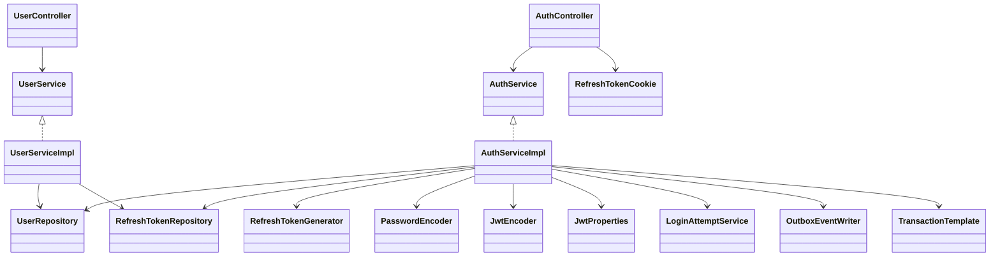
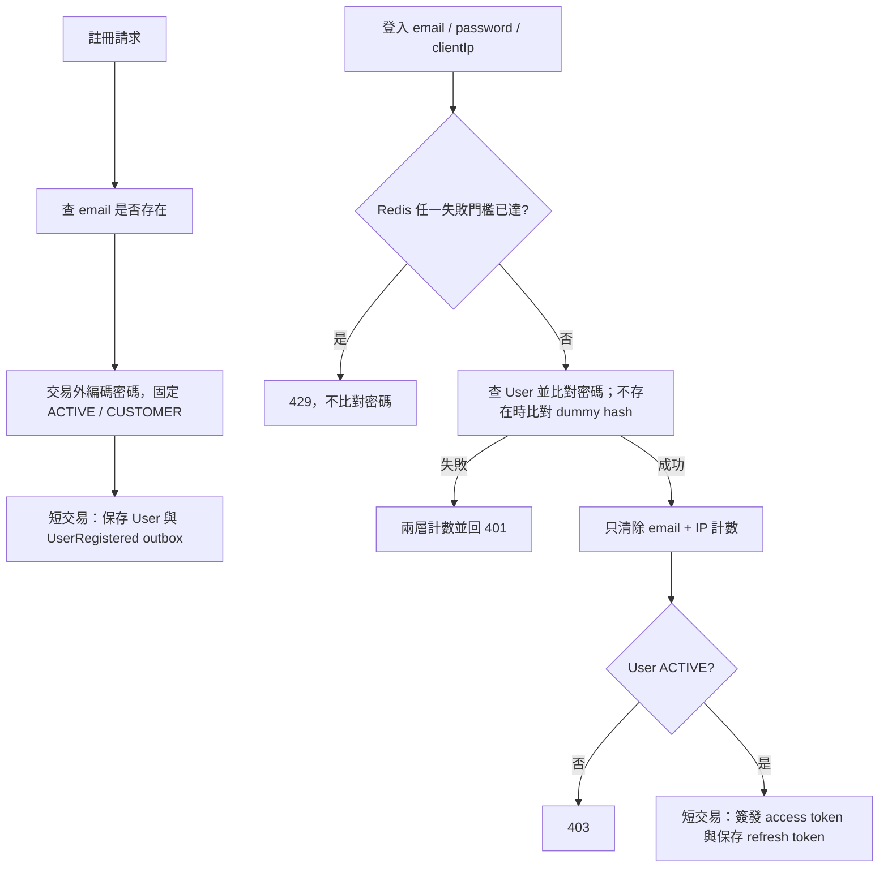
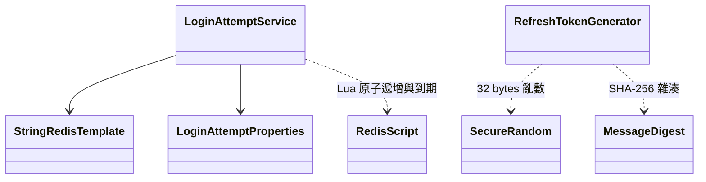
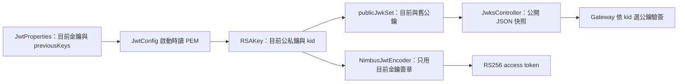
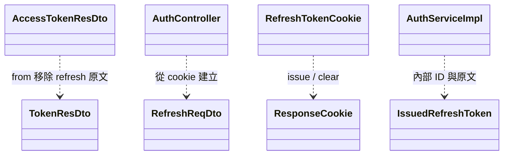
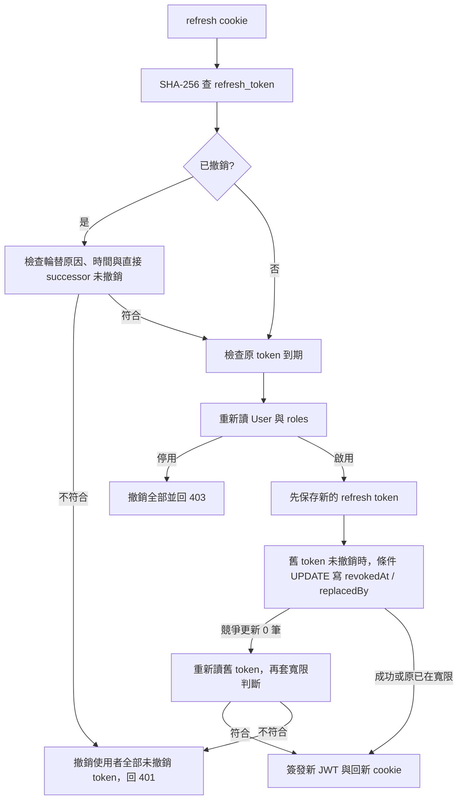
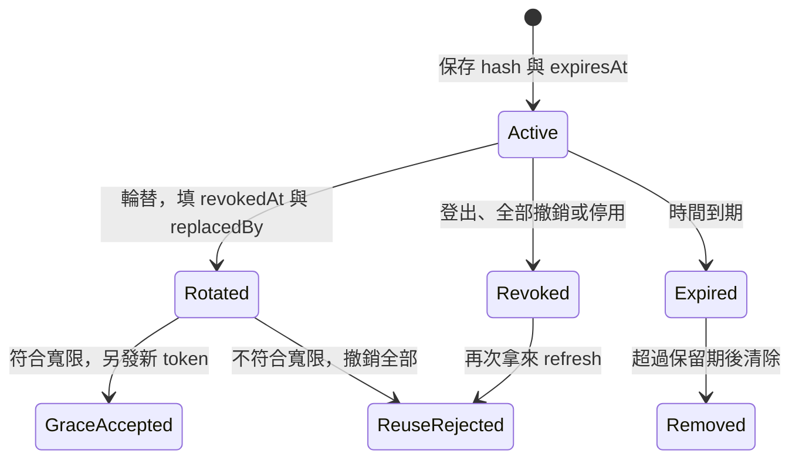
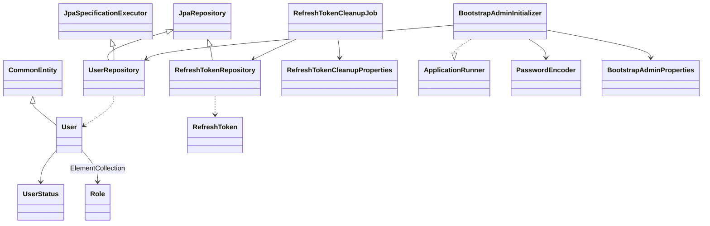

# spring-user-service 類別關係圖與職責說明

核對日期：2026-11-13。本文涵蓋 37 個 Java 主程式來源檔、九個 migration、兩份 YAML 與 Maven 設定，共 49 個主程式／資源／設定檔，另說明兩個內部 record；來源與職責逐一列於文末。

使用者服務負責註冊、密碼比對、JWT 簽發／公鑰發布、refresh token 輪替、登入失敗計數與使用者查詢。資料庫保存使用者及 refresh token 雜湊，Redis 保存登入失敗計數；Gateway 驗 JWT 後傳入身分 header，使用者服務不對一般使用者 API 自行驗 JWT。

共用角色、稽核與 outbox 見 [common 導讀](common.md)，驗簽與來源 IP 見 [Gateway 導讀](spring-api-gateway.md)，註冊事件見[事件契約](../architecture/event-contracts.md)。

## 入口與應用服務

Boot 掃描設定屬性與元件，Controller／Service／Component 採建構子注入，Repository 實作由 Spring Data 產生。UserServiceApplication 另外建立 DelegatingPasswordEncoder，預設密碼編碼採 bcrypt，並匯入 RequireRolesGuard。框架與 common 型別不計入本模組來源數。

AuthController 處理 `/api/v1/auth` 的 register／login／refresh／logout；UserController 處理 `/api/v1/users/me`、刪除本人 sessions 及 ADMIN 使用者列表。一般使用者身分由 `@CurrentUserId` 解析，列表由 `@RequireRoles("ADMIN")` 保護。此模組沒有公開修改角色、停用帳號、改密碼或刪除使用者的 API；程式會讀取既有狀態／角色並執行對應規則。

## 註冊、登入與失敗計數

email 在資料庫、註冊與登入查詢均區分大小寫，不自動轉小寫。註冊先查重，但並行仍由唯一約束裁決；先查到重複回 EMAIL_ALREADY_EXISTS，競爭寫入失敗由 common 回 DATA_CONFLICT。UserRegistered 的 aggregateId 為 userId，payload 為 userId／email／displayName；不含密碼，且與使用者、角色寫入共用交易，由 common relay 稍後發布。

登入密碼檢查與 Redis 操作不包資料庫交易；未知帳號仍執行 dummy password hash 比對以減少時間差。密碼錯與帳號不存在皆回 INVALID_CREDENTIALS 並累計失敗，密碼正確後才檢查停用狀態。此流程不保證檢查與簽發間的帳號狀態具有跨請求原子性。

預設 `(email,IP)` 15 分鐘內失敗 5 次鎖住該組，email 跨來源累計 30 次則所有來源都被擋；窗從第一次失敗起算，後續失敗不延長 TTL。Lua 將兩個 key 的 INCR 與第一次 PEXPIRE 一起執行；check 與 record 是不同呼叫，不是整次登入的原子限流。

Redis key 用 SHA-256，不保存 email／IP 原文；IP 來自 Gateway 的 X-Client-Ip，缺少／空白用 unknown。成功只重設當前 email+IP 計數，email 總計數不清除；停用但密碼正確也先做此重設。Redis DataAccessException 時放行並記 warn，並非 Redis 不可用就拒絕所有登入。這是失敗次數保護，與 Gateway 的來源速率限制分開。

## JWT 與 JWKS 接線

私鑰為 PKCS#8、公鑰為 X.509 Resource；讀取或解析失敗及重複 kid 在啟動時拒絕。公私鑰從設定載入，沒有執行期自動產生／輪替工作；要換 key 需更新部署設定。舊公鑰只發布、不簽章。JwksController 在建構時把 publicJwkSet 轉 JSON，`GET /api/v1/auth/jwks` 公開並允許快取五分鐘，沒有發布私鑰。

access token 包含 iss、sub=userId、iat、exp、排序後的 roles 字串陣列，簽章 RS256，kid 由 encoder 選中 JWK 帶入。預設 TTL **五分鐘**（可覆寫），refresh token 為 14 天，每次輪替重算期限；部分舊方法註解仍提 15 分鐘，現況以 YAML 為準。JWT 角色是簽發時快照，refresh 會重新讀 DB 的角色與狀態。

## Cookie 與 HTTP token 分工

TokenResDto 是 Service 與 Controller 間的完整 token 結果；HTTP body 使用 AccessTokenResDto，只有 accessToken、Bearer、expiresIn、refreshExpiresIn。refresh token 放 HttpOnly、SameSite=Strict、預設 Secure 的 `refresh_token` cookie，Path 為 `/api/v1/auth`，未指定 Domain。登入／refresh 回應加 Cache-Control: no-store。

refresh／logout 不讀 JSON body 中的 token，而是從 cookie 建 RefreshReqDto；要求非空白 X-Requested-With，沒有檢查其特定值。這與 SameSite 一起提供請求保護，仍依賴部署的 CORS／同站配置。RefreshReqDto 雖有驗證註解，此路徑是程式內 new，Controller 只明確檢查 cookie 非空，不能宣稱自動套用其所有 Bean Validation 長度約束。

logout 在 header 檢查通過後，沒有 cookie 也回 204；有 cookie 時撤銷對應 token，並回同名同 Path、Max-Age=0 清除 cookie。access token 不在撤銷表中，登出／登出所有裝置不會立刻使已簽發 JWT 失效。

## Refresh 輪替、寬限與撤銷

RefreshTokenGenerator 產生 32 bytes SecureRandom，base64url 無 padding（43 字元）；DB 只存 64 字元 SHA-256 hex，原文只交回 cookie。AuthServiceImpl.IssuedRefreshToken 保存新資料列 ID 與原文，供 replacedBy 及回應使用。

refresh 使用 `@Transactional(noRollbackFor=AppException.class)`：重用偵測或停用帳號時，撤銷必須在丟業務錯誤後仍提交。未知 token 與自然過期回 401；自然過期不撤銷其他 token。已撤銷 token 先做寬限判斷，再檢查原 token 是否過期。

寬限預設十秒，必須 grace 為正、replacedBy 有值、現在早於 revokedAt+grace，以及直接指向的 successor 在 DB 中 revokedAt 為 null。**此 successor 查詢沒有檢查 expiresAt，也不沿鏈追蹤**；不能把它描述成完整 token family 的有效性驗證。放行後會另發新 token，並非回放相同 token，可能形成多個有效 session；原舊 token 的 replacedBy 不會在每次寬限重用時改指向新分支。

條件輪替保證同一舊 token 只有一個請求更新一筆；並行敗者重新讀後可在寬限內繼續。超出條件的重用會撤銷該使用者所有 revokedAt 為 null 的 token，包含本交易剛建立的 token；其他使用者不受影響。停用同樣撤銷全部；這裡的「全部」是使用者範圍，不只某個輪替鏈。

此圖是邏輯狀態，資料表沒有 status enum；到期與 revokedAt 可同時成立。logout 僅撤銷送入的未撤銷 token，不沿 replacedBy 撤銷 successor；對已輪替舊 cookie 登出不等於撤銷所有分支，全部登出由 `/users/me/sessions` 執行。

## Entity、列表、排程與管理員初始化

User 的 roles 是 user_role ElementCollection，沒有獨立 Role Entity；登入及 me 使用 EntityGraph 取角色，分頁列表使用 BatchSize(100)，避免集合 fetch join 造成記憶體分頁。列表在唯讀交易內轉 DTO，支援 email／displayName 跳脫 LIKE、status／role 篩選與固定 ID tie-breaker，size 最多 100。GetMe 仍可回傳 DISABLED 狀態資料，不把它當登入檢查。

RefreshToken 不繼承 CommonEntity，沒有 version 或 updatedBy；userId、replacedBy 為 UUID，不是 JPA 物件關聯。DB user 外鍵 ON DELETE CASCADE、successor 外鍵 ON DELETE SET NULL；撤銷與輪替以 bulk UPDATE、flush／clear 管理，交易由 Service 提供。

RefreshTokenCleanupJob 每日 UTC 03:30 在交易中刪 `expiresAt < now-7d` 的資料，不論是否撤銷；未過期但已撤銷的資料保留供重用偵測。此實作使用 ShedLock（最多五分鐘、最少十秒），類別舊註解的「不需要鎖」不是現況。這是一次 DELETE，不是分批清除。

BootstrapAdminInitializer 與設定 bean 僅在 enabled=true 啟用；一般環境預設關，dev profile 自動開但仍必須提供密碼。email 已存在直接跳過，不重設密碼、不補 ADMIN；新建只給 ADMIN，沒有 CUSTOMER。並行唯一鍵失敗記錄並跳過。此路徑不經 AuthService.register，不產生 UserRegistered outbox。初始化帳號與密碼驗證不代表具備管理員編輯 API。

## 完整來源與職責對照

### controller

| 來源 | 職責 |
|---|---|
| [AuthController](../../backend/spring-user-service/src/main/java/com/mymicroservice/user/controller/AuthController.java) | 註冊／登入／refresh／logout、cookie 與請求 header 檢查。 |
| [JwksController](../../backend/spring-user-service/src/main/java/com/mymicroservice/user/controller/JwksController.java) | 公開公鑰 JSON 快照與五分鐘快取回應。 |
| [UserController](../../backend/spring-user-service/src/main/java/com/mymicroservice/user/controller/UserController.java) | 本人資料／全部 sessions 撤銷及 ADMIN 列表路由。 |

### service

| 來源 | 職責 |
|---|---|
| [AuthService](../../backend/spring-user-service/src/main/java/com/mymicroservice/user/service/AuthService.java) | 註冊、登入、refresh、logout 介面。 |
| [AuthServiceImpl](../../backend/spring-user-service/src/main/java/com/mymicroservice/user/service/impl/AuthServiceImpl.java) | 密碼檢查、簽發 JWT、註冊 outbox 與 refresh 輪替；內部 IssuedRefreshToken record。 |
| [LoginAttemptService](../../backend/spring-user-service/src/main/java/com/mymicroservice/user/service/impl/LoginAttemptService.java) | Redis 雙層失敗計數、固定窗 Lua 與不可用時放行。 |
| [RefreshTokenCleanupJob](../../backend/spring-user-service/src/main/java/com/mymicroservice/user/service/impl/RefreshTokenCleanupJob.java) | UTC 定時、ShedLock 與過期保留期清除。 |
| [RefreshTokenGenerator](../../backend/spring-user-service/src/main/java/com/mymicroservice/user/service/impl/RefreshTokenGenerator.java) | 256-bit 亂數原文與 SHA-256 hash。 |
| [UserServiceImpl](../../backend/spring-user-service/src/main/java/com/mymicroservice/user/service/impl/UserServiceImpl.java) | 唯讀資料轉換、列表篩選及全部 refresh token 撤銷。 |
| [UserService](../../backend/spring-user-service/src/main/java/com/mymicroservice/user/service/UserService.java) | 本人資料、使用者列表與全部 session 撤銷介面。 |

### entities

| 來源 | 職責 |
|---|---|
| [RefreshToken](../../backend/spring-user-service/src/main/java/com/mymicroservice/user/entities/RefreshToken.java) | UUIDv7 Entity，hash／expiresAt／revokedAt／replacedBy，不繼承稽核基底。 |
| [User](../../backend/spring-user-service/src/main/java/com/mymicroservice/user/entities/User.java) | UUIDv7 Entity，繼承 CommonEntity，roles 為 ElementCollection。 |

### enums

| 來源 | 職責 |
|---|---|
| [Role](../../backend/spring-user-service/src/main/java/com/mymicroservice/user/enums/Role.java) | CUSTOMER／ADMIN。 |
| [UserStatus](../../backend/spring-user-service/src/main/java/com/mymicroservice/user/enums/UserStatus.java) | ACTIVE／DISABLED。 |

### repositories

| 來源 | 職責 |
|---|---|
| [RefreshTokenRepository](../../backend/spring-user-service/src/main/java/com/mymicroservice/user/repositories/RefreshTokenRepository.java) | hash 查詢、條件輪替／撤銷與期限刪除。 |
| [UserRepository](../../backend/spring-user-service/src/main/java/com/mymicroservice/user/repositories/UserRepository.java) | email 唯一性、帶角色查詢與分頁 Specification。 |

### configs

| 來源 | 職責 |
|---|---|
| [JpaAuditingConfig](../../backend/spring-user-service/src/main/java/com/mymicroservice/user/configs/JpaAuditingConfig.java) | 啟用稽核並指定 common AuditorAware。 |
| [JwtConfig](../../backend/spring-user-service/src/main/java/com/mymicroservice/user/configs/JwtConfig.java) | PEM 載入、目前 RSAKey、公開 JWKSet 與 Nimbus encoder。 |
| [SchedulingConfig](../../backend/spring-user-service/src/main/java/com/mymicroservice/user/configs/SchedulingConfig.java) | 啟用排程，分散式鎖由 common 提供。 |

### properties

| 來源 | 職責 |
|---|---|
| [BootstrapAdminProperties](../../backend/spring-user-service/src/main/java/com/mymicroservice/user/properties/BootstrapAdminProperties.java) | 條件註冊、驗證管理員設定；toString 隱藏密碼。 |
| [JwtProperties](../../backend/spring-user-service/src/main/java/com/mymicroservice/user/properties/JwtProperties.java) | 金鑰位置、kid、issuer、TTL 與寬限；內部 PreviousKey 為舊公鑰設定。 |
| [LoginAttemptProperties](../../backend/spring-user-service/src/main/java/com/mymicroservice/user/properties/LoginAttemptProperties.java) | 雙層門檻與時間窗設定。 |
| [RefreshTokenCleanupProperties](../../backend/spring-user-service/src/main/java/com/mymicroservice/user/properties/RefreshTokenCleanupProperties.java) | cron 與過期資料保留期。 |

### bootstrap

| 來源 | 職責 |
|---|---|
| [BootstrapAdminInitializer](../../backend/spring-user-service/src/main/java/com/mymicroservice/user/bootstrap/BootstrapAdminInitializer.java) | 條件式 ApplicationRunner，僅建立不存在的 ADMIN，不更新既有帳號。 |

### web

| 來源 | 職責 |
|---|---|
| [RefreshTokenCookie](../../backend/spring-user-service/src/main/java/com/mymicroservice/user/web/RefreshTokenCookie.java) | HttpOnly／SameSite／Secure／Path 設定與簽發／清除 cookie。 |

### dtos

| 來源 | 職責 |
|---|---|
| [LoginReqDto](../../backend/spring-user-service/src/main/java/com/mymicroservice/user/dtos/login/LoginReqDto.java) | 非空 email／password 與長度上限，不套註冊密碼下限。 |
| [GetMeResDto](../../backend/spring-user-service/src/main/java/com/mymicroservice/user/dtos/me/GetMeResDto.java) | 本人資料、角色副本、版本與建立時間。 |
| [RegisterReqDto](../../backend/spring-user-service/src/main/java/com/mymicroservice/user/dtos/register/RegisterReqDto.java) | email、8–72 字元密碼與 displayName 驗證；不接受 roles／status。 |
| [RegisterResDto](../../backend/spring-user-service/src/main/java/com/mymicroservice/user/dtos/register/RegisterResDto.java) | 註冊結果與角色副本，不回 passwordHash。 |
| [AccessTokenResDto](../../backend/spring-user-service/src/main/java/com/mymicroservice/user/dtos/token/AccessTokenResDto.java) | HTTP body，移除 refresh token 原文並保留有效秒數。 |
| [RefreshReqDto](../../backend/spring-user-service/src/main/java/com/mymicroservice/user/dtos/token/RefreshReqDto.java) | Service 的 refresh／logout token 輸入；HTTP 實際從 cookie 組裝。 |
| [TokenResDto](../../backend/spring-user-service/src/main/java/com/mymicroservice/user/dtos/token/TokenResDto.java) | Service 內部完整 access／refresh token 結果與 Bearer 工廠。 |
| [GetUsersReqDto](../../backend/spring-user-service/src/main/java/com/mymicroservice/user/dtos/users/GetUsersReqDto.java) | 關鍵字／狀態／角色、分頁與排序白名單，預設 0／20／createdAt desc。 |
| [GetUsersResDto](../../backend/spring-user-service/src/main/java/com/mymicroservice/user/dtos/users/GetUsersResDto.java) | 穩定分頁格式與 UserListItem 容器。 |
| [UserListItem](../../backend/spring-user-service/src/main/java/com/mymicroservice/user/dtos/users/UserListItem.java) | 列表摘要與角色副本，不回 passwordHash。 |

### exception

| 來源 | 職責 |
|---|---|
| [UserErrorCode](../../backend/spring-user-service/src/main/java/com/mymicroservice/user/exception/UserErrorCode.java) | 實作 ErrorCode，定義註冊／認證／CSRF／查詢錯誤。 |

啟動入口：[UserServiceApplication](../../backend/spring-user-service/src/main/java/com/mymicroservice/user/UserServiceApplication.java)，Boot、設定掃描、角色 guard 與 DelegatingPasswordEncoder 工廠。

### 資源與建置

| 來源 | 職責 |
|---|---|
| [application-dev.yml](../../backend/spring-user-service/src/main/resources/application-dev.yml) | 啟用管理員初始化，密碼須由環境提供。 |
| [application.yml](../../backend/spring-user-service/src/main/resources/application.yml) | port 8084、JWT／DB／Redis／Kafka、五分鐘 access TTL、初始化／清理／登入門檻及 observability 匯入。 |
| [V1__create_user_table.sql](../../backend/spring-user-service/src/main/resources/db/migration/V1__create_user_table.sql) | users／user_role、email 大小寫敏感唯一與角色／狀態檢查。 |
| [V2__add_user_list_indexes.sql](../../backend/spring-user-service/src/main/resources/db/migration/V2__add_user_list_indexes.sql) | pg_trgm GIN 模糊搜尋與列表排序索引。 |
| [V3__create_refresh_token_table.sql](../../backend/spring-user-service/src/main/resources/db/migration/V3__create_refresh_token_table.sql) | refresh hash 唯一、user FK cascade 與使用者索引。 |
| [V4__add_refresh_token_replaced_by.sql](../../backend/spring-user-service/src/main/resources/db/migration/V4__add_refresh_token_replaced_by.sql) | successor FK，刪除時 SET NULL。 |
| [V5__add_refresh_token_expires_at_index.sql](../../backend/spring-user-service/src/main/resources/db/migration/V5__add_refresh_token_expires_at_index.sql) | 到期清理索引。 |
| [V6__create_shedlock_table.sql](../../backend/spring-user-service/src/main/resources/db/migration/V6__create_shedlock_table.sql) | 共用排程鎖表。 |
| [V7__create_outbox_event.sql](../../backend/spring-user-service/src/main/resources/db/migration/V7__create_outbox_event.sql) | 註冊事件 outbox 表與發布索引。 |
| [V8__order_outbox_by_sequence.sql](../../backend/spring-user-service/src/main/resources/db/migration/V8__order_outbox_by_sequence.sql) | outbox sequence_id 與待發布序號索引。 |
| [V9__optimize_event_indexes_and_cleanup.sql](../../backend/spring-user-service/src/main/resources/db/migration/V9__optimize_event_indexes_and_cleanup.sql) | aggregate sequence 索引；沒有 processed_event 表或清理索引。 |
| [pom.xml](../../backend/spring-user-service/pom.xml) | common／observability、JPA、Redis、Flyway、Web MVC、Validation、Security crypto／JOSE、springdoc 與測試依賴。 |

密碼 DTO 的 @Size 計算字元數，並不等於 bcrypt 的位元組限制；不能宣稱此驗證已涵蓋所有多位元組密碼長度。登入流程使用 email 原值，列表模糊搜尋則轉小寫，兩者用途不同。

本模組沒有自訂 Kafka Listener 或 processed_event 表；註冊事件發布由共用 OutboxRelay 負責。

## 閱讀順序與測試對照

先讀 AuthController → AuthServiceImpl，再依登入／輪替路徑看 LoginAttemptService、RefreshTokenRepository 與 JwtConfig；查詢與排程從 UserController、RefreshTokenCleanupJob 進入。以下測試連結僅作閱讀對照。

| 測試 | 對照行為 |
|---|---|
| [AuthControllerRegisterIntegrationTests](../../backend/spring-user-service/src/test/java/com/mymicroservice/user/controller/AuthControllerRegisterIntegrationTests.java) | 註冊驗證與帳號資料 |
| [AuthControllerLoginIntegrationTests](../../backend/spring-user-service/src/test/java/com/mymicroservice/user/controller/AuthControllerLoginIntegrationTests.java) | 密碼／狀態與簽發 |
| [AuthControllerLoginAttemptIntegrationTests](../../backend/spring-user-service/src/test/java/com/mymicroservice/user/controller/AuthControllerLoginAttemptIntegrationTests.java) | 登入失敗門檻 |
| [AuthControllerRefreshIntegrationTests](../../backend/spring-user-service/src/test/java/com/mymicroservice/user/controller/AuthControllerRefreshIntegrationTests.java) | cookie、輪替、並行、寬限與重用撤銷 |
| [AuthControllerLogoutIntegrationTests](../../backend/spring-user-service/src/test/java/com/mymicroservice/user/controller/AuthControllerLogoutIntegrationTests.java) | 單 token 登出及 cookie 清除 |
| [UserControllerSessionsIntegrationTests](../../backend/spring-user-service/src/test/java/com/mymicroservice/user/controller/UserControllerSessionsIntegrationTests.java) | 全部裝置登出 |
| [UserControllerMeIntegrationTests](../../backend/spring-user-service/src/test/java/com/mymicroservice/user/controller/UserControllerMeIntegrationTests.java) | 本人資料與身分 |
| [UserControllerListIntegrationTests](../../backend/spring-user-service/src/test/java/com/mymicroservice/user/controller/UserControllerListIntegrationTests.java) | 管理員權限、篩選與分頁 |
| [JwksControllerIntegrationTests](../../backend/spring-user-service/src/test/java/com/mymicroservice/user/controller/JwksControllerIntegrationTests.java) | 公鑰發布 |
| [JwksKeyRotationIntegrationTests](../../backend/spring-user-service/src/test/java/com/mymicroservice/user/controller/JwksKeyRotationIntegrationTests.java) | 新舊 kid 與驗簽 |
| [JwtConfigTest](../../backend/spring-user-service/src/test/java/com/mymicroservice/user/configs/JwtConfigTest.java) | 金鑰設定與錯誤 |
| [AccessTokenTtlIntegrationTests](../../backend/spring-user-service/src/test/java/com/mymicroservice/user/configs/AccessTokenTtlIntegrationTests.java) | access token 期限 |
| [LoginAttemptServiceTest](../../backend/spring-user-service/src/test/java/com/mymicroservice/user/service/impl/LoginAttemptServiceTest.java) | Redis key／計數策略 |
| [RefreshTokenCleanupJobIntegrationTests](../../backend/spring-user-service/src/test/java/com/mymicroservice/user/service/impl/RefreshTokenCleanupJobIntegrationTests.java) | 到期資料保留與清理 |
| [BootstrapAdminInitializerIntegrationTests](../../backend/spring-user-service/src/test/java/com/mymicroservice/user/bootstrap/BootstrapAdminInitializerIntegrationTests.java) | 初始化冪等與角色 |
| [BootstrapAdminEnabledByPropertyIntegrationTests](../../backend/spring-user-service/src/test/java/com/mymicroservice/user/bootstrap/BootstrapAdminEnabledByPropertyIntegrationTests.java) | 設定開關 |
| [BootstrapAdminNotDevIntegrationTests](../../backend/spring-user-service/src/test/java/com/mymicroservice/user/bootstrap/BootstrapAdminNotDevIntegrationTests.java) | 非 dev 預設行為 |
| [UserEventContractIntegrationTests](../../backend/spring-user-service/src/test/java/com/mymicroservice/user/UserEventContractIntegrationTests.java) | 註冊事件契約 |

本次僅更新文件，靜態核對全部主程式／資源／設定來源、相對連結、UTF-8 無 BOM 與 Mermaid 區塊結構；未重新執行服務測試或渲染 Mermaid。測試連結不代表本次重新驗收通過。
