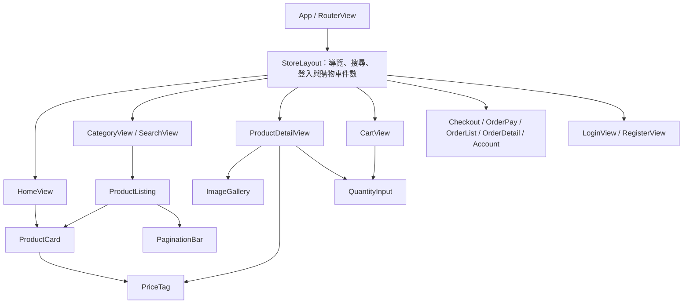
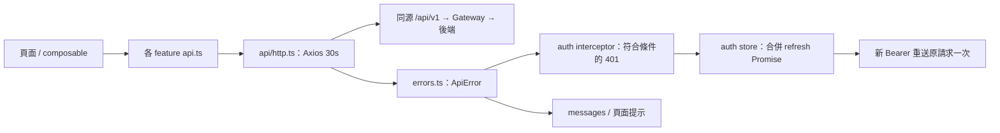
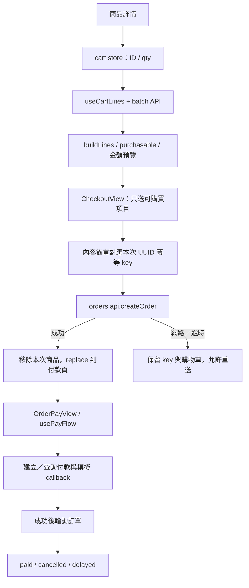

# vue-customer 元件關係圖與職責說明

核對日期：2026-11-13。範圍為 src 下的正式 Vue／TypeScript／樣式，以及入口與主要建置／代理設定；測試與型別宣告檔不列入應用來源數。完整來源連結見文末。

顧客端使用 Vue、Vue Router、Pinia 與 Axios，負責商店畫面及操作協調。業務規則對照[商品](../class-relationships/spring-product-service.md)、[訂單](../class-relationships/spring-order-service.md)、[付款](../class-relationships/spring-payment-service.md)、[使用者服務](../class-relationships/spring-user-service.md)。

## 啟動、路由與頁面

main.ts 先註冊 Pinia，再安裝 API auth interceptors，背景 restoreSession，最後註冊 router 並掛載 App。App 透過 RouterView 呈現 StoreLayout；guard 與背景恢復共用 auth store 的恢復 Promise。除了 HomeView，其餘路由元件多使用動態 import。

| 路徑 | 元件 | 登入要求 |
|---|---|---|
| `/` | HomeView | 公開 |
| `/c/:slug`、`/search` | CategoryView／SearchView，共用 ProductListing | 公開 |
| `/p/:id`、`/cart` | ProductDetailView／CartView | 公開 |
| `/checkout` | CheckoutView | requiresAuth |
| `/orders/:id/pay` | OrderPayView | requiresAuth |
| `/orders`、`/orders/:id` | OrderListView／OrderDetailView | requiresAuth |
| `/account` | AccountView | requiresAuth |
| `/login`、`/register` | LoginView／RegisterView | 公開，已登入回首頁 |
| 其他 | NotFoundView | 公開 |

受保護頁先 restoreSession，失敗轉 login 並帶原 fullPath；登入／註冊使用 safeRedirect 限制返回目標。標題由 route meta 更新。導覽連結不是直接巢狀呈現；圖中 Protected／Auth 是頁面集合，非實際元件。

## 狀態與持久化

| 持有者 | 資料與生命週期 |
|---|---|
| auth store | accessToken、user 僅記憶體；localStorage 的 vue-customer.hasSession 只是恢復提示；refresh token 在後端設定的 HttpOnly cookie。 |
| cart store | localStorage 的 vue-customer.cart 只存 productId／qty；不綁帳號，頂部列主動登出或帳號頁成功登出所有裝置後清空；登入與登入過期保留。監聽 storage 事件同步其他同源分頁。最多 50 種、每種 1–99。 |
| categoryStore | 分類樹記憶體快取，首次載入 Promise 合併；成功後本頁生命週期不主動再載，失敗保留未載入狀態供下次重試。 |
| useRouteQuery | 列表篩選與分頁以 URL query 為來源；update 推 router，watch 再載資料。draft 表單先留頁面，套用才改 URL。 |
| 頁面／composable | 載入結果、錯誤、送出狀態、付款 phase 等局部狀態，不把所有 API 結果集中在 Pinia。 |

session hint key 與管理端分開，但 cookie 是否隔離取決於 origin／host／Path；同 host 不同 port 仍可能共用 cookie，不能僅憑兩個 localStorage key 保證兩套帳號互不影響。single-flight Promise 也只限目前應用實例，沒有跨分頁 refresh 鎖。

## API 與驗證恢復

auth API 的 login／register／refresh／logout 設 skipAuth，避免 refresh 遞迴；refresh／logout 帶 X-Requested-With。其他請求附 Bearer，401 且尚未 authRetried 才處理；若別的請求已換 token，直接用新 token 重送。refresh 4xx 清除狀態，網路／5xx 保留 hint 供之後再試；清除 session 時僅受保護頁導登入，公開瀏覽不中斷。

登入後必須 getMe 才成為 isAuthenticated；getMe 失敗嘗試 logout，避免半登入。註冊是 register 後再 login，後者失敗用 REGISTERED_LOGIN_FAILED 表達帳號已建立。單機 logout 先清狀態再盡力撤銷；Account 的 logoutAll 先等後端撤銷成功才清狀態。兩個主動登出呼叫端在登出後執行 cart.clear()，不在 auth.clear() 或內部 logout 清空；撤銷失敗保留購物車。這些操作不立刻撤銷已簽發 JWT。

API baseURL 來自 VITE_API_BASE，feature URL 不重複包含 `/api/v1`。Vite 開發代理與正式 nginx 讓 API 同源；程式未啟用跨來源 credentials。ApiError 統一 ProblemDetail、網路、逾時及取消錯誤，HTTP status 以實際回應為準，非 ProblemDetail 不直接顯示 HTML 錯誤頁。

## 瀏覽與元件輸入輸出

| 元件 | props／回報與職責 |
|---|---|
| ProductListing | 接 categoryId；由 URL 解析價格／排序／頁碼，呼叫 catalog API，呈現 ProductCard／PaginationBar；request 序號避免舊結果覆蓋。 |
| ProductCard → PriceTag | product 快照傳入卡片，price／originalPrice 傳價格元件；卡片連商品詳情，不自行載入詳情。 |
| PaginationBar | page／totalPages，emit change(page)，父層更新 URL。 |
| QuantityInput | min／max、必要 number v-model；輸入取整並限制範圍，父層決定實際數量。 |
| ImageGallery | images／productName，局部 selected 控制選圖，圖片改變時重設。 |
| OrderStatusBadge | status 轉成一致標示，列表與詳情共用。 |

分類頁以 slug 查分類並傳 ID 給 ProductListing，搜尋頁共用列表但不帶分類 props。商品詳情載商品、圖片與 SKU 庫存：圖片失敗退空圖、庫存失敗停用加入而仍可看商品；庫存只供提示，加入購物車不預扣，建單時才由後端裁決。最新 request 序號是忽略過時回應，不是取消已送出的 HTTP。

## 購物車、結帳與付款

useCartLines 每次 load 查最新商品名稱／價格／狀態，qty 變動即時計算；沒有保存庫存保留或價格承諾。lines 純函式以分計算顯示金額，總額只算 ACTIVE。實際價格由後端下單快照決定。

CheckoutView 的 key 僅存在元件記憶體，同內容在網路／逾時不確定結果時沿用；成功、判定確定失敗或內容改變後換 key，重新載入頁面不保留。不能把它描述為跨重整的永久去重。只移除本次送出的商品 ID，未購買項目保留。

usePayFlow 管理 loading／ready／processing／confirming／paid／failed／cancelled／delayed 等 phase。回呼失敗先查付款記錄，不直接猜結果；SUCCEEDED 後每秒查訂單，預設最多十次，到上限顯示 delayed，並非重新扣款。已 PAID／SHIPPED／COMPLETED 視為付款完成；取消後成功提示需處理退款，前端不實作退款。

付款頁目前呼叫模擬回呼，後端須啟用 mock-callback，尚非真實金流。三十分鐘倒數使用本機時鐘及固定常數，僅控制提示／按鈕，後端期限才是依據；scope dispose 清 interval 並讓輪詢停止更新，不是終止已送出的後端操作。

## 完整應用來源對照

本次來源對照涵蓋 52 個正式應用來源檔，另列五個入口／套件／代理設定檔；自動產生的宣告、favicon、部署清單與測試設定不計入此數。

| 來源 | 職責 |
|---|---|
| [api/errors.ts](../../frontend/vue-customer/src/api/errors.ts) | ProblemDetail／Axios 錯誤轉 ApiError，保留 status／code／cause。 |
| [api/http.ts](../../frontend/vue-customer/src/api/http.ts) | Axios baseURL、30 秒逾時與錯誤正規化；擴充 skipAuth／authRetried。 |
| [App.vue](../../frontend/vue-customer/src/App.vue) | 根 RouterView，不直接持有業務資料。 |
| [components/PaginationBar.vue](../../frontend/vue-customer/src/components/PaginationBar.vue) | page／totalPages props，emit change(page)。 |
| [components/PriceTag.vue](../../frontend/vue-customer/src/components/PriceTag.vue) | price／originalPrice props，格式化價格與折扣。 |
| [components/ProductCard.vue](../../frontend/vue-customer/src/components/ProductCard.vue) | 商品摘要 props、主圖、PriceTag 與詳情連結。 |
| [components/QuantityInput.vue](../../frontend/vue-customer/src/components/QuantityInput.vue) | number v-model，min／max props 與整數範圍控制。 |
| [composables/useRouteQuery.ts](../../frontend/vue-customer/src/composables/useRouteQuery.ts) | URL query 為列表狀態來源，update 推入 router。 |
| [features/account/AccountView.vue](../../frontend/vue-customer/src/features/account/AccountView.vue) | 本人資料重新查詢及全部裝置登出。 |
| [features/auth/api.ts](../../frontend/vue-customer/src/features/auth/api.ts) | 登入／refresh／logout／me HTTP；顧客端另有註冊與全部登出。 |
| [features/auth/interceptors.ts](../../frontend/vue-customer/src/features/auth/interceptors.ts) | Bearer、符合條件的 401 換 token 與一次重送，回傳卸載函式。 |
| [features/auth/LoginView.vue](../../frontend/vue-customer/src/features/auth/LoginView.vue) | 登入表單、送出狀態、錯誤與成功返回目標。 |
| [features/auth/messages.ts](../../frontend/vue-customer/src/features/auth/messages.ts) | 驗證相關錯誤訊息與安全的登入後 redirect。 |
| [features/auth/RegisterView.vue](../../frontend/vue-customer/src/features/auth/RegisterView.vue) | 註冊表單與註冊後自動登入。 |
| [features/auth/store.ts](../../frontend/vue-customer/src/features/auth/store.ts) | 登入狀態、記憶體 access token、session hint 與 single-flight refresh／restore。 |
| [features/auth/types.ts](../../frontend/vue-customer/src/features/auth/types.ts) | 此 feature 的請求／回應與畫面資料型別，不含執行期 API 驗證。 |
| [features/auth/validation.ts](../../frontend/vue-customer/src/features/auth/validation.ts) | 顧客端註冊／登入欄位驗證。 |
| [features/cart/api.ts](../../frontend/vue-customer/src/features/cart/api.ts) | 批次取購物車商品快照。 |
| [features/cart/CartView.vue](../../frontend/vue-customer/src/features/cart/CartView.vue) | 數量變動、移除與不可購買項目處理。 |
| [features/cart/lines.ts](../../frontend/vue-customer/src/features/cart/lines.ts) | 合併商品快照、判可購買及以分計算預覽金額。 |
| [features/cart/store.ts](../../frontend/vue-customer/src/features/cart/store.ts) | ID／數量的持久購物車、數量限制與跨分頁 storage 同步。 |
| [features/cart/useCartLines.ts](../../frontend/vue-customer/src/features/cart/useCartLines.ts) | CartView／CheckoutView 共用的載入、分類與金額 computed。 |
| [features/catalog/api.ts](../../frontend/vue-customer/src/features/catalog/api.ts) | 分類樹／slug、商品列表／詳情／圖片與庫存讀取。 |
| [features/catalog/categoryStore.ts](../../frontend/vue-customer/src/features/catalog/categoryStore.ts) | 分類樹記憶體快取、並行請求合併與 slug 查節點。 |
| [features/catalog/CategoryView.vue](../../frontend/vue-customer/src/features/catalog/CategoryView.vue) | 依 slug 載分類，接 ProductListing。 |
| [features/catalog/ImageGallery.vue](../../frontend/vue-customer/src/features/catalog/ImageGallery.vue) | 圖片 props、排序與局部選圖狀態。 |
| [features/catalog/ProductDetailView.vue](../../frontend/vue-customer/src/features/catalog/ProductDetailView.vue) | 商品／圖片／庫存載入與加入購物車，忽略過時回應。 |
| [features/catalog/ProductListing.vue](../../frontend/vue-customer/src/features/catalog/ProductListing.vue) | URL 篩選／分頁、商品 API、卡片與 request 序號保護。 |
| [features/catalog/query.ts](../../frontend/vue-customer/src/features/catalog/query.ts) | 商品列表 URL 解析、序列化、價格及排序參數轉換。 |
| [features/catalog/SearchView.vue](../../frontend/vue-customer/src/features/catalog/SearchView.vue) | 搜尋標題與共用 ProductListing。 |
| [features/catalog/types.ts](../../frontend/vue-customer/src/features/catalog/types.ts) | 此 feature 的請求／回應與畫面資料型別，不含執行期 API 驗證。 |
| [features/checkout/CheckoutView.vue](../../frontend/vue-customer/src/features/checkout/CheckoutView.vue) | 重查商品、結帳冪等 key、送單與移除本次商品。 |
| [features/checkout/messages.ts](../../frontend/vue-customer/src/features/checkout/messages.ts) | 建單失敗轉可讀訊息、是否重查與是否保留冪等 key。 |
| [features/orders/api.ts](../../frontend/vue-customer/src/features/orders/api.ts) | 訂單列表／詳情／操作；顧客端另有建立訂單與冪等 header。 |
| [features/orders/OrderDetailView.vue](../../frontend/vue-customer/src/features/orders/OrderDetailView.vue) | 訂單詳情、狀態操作與重查；兩端可用動作不同。 |
| [features/orders/OrderListView.vue](../../frontend/vue-customer/src/features/orders/OrderListView.vue) | 訂單列表篩選、URL 分頁與詳情導覽。 |
| [features/orders/OrderPayView.vue](../../frontend/vue-customer/src/features/orders/OrderPayView.vue) | 呈現 usePayFlow phase 與付款操作。 |
| [features/orders/OrderStatusBadge.vue](../../frontend/vue-customer/src/features/orders/OrderStatusBadge.vue) | status prop 的共用顧客訂單標示。 |
| [features/orders/query.ts](../../frontend/vue-customer/src/features/orders/query.ts) | 訂單列表 URL／API 查詢格式轉換。 |
| [features/orders/status.ts](../../frontend/vue-customer/src/features/orders/status.ts) | 訂單狀態標示、可用動作與錯誤提示。 |
| [features/orders/types.ts](../../frontend/vue-customer/src/features/orders/types.ts) | 此 feature 的請求／回應與畫面資料型別，不含執行期 API 驗證。 |
| [features/payments/api.ts](../../frontend/vue-customer/src/features/payments/api.ts) | 建立／查付款及模擬 callback HTTP。 |
| [features/payments/types.ts](../../frontend/vue-customer/src/features/payments/types.ts) | 此 feature 的請求／回應與畫面資料型別，不含執行期 API 驗證。 |
| [features/payments/usePayFlow.ts](../../frontend/vue-customer/src/features/payments/usePayFlow.ts) | 付款 phase、模擬回呼、結果補查、訂單輪詢與倒數。 |
| [layouts/StoreLayout.vue](../../frontend/vue-customer/src/layouts/StoreLayout.vue) | 商店框架、導覽搜尋、分類、登入與購物車件數及子路由出口。 |
| [main.ts](../../frontend/vue-customer/src/main.ts) | 建立 Vue／Pinia、註冊驗證攔截器與 router，掛載應用。 |
| [router/index.ts](../../frontend/vue-customer/src/router/index.ts) | 路由表、登入守衛、標題更新；管理端另產生側欄選單。 |
| [styles/base.css](../../frontend/vue-customer/src/styles/base.css) | 顧客端共用版面、按鈕與基礎樣式。 |
| [styles/tokens.css](../../frontend/vue-customer/src/styles/tokens.css) | 顧客端色彩／間距／字型等設計變數。 |
| [utils/format.ts](../../frontend/vue-customer/src/utils/format.ts) | 價格、時間等顯示格式純函式。 |
| [views/HomeView.vue](../../frontend/vue-customer/src/views/HomeView.vue) | 首頁資料載入與入口呈現；顧客端商品推薦，管理端營運總覽。 |
| [views/NotFoundView.vue](../../frontend/vue-customer/src/views/NotFoundView.vue) | 找不到頁面的狀態呈現。 |

### 入口與執行環境

| 來源 | 職責 |
|---|---|
| [package.json](../../frontend/vue-customer/package.json) | 套件、開發／建置／測試 scripts。 |
| [vite.config.ts](../../frontend/vue-customer/vite.config.ts) | Vue 插件、alias 與 /api 開發代理；管理端另含 Element Plus 自動匯入。 |
| [index.html](../../frontend/vue-customer/index.html) | 應用 HTML 入口。 |
| [nginx/default.conf.template](../../frontend/vue-customer/nginx/default.conf.template) | 正式 API 代理、SPA history fallback 與資產快取。 |
| [nginx/security-headers.inc.template](../../frontend/vue-customer/nginx/security-headers.inc.template) | 部署時共用安全標頭模板。 |

## 測試閱讀入口

- [src/features/auth/__tests__/store.spec.ts](../../frontend/vue-customer/src/features/auth/__tests__/store.spec.ts)
- [src/features/auth/__tests__/interceptors.spec.ts](../../frontend/vue-customer/src/features/auth/__tests__/interceptors.spec.ts)
- [src/router/__tests__/guard.spec.ts](../../frontend/vue-customer/src/router/__tests__/guard.spec.ts)
- [src/features/cart/__tests__/store.spec.ts](../../frontend/vue-customer/src/features/cart/__tests__/store.spec.ts)
- [src/features/checkout/__tests__/CheckoutView.spec.ts](../../frontend/vue-customer/src/features/checkout/__tests__/CheckoutView.spec.ts)
- [src/features/orders/__tests__/OrderPayView.spec.ts](../../frontend/vue-customer/src/features/orders/__tests__/OrderPayView.spec.ts)
- [e2e/purchase-flow.spec.ts](../../frontend/vue-customer/e2e/purchase-flow.spec.ts)
- [e2e/cart-edge.spec.ts](../../frontend/vue-customer/e2e/cart-edge.spec.ts)

本次只更新文件，靜態核對路由、來源依賴、相對連結、UTF-8 無 BOM 與 Mermaid 區塊結構；未重新執行單元／元件／E2E 測試、建置或渲染 Mermaid。上述測試是閱讀入口，不代表本次重新驗收。
