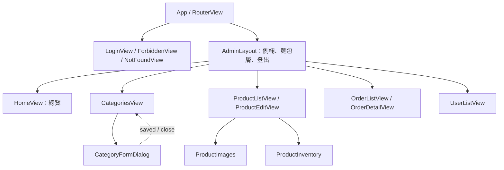
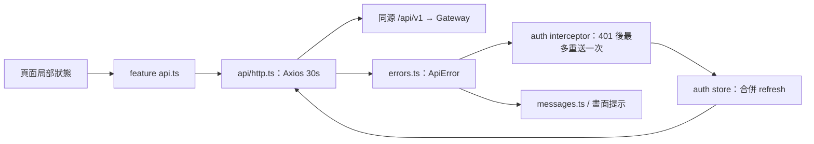
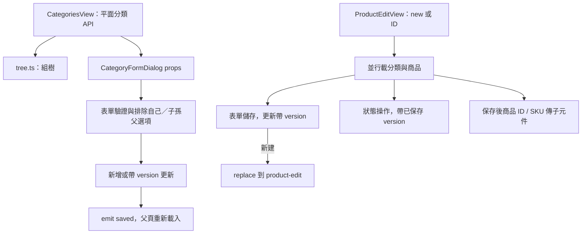
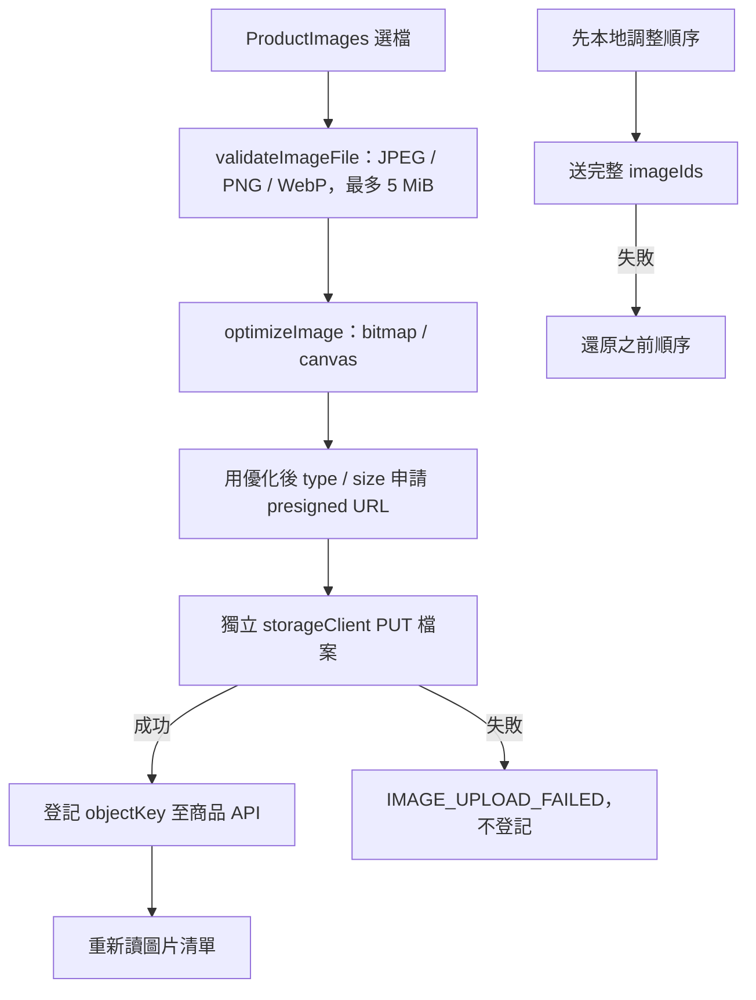

# vue-management 元件關係圖與職責說明

核對日期：2026-11-13。範圍為 src 下正式 Vue／TypeScript／樣式，以及入口與主要建置／代理設定；測試與產生的型別宣告不列入應用來源數。完整來源連結見文末。

管理端使用 Vue、Vue Router、Pinia、Axios 與 Element Plus。負責分類、商品、圖片、SKU 庫存、訂單操作及使用者查詢；業務驗證仍由[商品](../class-relationships/spring-product-service.md)、[庫存](../class-relationships/spring-inventory-service.md)、[訂單](../class-relationships/spring-order-service.md)、[使用者服務](../class-relationships/spring-user-service.md)負責。

## 啟動、路由與頁面

main.ts 先建立 Pinia、安裝 auth interceptors，再註冊 router 與掛載 App；Element Plus 元件／API 由 Vite 插件按需匯入，主入口載入深色變數與 theme.css。App 只提供路由出口；AdminLayout 的動態 import 避免它讀 router menuItems 時形成靜態循環。

圖中的 Products／Orders／Public 是頁面集合。ProductImages／ProductInventory 只由 ProductEditView 在商品已存在時呈現，列表不直接建立它們。

| 路徑 | 頁面 | 畫面保護 |
|---|---|---|
| `/login`、`/403`、其他未知網址 | LoginView／ForbiddenView／NotFoundView | meta.public |
| `/` | HomeView | 恢復 ADMIN session |
| `/categories` | CategoriesView | 同上 |
| `/products` | ProductListView | 同上 |
| `/products/new`、`/products/:id` | 共用 ProductEditView | 同上 |
| `/orders`、`/orders/:id` | OrderListView／OrderDetailView | 同上 |
| `/users` | UserListView | 同上 |

除了 public 路由，guard 都先 restoreSession；失敗轉 login 並帶 redirect。登入及恢復流程 getMe 後要求 ADMIN，不符則 logout。guard 本身不逐條比對角色；已建立 session 也不是每次導覽重查角色，後端才是權限依據。403 是公開狀態頁，不代表所有 API 403 都會全域自動導到此頁。

AdminLayout 側欄由 adminChildren 的 menu／section／title 產生，麵包屑及分頁標題依 route meta。products／orders 父路由提供選單與麵包屑，沒有額外頁面元件。

## 狀態、驗證與 API

auth store 只在記憶體存 accessToken／user，localStorage 的 vue-management.hasSession 是恢復提示；refresh token 是 HttpOnly cookie。登入／恢復會檢查 ADMIN；refreshAccessToken 本身只換 JWT，不同步更新 user。refresh 4xx 清狀態、網路／5xx 保留提示；失效回呼導 login。單機 logout 先清本機再盡力撤銷，失敗不阻止畫面登出。

skipAuth 排除 login／refresh／logout 的 Bearer 與自動重試，refresh／logout 帶 X-Requested-With。其他 401 若符合條件會共用 refresh Promise；已被別的請求換過 token 則直接重送，authRetried 防無限循環。此協調只限目前實例，沒有跨分頁鎖。兩個前端 session hint 分開不保證 cookie 分開，同 host 的 cookie 可能共用，取決於部署。

URL query 保存商品／訂單／使用者列表條件，feature query.ts 解析／正規化並轉 API 分頁格式；useRouteQuery 只負責 router push 與 computed state。表單、結果與 busy flags 留在頁面；沒有全域商品／訂單編輯 store。

Dashboard counts store 以 key 快取數量三十秒，同 key 載入共用 Promise；auth.user.id 變動時清 cache／pending 並增加 generation，避免舊請求回填到新使用者快取。它不是跨服務一致快照，也不會在每次商品／訂單修改後立即失效。

## 分類與商品編輯

CategoryFormDialog 接 categories、可選 category、defaultParentId；emit saved(message)／close。後端仍驗 slug／同層名稱／父循環，前端選項排除不能代替後端驗證。刪除先 confirmDanger，資料衝突轉功能訊息。

ProductEditView 同時負責新建與修改，透過 route.params.id 判斷；儲存後更新本地商品與 version，新建則跳編輯路由。狀態按鈕依 status.ts 與 dirty 控制，上架針對已保存內容；封存唯讀控制傳給子元件。圖片／庫存各自呼叫 API，不與商品表單儲存組成同一交易。

| 子元件 | props 與責任 |
|---|---|
| ProductImages | productId、readOnly；自己載圖、busy、進度、主圖、刪除與排序。不是以 emit 把圖片交父表單一起保存。 |
| ProductInventory | 已保存 sku、readOnly；查 available／reserved，驗非負整數再 PUT available，成功重新讀庫存。SKU 路徑經編碼，STOCK_NOT_FOUND 表示尚未建檔。 |

庫存 PUT 是設定 available，不是追加量，也沒有版本欄位；reserved 只展示，不能從此表單修改。主圖限制、商品版本與可否上架均以後端回應為準。訂單詳情以狀態決定取消／出貨／完成按鈕，確認後呼叫 API 更新；使用者頁只有查詢及相關導覽，沒有角色／停用編輯功能。

## 圖片直傳與失敗處理

先驗原檔再優化，因此超過 5 MiB 的原檔不會靠縮圖繞過初始驗證。optimizeImage 將最長邊限制 1600、不放大，以 WebP quality 0.85 編碼，只有 blob 類型正確且更小才採用；不支援／失敗就沿用原檔，最後釋放 bitmap。申請簽名採轉換後檔案的 type／size。

storageClient 與主 API client 分開，不帶 Bearer、withCredentials=false、不套 API baseURL；Content-Length／Host 交瀏覽器管理，其他 requiredHeaders 由簽名回應帶入。上傳進度只代表 PUT，不代表後續登記已完成。PUT 成功但登記失敗仍可能留下暫存物件，清理由儲存端／後端負責。

ProductImages 以 busy 限制同時操作；上傳後重新載入，刪圖不論成功失敗都重讀，排序先更新畫面、失敗還原。圖片限制及 metadata 檢查的最終執行在後端，前端不保證上傳內容可信。

## 建置、代理與測試界線

Vite 代理 `/api` 到 Gateway；正式 nginx 提供 history fallback、API 轉發與安全標頭。VITE_API_BASE 是建置時 Axios base，feature URL 不重複 `/api/v1`；圖片直傳需瀏覽器可達的 storage endpoint 與物件儲存 CORS，主 API 同源代理不代理這個 PUT。

Vitest／元件測試覆蓋 store、interceptor、查詢轉換與功能頁；Playwright 測試真實瀏覽器操作。檔案上傳的部分單元測試攔 storageClient.put，不能當成真實瀏覽器簽章／CORS 驗收；bitmap／canvas 的瀏覽器測試另有 browser-tests/resize.spec.ts。

## 完整應用來源對照

本次來源對照涵蓋 51 個正式應用來源檔，另列五個入口／套件／代理設定檔；自動產生的宣告、favicon、部署清單與測試設定不計入此數。

| 來源 | 職責 |
|---|---|
| [api/errors.ts](../../frontend/vue-management/src/api/errors.ts) | ProblemDetail／Axios 錯誤轉 ApiError，保留 status／code／cause。 |
| [api/http.ts](../../frontend/vue-management/src/api/http.ts) | Axios baseURL、30 秒逾時與錯誤正規化；擴充 skipAuth／authRetried。 |
| [App.vue](../../frontend/vue-management/src/App.vue) | 根 RouterView，不直接持有業務資料。 |
| [composables/useConfirm.ts](../../frontend/vue-management/src/composables/useConfirm.ts) | Element Plus 危險操作確認，取消／關閉回 false。 |
| [composables/useRouteQuery.ts](../../frontend/vue-management/src/composables/useRouteQuery.ts) | URL query 為列表狀態來源，update 推入 router。 |
| [features/auth/api.ts](../../frontend/vue-management/src/features/auth/api.ts) | 登入／refresh／logout／me HTTP；顧客端另有註冊與全部登出。 |
| [features/auth/interceptors.ts](../../frontend/vue-management/src/features/auth/interceptors.ts) | Bearer、符合條件的 401 換 token 與一次重送，回傳卸載函式。 |
| [features/auth/LoginView.vue](../../frontend/vue-management/src/features/auth/LoginView.vue) | 登入表單、送出狀態、錯誤與成功返回目標。 |
| [features/auth/messages.ts](../../frontend/vue-management/src/features/auth/messages.ts) | 驗證相關錯誤訊息與安全的登入後 redirect。 |
| [features/auth/store.ts](../../frontend/vue-management/src/features/auth/store.ts) | 登入狀態、記憶體 access token、session hint 與 single-flight refresh／restore。 |
| [features/auth/types.ts](../../frontend/vue-management/src/features/auth/types.ts) | 此 feature 的請求／回應與畫面資料型別，不含執行期 API 驗證。 |
| [features/categories/api.ts](../../frontend/vue-management/src/features/categories/api.ts) | 後台分類平面列表與新增／修改／刪除。 |
| [features/categories/CategoriesView.vue](../../frontend/vue-management/src/features/categories/CategoriesView.vue) | 分類列表、組樹、開表單、刪除與 saved 後重載。 |
| [features/categories/CategoryFormDialog.vue](../../frontend/vue-management/src/features/categories/CategoryFormDialog.vue) | 分類新增／修改表單、父選項排除及 saved／close 事件。 |
| [features/categories/messages.ts](../../frontend/vue-management/src/features/categories/messages.ts) | 分類儲存／刪除業務錯誤訊息。 |
| [features/categories/tree.ts](../../frontend/vue-management/src/features/categories/tree.ts) | 平面分類組樹及子樹 ID 計算。 |
| [features/categories/types.ts](../../frontend/vue-management/src/features/categories/types.ts) | 此 feature 的請求／回應與畫面資料型別，不含執行期 API 驗證。 |
| [features/dashboard/store.ts](../../frontend/vue-management/src/features/dashboard/store.ts) | 數量快取三十秒、pending 合併、使用者切換 generation 隔離。 |
| [features/orders/api.ts](../../frontend/vue-management/src/features/orders/api.ts) | 訂單列表／詳情／操作；顧客端另有建立訂單與冪等 header。 |
| [features/orders/OrderDetailView.vue](../../frontend/vue-management/src/features/orders/OrderDetailView.vue) | 訂單詳情、狀態操作與重查；兩端可用動作不同。 |
| [features/orders/OrderListView.vue](../../frontend/vue-management/src/features/orders/OrderListView.vue) | 訂單列表篩選、URL 分頁與詳情導覽。 |
| [features/orders/query.ts](../../frontend/vue-management/src/features/orders/query.ts) | 訂單列表 URL／API 查詢格式轉換。 |
| [features/orders/status.ts](../../frontend/vue-management/src/features/orders/status.ts) | 訂單狀態標示、可用動作與錯誤提示。 |
| [features/orders/types.ts](../../frontend/vue-management/src/features/orders/types.ts) | 此 feature 的請求／回應與畫面資料型別，不含執行期 API 驗證。 |
| [features/products/api.ts](../../frontend/vue-management/src/features/products/api.ts) | 商品列表／詳情／新增／帶版本更新與狀態操作。 |
| [features/products/images/api.ts](../../frontend/vue-management/src/features/products/images/api.ts) | 主 API 圖片操作與獨立 storageClient，協調優化→簽名→PUT→登記。 |
| [features/products/images/messages.ts](../../frontend/vue-management/src/features/products/images/messages.ts) | 圖片業務／上傳錯誤提示。 |
| [features/products/images/ProductImages.vue](../../frontend/vue-management/src/features/products/images/ProductImages.vue) | productId／readOnly 子元件，載圖、上傳進度、主圖、刪除與樂觀排序。 |
| [features/products/images/resize.ts](../../frontend/vue-management/src/features/products/images/resize.ts) | bitmap／canvas 最長邊 1600、WebP 0.85，較小才替換原檔。 |
| [features/products/images/types.ts](../../frontend/vue-management/src/features/products/images/types.ts) | 此 feature 的請求／回應與畫面資料型別，不含執行期 API 驗證。 |
| [features/products/images/validate.ts](../../frontend/vue-management/src/features/products/images/validate.ts) | 原檔類型／大小驗證與純函式 moveItem。 |
| [features/products/inventory/api.ts](../../frontend/vue-management/src/features/products/inventory/api.ts) | SKU 編碼、STOCK_NOT_FOUND 空值與庫存 GET／PUT。 |
| [features/products/inventory/ProductInventory.vue](../../frontend/vue-management/src/features/products/inventory/ProductInventory.vue) | 保存 SKU 的庫存查詢與 available 設定，儲存後重載。 |
| [features/products/messages.ts](../../frontend/vue-management/src/features/products/messages.ts) | 商品驗證／版本／狀態錯誤提示。 |
| [features/products/ProductEditView.vue](../../frontend/vue-management/src/features/products/ProductEditView.vue) | 新增／修改共用表單、version 與狀態操作，掛載圖片／庫存子元件。 |
| [features/products/ProductListView.vue](../../frontend/vue-management/src/features/products/ProductListView.vue) | 商品列表、分類篩選、URL 查詢與編輯導覽。 |
| [features/products/query.ts](../../frontend/vue-management/src/features/products/query.ts) | 商品列表查詢解析、序列化與 API 參數。 |
| [features/products/status.ts](../../frontend/vue-management/src/features/products/status.ts) | 商品狀態標示與操作可用性。 |
| [features/products/types.ts](../../frontend/vue-management/src/features/products/types.ts) | 此 feature 的請求／回應與畫面資料型別，不含執行期 API 驗證。 |
| [features/users/api.ts](../../frontend/vue-management/src/features/users/api.ts) | 管理員使用者分頁查詢。 |
| [features/users/query.ts](../../frontend/vue-management/src/features/users/query.ts) | 使用者列表 URL／API 篩選與排序轉換。 |
| [features/users/types.ts](../../frontend/vue-management/src/features/users/types.ts) | 此 feature 的請求／回應與畫面資料型別，不含執行期 API 驗證。 |
| [features/users/UserListView.vue](../../frontend/vue-management/src/features/users/UserListView.vue) | 使用者列表、URL 篩選與營運導覽。 |
| [layouts/AdminLayout.vue](../../frontend/vue-management/src/layouts/AdminLayout.vue) | 後台框架、側欄分組、麵包屑、帳號登出及子路由出口。 |
| [main.ts](../../frontend/vue-management/src/main.ts) | 建立 Vue／Pinia、註冊驗證攔截器與 router，掛載應用。 |
| [router/index.ts](../../frontend/vue-management/src/router/index.ts) | 路由表、登入守衛、標題更新；管理端另產生側欄選單。 |
| [styles/theme.css](../../frontend/vue-management/src/styles/theme.css) | Element Plus 與管理端共用視覺主題。 |
| [utils/format.ts](../../frontend/vue-management/src/utils/format.ts) | 價格、時間等顯示格式純函式。 |
| [views/ForbiddenView.vue](../../frontend/vue-management/src/views/ForbiddenView.vue) | 沒有權限的公開狀態頁。 |
| [views/HomeView.vue](../../frontend/vue-management/src/views/HomeView.vue) | 首頁資料載入與入口呈現；顧客端商品推薦，管理端營運總覽。 |
| [views/NotFoundView.vue](../../frontend/vue-management/src/views/NotFoundView.vue) | 找不到頁面的狀態呈現。 |

### 入口與執行環境

| 來源 | 職責 |
|---|---|
| [package.json](../../frontend/vue-management/package.json) | 套件、開發／建置／測試 scripts。 |
| [vite.config.ts](../../frontend/vue-management/vite.config.ts) | Vue 插件、alias 與 /api 開發代理；管理端另含 Element Plus 自動匯入。 |
| [index.html](../../frontend/vue-management/index.html) | 應用 HTML 入口。 |
| [nginx/default.conf.template](../../frontend/vue-management/nginx/default.conf.template) | 正式 API 代理、SPA history fallback 與資產快取。 |
| [nginx/security-headers.inc.template](../../frontend/vue-management/nginx/security-headers.inc.template) | 部署時共用安全標頭模板。 |

## 測試閱讀入口

- [src/features/auth/__tests__/store.spec.ts](../../frontend/vue-management/src/features/auth/__tests__/store.spec.ts)
- [src/features/auth/__tests__/interceptors.spec.ts](../../frontend/vue-management/src/features/auth/__tests__/interceptors.spec.ts)
- [src/router/__tests__/guard.spec.ts](../../frontend/vue-management/src/router/__tests__/guard.spec.ts)
- [src/features/dashboard/__tests__/store.spec.ts](../../frontend/vue-management/src/features/dashboard/__tests__/store.spec.ts)
- [src/features/categories/__tests__/CategoriesView.spec.ts](../../frontend/vue-management/src/features/categories/__tests__/CategoriesView.spec.ts)
- [src/features/products/__tests__/ProductEditView.spec.ts](../../frontend/vue-management/src/features/products/__tests__/ProductEditView.spec.ts)
- [src/features/products/images/__tests__/ProductImages.spec.ts](../../frontend/vue-management/src/features/products/images/__tests__/ProductImages.spec.ts)
- [src/features/products/inventory/__tests__/ProductInventory.spec.ts](../../frontend/vue-management/src/features/products/inventory/__tests__/ProductInventory.spec.ts)
- [browser-tests/resize.spec.ts](../../frontend/vue-management/browser-tests/resize.spec.ts)
- [e2e/product-flow.spec.ts](../../frontend/vue-management/e2e/product-flow.spec.ts)
- [e2e/notification-order-shipment.spec.ts](../../frontend/vue-management/e2e/notification-order-shipment.spec.ts)

本次只更新文件，靜態核對路由、來源依賴、相對連結、UTF-8 無 BOM 與 Mermaid 區塊結構；未重新執行單元／元件／E2E 測試、建置或渲染 Mermaid。上述測試是閱讀入口，不代表本次重新驗收。
